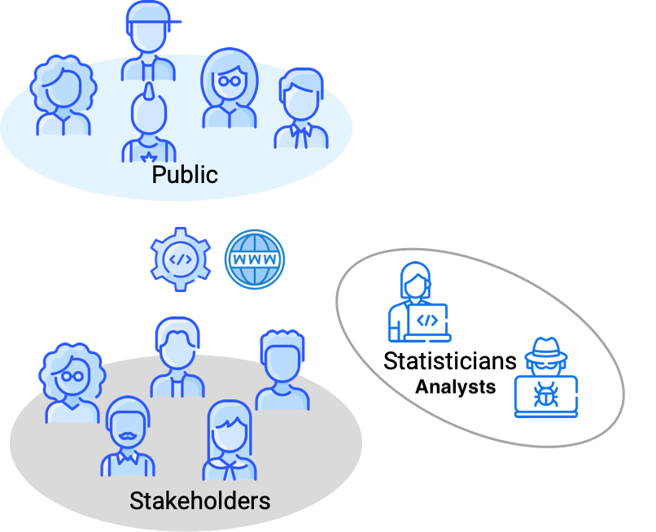
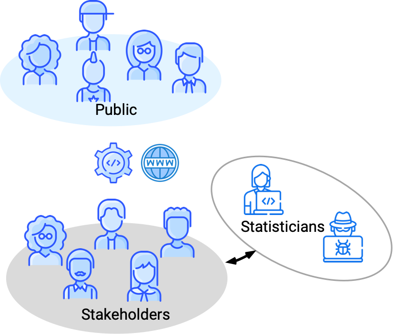
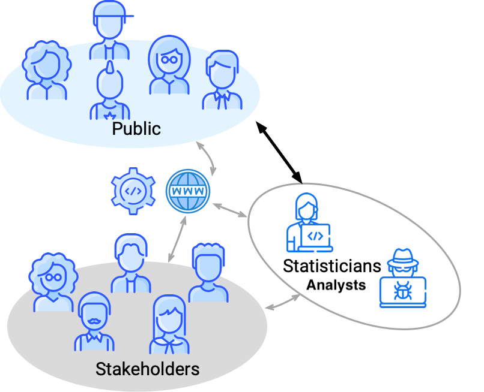
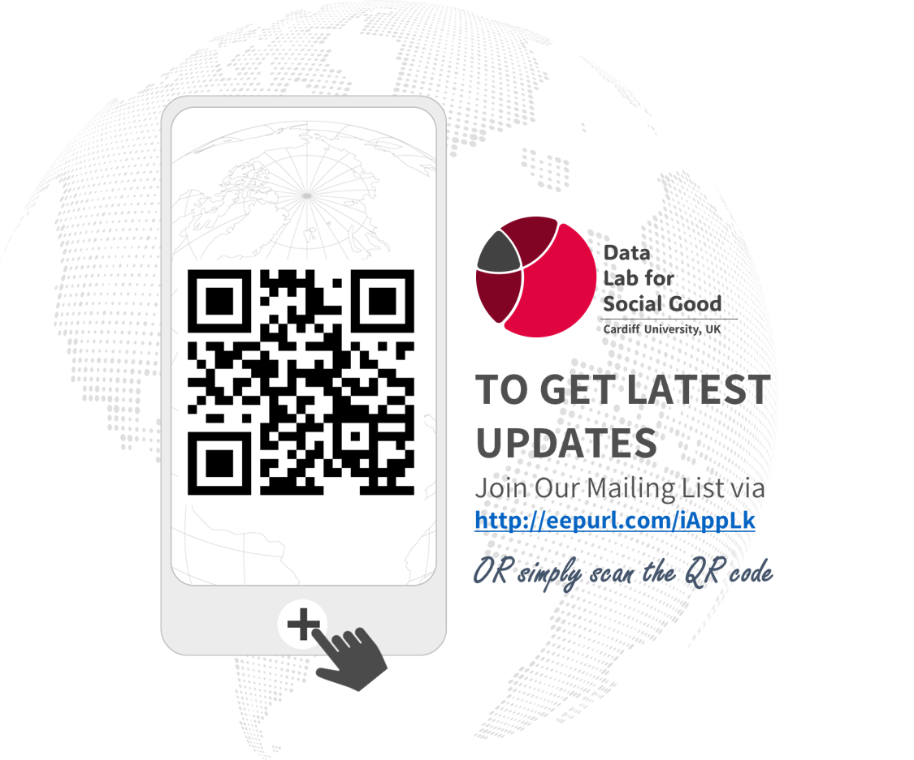

```{r}
#| label: setup
#| include: false
#| cache: false

library(tidyverse)
library(knitr)
library(kableExtra)
library(fontawesome)
library(DT)
library(gapminder)
library(ggthemes)
library(countdown)
library(here)
mockdata <- read_csv(here("data/mockdata.csv"))
```


## 

:::: columns
::: {.column width="30%"}
:::

::: {.column width="70%"}
### Learning objectives

**By the end of this session, you are able to:**

- Identify various audiences to communicate with as data analyst

- Issues in communicating analyses

- Describe Quarto and its importance in data analytics life cycle

- Create reproducible reports using Quarto 


:::
::::

{.image-left}


## Main tasks

In data analytics, we are doing three main tasks:

1. Doing the analysis (e.g. writing codes in R)
2. Producing output and looking at them
3. Taking notes, writing reports/papers


`We need to communicate our analysis and its production`

## Comminication

 *Who* do we communicate with as data analyst, data scientists or statisticians?

{fig-align="center"}

## Analysts  to Stakeholders

:::: columns
::: {.column width="50%"}
* Stakeholders can have a span from zero to proficient technical knowledge (e.g. statistics, models,etc).

* They may be 
    - technicians, 
    - domain-knowledge experts, 
    - managers, 
    - decision-makers and so on.
:::
::: {.column width="50%"}

{fig-align="center"}

:::
::::


## Analysts  to Stakeholders

:::: columns
::: {.column width="50%"}
You may not directly interact with the stakeholders but rather through a product (e.g. reports, dashboard) that you provide the stakeholders.
:::
::: {.column width="50%"}

{fig-align="center"}

:::
::::


## Analysts to General Public

:::: columns
::: {.column width="50%"}
* Reports, blogs, social media posts, tools and so on may also be consumed by the general public.

* The general public will have a variety of background.
:::
::: {.column width="50%"}

{fig-align="center"}

:::
::::

## Analysts to General Public

You may directly communicate with public as well (presentations, workshops, interviews, outreach and so on)

{fig-align="center"}

## Analysts to Analysts

You also talk to your peers (directly or indirectly)

{fig-align="center"}

## You  to Future You
Future you also needs to understand what past you did!

{fig-align="center"}


## Issues in writing reports/ publications

  - Different tasks are not connected
  
      - Using various tools/software


  - Time consuming to update reports

  - Less transparency

  - Hard to reproduce

## Reproducibility

- Can you reproduce your results tomorrow on the same computer with the same software installed?

- Can someone else on a different computer reproduce your results with the same software installed?

- Could you reproduce your results in 2 years time after some of your software environment may have changed?

- How many tools do you need to prepare your report?

- How long do you need to produce your daily/weekly/monthly/etc report?


## Wouldn't it be great if...

- You could have code, results, and text in the same document?

- Your results and plots were automatically generated from your data, so your documents were updated if your data changed?

- You spend less time on producing regular reports, instead focusing on important tasks?

- The file format of your documents was future-proof?

- The syntax for this was easy?

## Quarto

- Use one environment for:
    - analysis, 
    - modeling, 
    - visualization, 
    - communication
    
--

**Additionally:**

- Reproducible
- Transparent

## Quarto files are designed to be used in three ways:

- For [communicating to decision makers]{.remember}, who want to focus on the conclusions, not the code behind the analysis.

- For [collaborating with other data scientists/analysts]{.remember} (including future you!), who are interested in both your conclusions, and how you reached them (i.e. the code).

- As an environment in which to do data science, as a modern day lab notebook where you can [capture not only what you did, but also what you were thinking]{.remember}

## References & resources {background-image="https://images.unsplash.com/photo-1550399105-05c4a7641b02?ixlib=rb-1.2.1&ixid=MnwxMjA3fDB8MHxwaG90by1wYWdlfHx8fGVufDB8fHx8&auto=format&fit=crop&w=774&q=80" background-size="contain" background-position="right"}

<!-- ## References & resources -->

:::::: columns
:::: {.column width="60%"}
::: r-fit-text

- [Chp 28 Quarto](https://r4ds.hadley.nz/quarto.html)📖

- [Chp 29 Quarto formats](https://r4ds.hadley.nz/quarto-formats.html)📖

:::
::::

::: {.column width="40%"}
:::
::::::

# Any questions or thoughts? 💬

{fig-align="center"}
