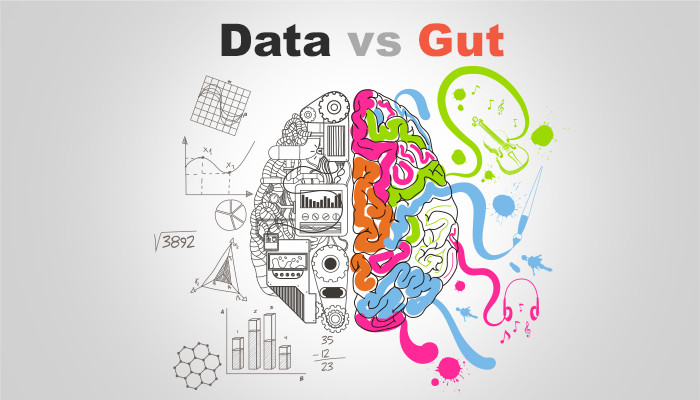
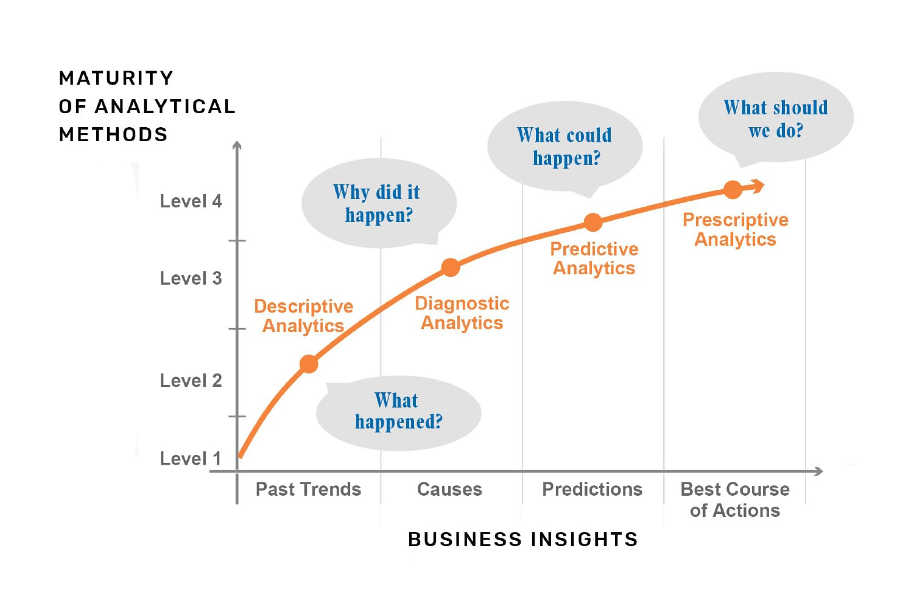
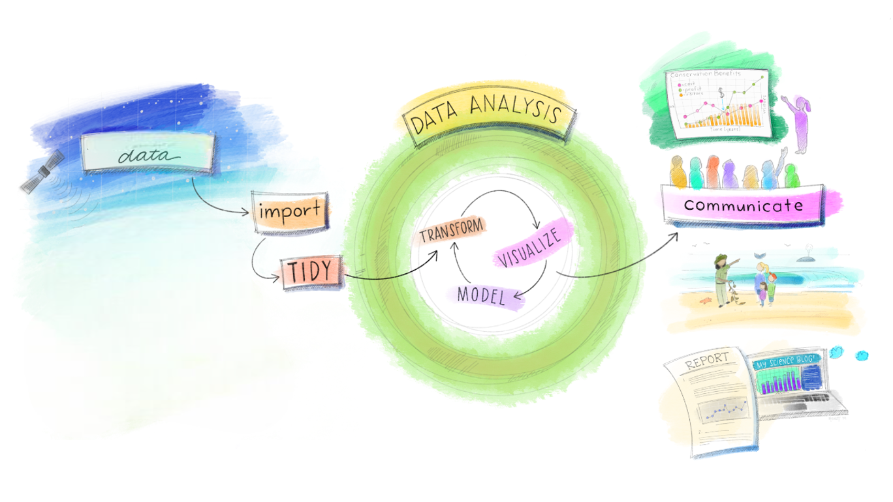
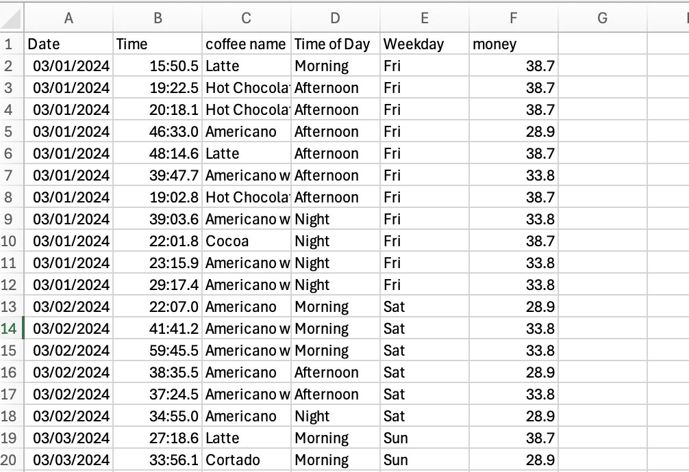

```{r setup}
#| include: false

# for color
library(paletteer)

# for plots
library(tidyverse)


gapminder <- read_csv("../../data/gapminder.csv")# Import data into R

```


## 

::::: columns
::: {.column width="30%"}
:::

::: {.column width="70%"}
### Learning objectives


- Explain what business data analytics is and why it matters  
- Identify the key skills required to become proficient in data science and analytics  
- Recognize the importance of non-technical factors in successful analytics practice  
- Learn how to import data, recognize tidy data, and understand common data structures and types

:::
:::::

{.image-left}


## 

::::: columns
::: {.column width="30%"}
:::

::: {.column width="70%"}
### Learning objectives


- [Explain what business data analytics is and why it matters]{.remember}
- Identify the key skills required to become proficient in data science and analytics  
- Recognize the importance of non-technical factors in successful analytics practice  
- Learn how to import data, recognize tidy data, and understand common data structures and types

:::
:::::

{.image-left}

# {.big}

When was the last time you used an app or service that seemed to anticipate your needs? How did it know? 💬


##  How analytics informs decisions

::: columns
::: {.column width="65%"}

1. `Uber` uses real-time data to match riders and drivers, set dynamic prices, and reduce waiting times.

2. `Amazon` analyses customer behaviour to recommend products, manage inventory, and personalize the shopping experience.

3. `Lidl` applies analytics to optimise pricing, track inventory, and decide which store formats work best in each region.

4. `Cardiff Bus` relies on passenger and route data to forecast demand, adjust schedules, and plan service improvements.

All these examples have one thing in common: They use data to make better decisions.

:::

::: {.column width="35%"}

<div style="display:flex; flex-direction:column; align-items:center; gap:0; margin:0; padding:0;">
  
  
  
  
</div>
:::
:::

## Public trasportation case

::: columns
::: {.column width="50%"}
Which questions could be answered using data analytics for the tarsportation case?


:::

::: {.column width="50%"}
{height=300px style="margin:0;padding:0;"}
{height=300px style="margin:0;padding:0;"}
:::
:::


## Why Data Matters in Modern Business?

::::: columns
::: {.incremental}
::: column

- [Data drives every decision:]{.remember}
From scheduling buses to pricing products, organizations rely on real-time data to operate efficiently and serve customers better.

- [Shift from intuition to insight :]{.remember}
Successful companies no longer rely solely on experience — they use analytics to guide evidence-based decisions.

:::

::: column

- [Data is a strategic asset :]{.remember}
Firms that harness analytics gain competitive advantage, improve performance, and innovate faster.

- [Analytics connects data to business value :]{.remember}
Turning raw numbers into actionable insights helps organizations plan, predict, and adapt in a dynamic environment.
:::
:::
:::::


## Human and Model/Data Intteligence

::::: columns
::: column

- Traditional decisions relied on intuition and experience — “we’ve always done it this way.”

- Modern organizations use data evidence to question assumptions, measure results, predict, plan, and act on uncertainty.
:::
::: column

:::

::: {.callout-warning}
Analytics [complements]{.remember}—not replaces—[human intelligence]{.remember}, providing evidence to guide better choices.
:::
:::::

## What Is Business Data Analytics?

:::{.fragment}
- Business Data Analytics (BDA) is the practice of using data, statistical analysis, and models to make better business decisions.

- It combines business understanding, and analytical methods to turns data into insights and insights into actions.

::: {.callout-important}
Analytics should creates value, otherwise what's the point!
:::
:::

## Analytical Maturity Level 

{width=70%}

## Data to Insight: The Process
### Main focus of the module



## 

::::: columns
::: {.column width="30%"}
:::

::: {.column width="70%"}
### Learning objectives


- [Explain what business data analytics is and why it matters]{.graylight}
- [Identify the key skills required to become proficient in data science and analytics]{.remember}
- Recognize the importance of non-technical factors in successful analytics practice  
- Learn how to import data, recognize tidy data, and understand common data structures and types

:::
:::::

{.image-left}

## Skills You Need
### in Data Science/Analytics

```{r}
#| label: venn-data-scientist
#| fig.width: 7.5
#| fig.height: 7.5
#| fig.align: "center"
#| out.width: "70%"

# Draw a filled ellipse
draw.ellipse <- function(center, angle, semimajor, semiminor, radius, col, ...) {
  rot   <- rbind(c(cos(angle), -sin(angle)), c(sin(angle), cos(angle)))
  shape <- rot %*% diag(c(semimajor, semiminor))
  tt    <- seq(0, 2*pi, length.out = 900)
  pts   <- matrix(center, nrow = 2, ncol = length(tt)) + shape %*% (radius * rbind(cos(tt), sin(tt)))
  polygon(pts[1,], pts[2,], col = col, border = "black", ...)
}

# Text helper
label <- function(x, y, txt, cex = 1.45, col = "black", ...) {
  text(x, y, txt, cex = cex, col = col, ...)
}

# Full-bleed plotting region with larger bounds so nothing gets cut off
opar <- par(mai = c(0,0,0,0), lwd = 2, font = 2, bg = NA, xpd = NA)
plot(c(0,120), c(0,120), type = "n", bty = "n", xaxt = "n", yaxt = "n", xlab = "", ylab = "")

# Common radius (slightly smaller to avoid clipping), and colors
R <- 18
col_stat  <- adjustcolor("#F7DC6F", alpha.f = 0.60)
col_prog  <- adjustcolor("#F1948A", alpha.f = 0.60)
col_comm  <- adjustcolor("#82E0AA", alpha.f = 0.60)
col_bus   <- adjustcolor("#85C1E9", alpha.f = 0.60)
col_orms  <- adjustcolor("#C39BD3", alpha.f = 0.60)

# Centers (spread to avoid crowding and keep all circles inside 0..120 box)
stat_center <- c(32, 56)   # Stat/Math (left)
prog_center <- c(80, 56)   # Programming (right)
comm_center <- c(45, 79)   # Communication (upper-left)
bus_center  <- c(75, 79)   # Business (upper-right)
orms_center <- c(60,88)   # OR/MS (top, vertical)

# Ellipses
draw.ellipse(stat_center, 0.05*pi, 2, 1, R, col_stat)
draw.ellipse(prog_center, -0.05*pi, 2, 1, R, col_prog)
draw.ellipse(comm_center, 0.80*pi, 2, 1, R, col_comm)
draw.ellipse(bus_center,  0.10*pi, 2, 1, R, col_bus)
draw.ellipse(orms_center, 0.5*pi, 2, 1, R, col_orms)  # vertical

# Title (kept clear of the top ellipse)


# Labels placed INSIDE colored regions with offsets to avoid overlaps
label(stat_center[1]-8, stat_center[2], "Communication",    col = "black")
label(prog_center[1]+10, prog_center[2], "Programming",  col = "black")
label(comm_center[1]-15, comm_center[2]+4, "Stat/Math",col = "black")
label(bus_center[1]+16,  bus_center[2]+5,  "Business",     col = "black")
label(orms_center[1],   orms_center[2]+15, "OR/MS",        col = "black")

# Central overlap label
label(60, 66, "Data Science", cex = 1.5, col = "orange4")

par(opar)

```


## 

::::: columns
::: {.column width="30%"}
:::

::: {.column width="70%"}
### Learning objectives


- [Explain what business data analytics is and why it matters]{.graylight}
- [Identify the key skills required to become proficient in data science and analytics]{.graylight}
- [Recognize the importance of non-technical factors in successful analytics practice]{.remember}
- Learn how to import data, recognize tidy data, and understand common data structures and types

:::
:::::

{.image-left}

##  {.big}

If we had perfect data but didn’t know what decision it was meant to support — would it still be valuable? 💬


## Business Context: Connecting Analytics to Decisions


:::{.incremental}
- [Every analytics project starts with a business question.]{.remember}
Data and tools matter only if they help solve a real decision problem.

- [Analytics supports all types of business decisions]{.remember} — operational (day-to-day), tactical (medium-term), and strategic (long-term).

- [Effective analytics aligns insights with business goals]{.remember} such as improving efficiency, reducing risk, or enhancing customer experience.

- The key is translation: [turning analytical findings into actionable recommendations]{.remember} that decision-makers can understand and trust.
:::


## The People Side of Analytics

>Analytics doesn’t make decisions — people do


::: {.callout-important}
Who do you think actually uses analytics results — the data scientist or the manager? 💬
:::

:::{.fragment}
::::: columns
::: column

- [Analytics is a team effort:]{.remember}
It requires collaboration between business experts, data professionals, and decision-makers.

- [Different roles, one goal:]{.remember}
Analysts uncover insights; managers translate them into business actions; executives decide and drive change.
:::
::: column
- [Communication and storytelling]{.remember} are as vital as technical skills.
Insights must be clear, relevant, and persuasive to non-technical audiences.

- [Building a data-driven culture]{.remember} means encouraging curiosity, trust in evidence, and shared responsibility for decisions.
:::

:::::
:::

## Ethical Considerations in Analytics

When people and data interact, we also face challenges — privacy, bias, and responsible use of analytics.

:::{.fragment}
- Data quality and `bias` can distort insights: Incomplete, inaccurate, or biased data leads to misleading conclusions.

- `Privacy` and security must be protected: Collecting and analyzing personal or sensitive data requires transparency and compliance (e.g., GDPR).

- `Ethical use of analytics matters/Potential harm`: Predictive models can influence opportunities, pricing, or hiring — fairness and accountability are essential.

- `Human judgment is still vital`: Analytics informs decisions but cannot replace ethical reasoning or contextual understanding.
:::

## 

::::: columns
::: {.column width="30%"}
:::

::: {.column width="70%"}
### Learning objectives


- [Explain what business data analytics is and why it matters]{.graylight}
- [Identify the key skills required to become proficient in data science and analytics]{.graylight}
- [Recognize the importance of non-technical factors in successful analytics practice]{.graylight}
- [Learn how to import data, recognize tidy data, and understand common data structures and types]{.remember}

:::
:::::

{.image-left}


## Types of Data Used in Analytics

::: columns
::: {.column width="50%"}
[Structured]{.remember} data: It has predefined format, such as tables, transactions, spreadsheets.

{height=300px style="margin:0;padding:0;"}

:::

::: {.column width="50%"}
[Unstructured]{.remember} data: No predefined format: , such as documents, text, images, social media, audio, video.

{height=300px style="margin:0;padding:0;"}

:::
:::


## Focus of This Module
### Rectangular Data


- [Rectangular data]{.remember} = tables (rows = observations, columns = variables).

- Common formats: .csv, .xlsx, .tsv, database tables.

- Most business datasets — transactions, surveys, sales — are rectangular.

- Foundation for visualisation, statistical and machine learning analysis.

## Tidy Data

::::: columns
::: column

>“Happy families are all alike; every unhappy family is unhappy in its own way.”
— Leo Tolstoy

{height=300px style="margin:0;padding:0;"}
:::

::: column 
::: {.fragment}
>“Tidy datasets are all alike, but every messy dataset is messy in its own way.”
— Hadley Wickham

{height=300px style="margin:0;padding:0;"}
:::
:::
:::::


## Tidy Data

::::: columns
::: column
- Each variable in a column

- Each observation in a row

- Each value in a cell
:::

::: column

Tidy data = ready for analysis.

:::
:::::


## Tidy Data {background-image="/img/lecture2/tidy-1.png" background-size="100%"}

## Untidy data

Untidy data: duplicated headers, mixed variable types, merged cells.


Untidy data = cleaning first, analysis later.


## Examples of Untidy Data {.big}

## {background-image="/img/lecture2/untidy1.png" background-size="100%"}

## {background-image="/img/lecture2/untidy2.png" background-size="100%"}

## {background-image="/img/lecture2/untidy3.png" background-size="100%"}

## {background-image="/img/lecture2/untidy4.png" background-size="100%"}

## Data Strcutures in R/Python

```{r}
#| label: data-structures
#| echo: false

gapminder
```

## Data Structures: R vs Python

::: columns
::: {.column width="50%"}
**R**

- Vector  
- List  
- Array  
- Matrix  
- Data Frame / Tibble
:::

::: {.column width="50%"}
**Python**

- List / NumPy Array  
- Dictionary  
- NumPy Array  
- NumPy Array (2D)  
- Pandas DataFrame
:::
:::


## Data Types: R vs Python

::: columns
::: {.column width="50%"}
**R**

- Numeric (dbl)  
- Numeric (int) 
- Character (chr)
- Logical  
- Factor  
- Date / datetime/ POSIXct
:::

::: {.column width="50%"}
**Python**

- Numeric (float  )
- Numeric (int)
- str  
- bool  
- category (pandas)  
- datetime / datetime64
:::
:::


## Data Quality and Reliability

Data quality affects every insight.

- Quality checks ensure data supports valid decisions.

  - Common issues: missing values, duplicates, inconsistencies, outliers.

  - Good data = accurate, complete, consistent, timely, validity.


>If data is unreliable, no amount of analytics can fix it.

#  {.large}

::: r-fit-text
[Live Demo]{.flow}
:::

## References & resources {background-image="https://images.unsplash.com/photo-1550399105-05c4a7641b02?ixlib=rb-1.2.1&ixid=MnwxMjA3fDB8MHxwaG90by1wYWdlfHx8fGVufDB8fHx8&auto=format&fit=crop&w=774&q=80" background-size="contain" background-position="right"}

<!-- ## References & resources -->

::: columns
::: {.column width="60%"}

::: r-fit-text


- R for Data Science [Import Data](https://r4ds.hadley.nz/data-import.html)

- R for Data Science [Tudying Data](https://r4ds.hadley.nz/data-tidy.html)

- Python for Data Science [Import Data](https://aeturrell.github.io/python4DS/data-import.html)

- Python for Data Science [Tudying Data](https://aeturrell.github.io/python4DS/data-tidy.html)


- [Moneyball](https://uwex.wisconsin.edu/stories-news/moneyball-proves-importance-big-data-big-ideas/)

- [Interactive tutorials in R](https://tutorials.shinyapps.io/04-Programming-Basics/)

- Chapter 1, Introduction to Business Analytics, Koole, G. (2019). 

:::

:::

::: {.column width="40%"}
:::
:::


# Any questions or thoughts? 💬

{fig-align="center"}