```{r}
#| label: setup
#| include: false

library(tidyverse)
library(kableExtra)
library(DT)
library(gapminder)
library(ggthemes)
library(cowplot)
library(patchwork)
library(fpp3)
library(fontawesome)
library(countrycode)
library(gganimate)
library(here)
getwd()
# Add a continent column based on country names
gapminder_extended <- read_csv(here("data/gapminder_all.csv")) |> 
  mutate(continent = countrycode(country, origin = "country.name", destination = "continent"))
gapminder <- gapminder_extended |> filter(year <= 2024) |> drop_na()

arrival_hourly <- read_csv(here("data/ED_hourly_arrival.csv"))


```


## 

::::: columns
::: {.column width="30%"}
:::

::: {.column width="70%"}
### Learning objectives

- Explain why data visualisation is important

- Identify the components of an effective data visualisation

- Select appropriate plot types for different kinds of data and questions

- Create and customise plots using ggplot2

:::
:::::

{.image-left}

## 

::::: columns
::: {.column width="30%"}
:::

::: {.column width="70%"}
### Learning objectives

- [Explain why data visualisation is important]{.remember}

- Identify the components of an effective data visualisation

- Select appropriate plot types for different kinds of data and questions

- Create and customise plots using ggplot2

:::
:::::

{.image-left}


## Two engines to understand data

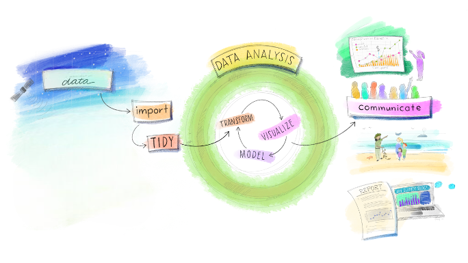

## {.big .center .middle}

Why Do We Need Data Visualisation?

How Can Data Visualisation Help?

## What is data visualisation?

>**A visualisation** is any kind of visual representation of information designed to enable communication, anaysis, discovery, and exploration.

>**A data visualisation or data plot ** is a display of data designed to enable communication, anaysis, discovery and exploration.


Whenever we visualize data, we take data values and convert them in a systematic and logical way into the visual elements that make up the final graphic.

We may use different terminology, i.e. [data visualisation, data plot, chart, graph, plot]{.remember}, etc! These are the same.

## Anscombe's quartet

```{r}
#| echo: false
# Load the built-in Anscombe dataset
data(anscombe)

# Display the first few rows
head(anscombe)

```

:::{.fragment}
```{r}
#| echo: false
# Compute summary statistics for each pair (x1,y1), (x2,y2), (x3,y3), (x4,y4)
summary_stats <- data.frame(
  set = paste0("Set", 1:4),
  mean_x = sapply(1:4, function(i) mean(anscombe[[paste0("x", i)]])),
  mean_y = sapply(1:4, function(i) mean(anscombe[[paste0("y", i)]])),
  sd_x   = sapply(1:4, function(i) sd(anscombe[[paste0("x", i)]])),
  sd_y   = sapply(1:4, function(i) sd(anscombe[[paste0("y", i)]])),
  cor_xy = sapply(1:4, function(i) cor(anscombe[[paste0("x", i)]], anscombe[[paste0("y", i)]]))
)
summary_stats
```
:::

## Anscombe's quartet

```{r}
#| echo: false
par(mfrow = c(2, 2))  # Arrange plots in a 2x2 grid
for (i in 1:4) {
  x <- anscombe[[paste0("x", i)]]
  y <- anscombe[[paste0("y", i)]]
  plot(x, y,
       main = paste("Anscombe Set", i),
       xlim = c(4, 20), ylim = c(3, 13),
       pch = 19, col = "blue")
  abline(lm(y ~ x), col = "red", lwd = 2)
}
par(mfrow = c(1, 1))
```


## The Datasaurus Dozen

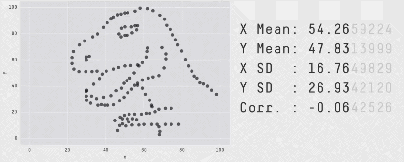

## The Datasaurus Dozen

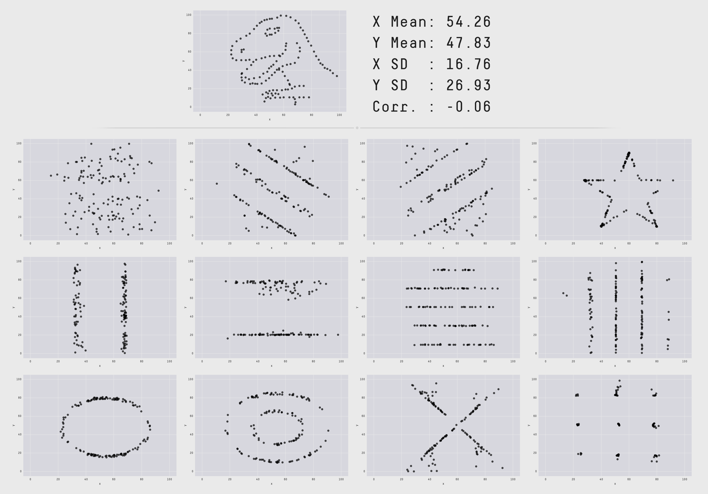


[Same Stats, Different Graphs](https://www.autodesk.com/research/publications/same-stats-different-graphs){.footnote}


## Why make data plots?

>A picture is worth a thousand words. -Henrik Ibsen 


- Our brains think visually- [Cognitive limitations]{.remember}

- Summary statistics hide information- [Information loss]{.remember}

- Models can miss important features- [Model limitations]{.remember}

- Data are complex.

- Variation matters.

- Insights must be communicated.

## How Can Data Visualisation Help?

- [Explore]{.remember}: Discover patterns, trends, relationships and outliers.

- [Diagnose]{.remember}: Check data quality, model assumptions and model performance.

- [Explain]{.remember}: Communicate findings, variation and uncertainty.

- [Compare]{.remember}: Evaluate alternatives, groups, scenarios and outcomes.

- [Monitor]{.remember}: Track performance and detect emerging changes.

- [Decide]{.remember}: Support evidence-based decisions and actions.


## 
::::: columns
::: {.column width="30%"}
:::

::: {.column width="70%"}
### Learning objectives

- [Explain why data visualisation is important]{.graylight}

- [Identify the components of an effective data visualisation]{.remember}

- Select appropriate plot types for different kinds of data and questions

- Create and customise plots using ggplot2

:::
:::::

{.image-left}


## Are these good data visualisations?

::::: columns

::: {.column width="50%"}

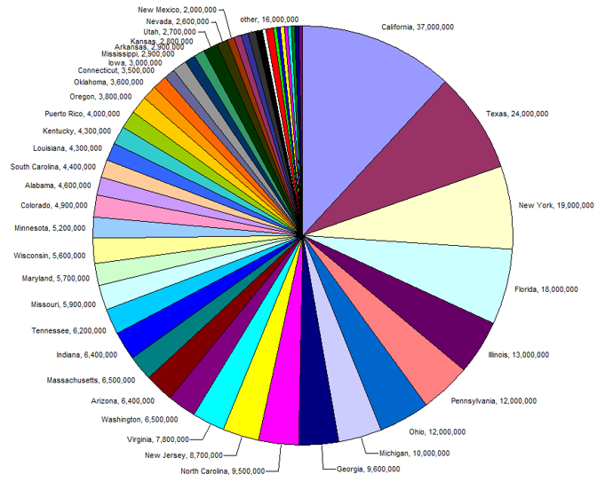
:::

::: {.column width="50%"}
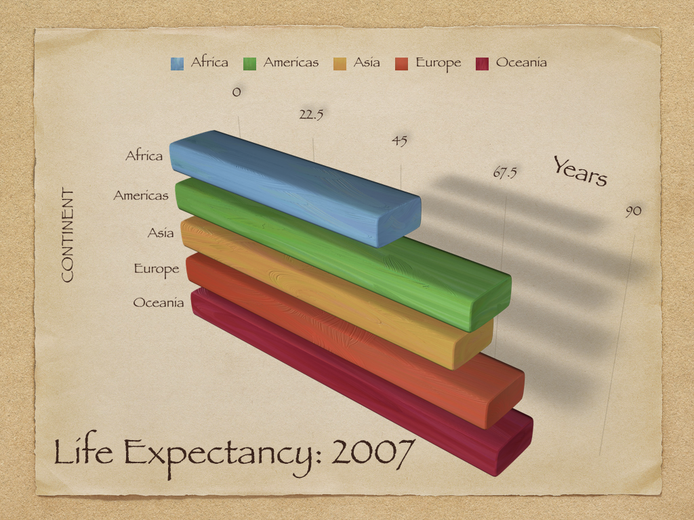

:::
:::::

## Three Fundamental Problems in Bad Plots {.smaller}

| Category | What Does It Mean? | What Can Go Wrong? | Examples |
|:---|:---|:---|:---|
| **Aesthetic** | How the chart looks and is designed | Poor design makes the chart difficult or unpleasant to read | Too many colours, inappropriate fonts, cluttered layout, unnecessary decorations, unclear labels, 3D effects |
| **Substantive** | What data are presented and whether they tell an accurate and meaningful story | Incomplete, selective or inappropriate data can lead to misleading conclusions | Cherry-picked data, missing observations, inappropriate comparisons, missing context, biased samples |
| **Perceptual** | How our eyes and brain interpret the visual information | The way data are displayed makes differences, patterns or relationships difficult to judge or misleading | Distorted axes, misleading scales, inappropriate chart types, confusing colour gradients, comparing circle areas instead of lengths |

[https://socviz.co/01-look-at-data.html](https://socviz.co/01-look-at-data.html){.footnote}

## What makes bad figures bad?
### Bad taste

::::: columns

::: {.column width="50%"}

:::

::: {.column width="50%" .fragment}
- **Problem**: Unnecessary decoration and poor visual design.
- **Examples**: Excessive colours, 3D effects, shadows, inappropriate fonts and clutter.
- **Consequence**: Important information becomes harder to find and compare.
:::
::::


## What makes bad figures bad?
### Bad data

:::: columns

::: {.column width="50%"}
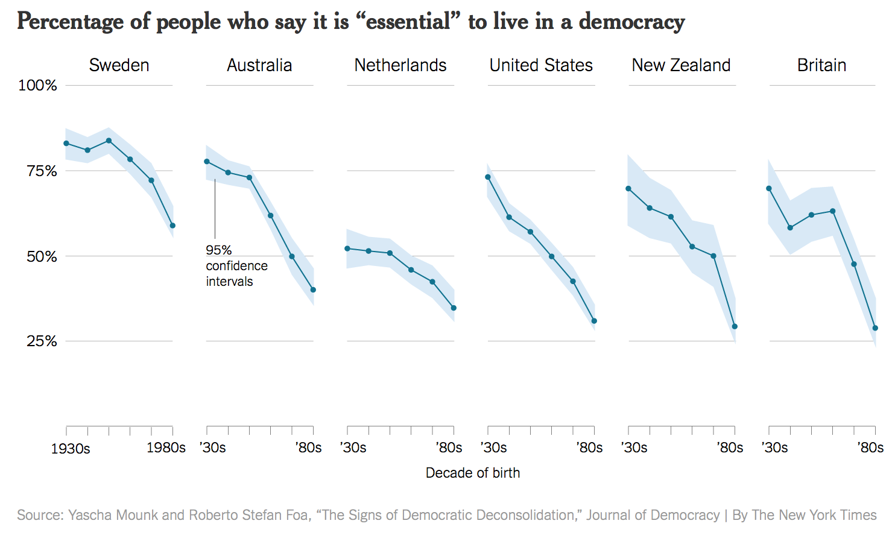
:::

::: {.column width="50%" .fragment}
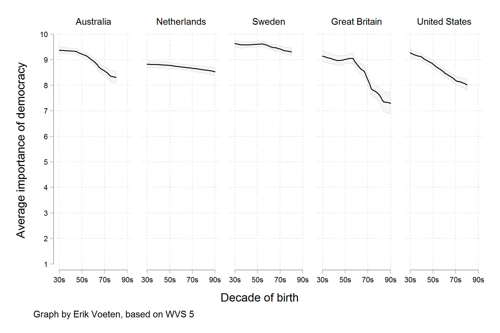
:::
::::

## What makes bad figures bad? 
### Bad perception

::::: columns

::: {.column width="50%"}

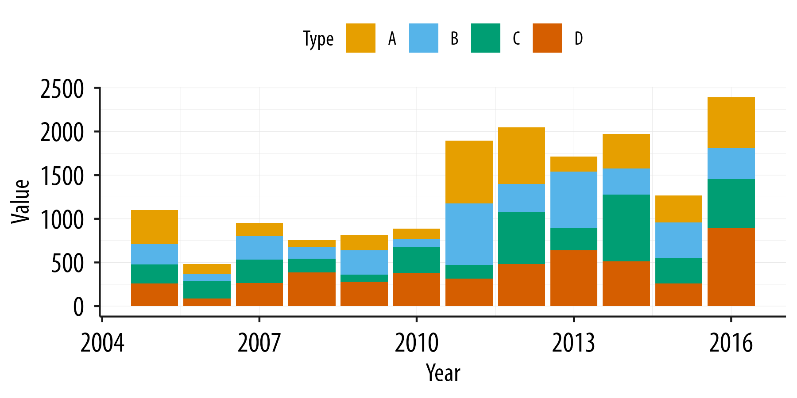
:::

::: {.column width="50%"}
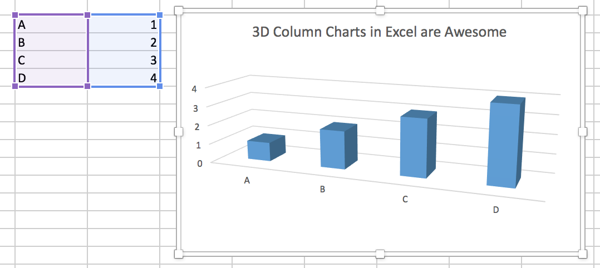
:::
::::

## Hierarchy of visual encodings

::::: columns

::: {.column width="50%"}

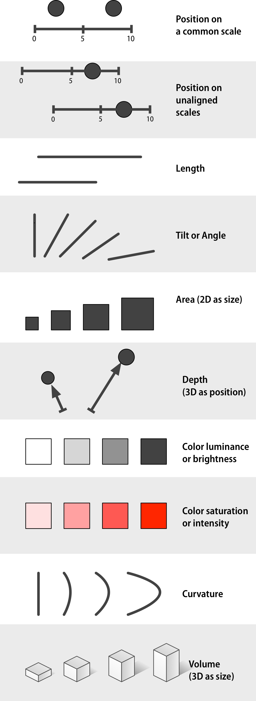{width="40%"}
:::

::: {.column width="50%"}
How effectively humans perceive and compare quantities depending on how those quantities are visually represented.

The key idea is that some encodings make comparisons much easier, while others make them error-prone.

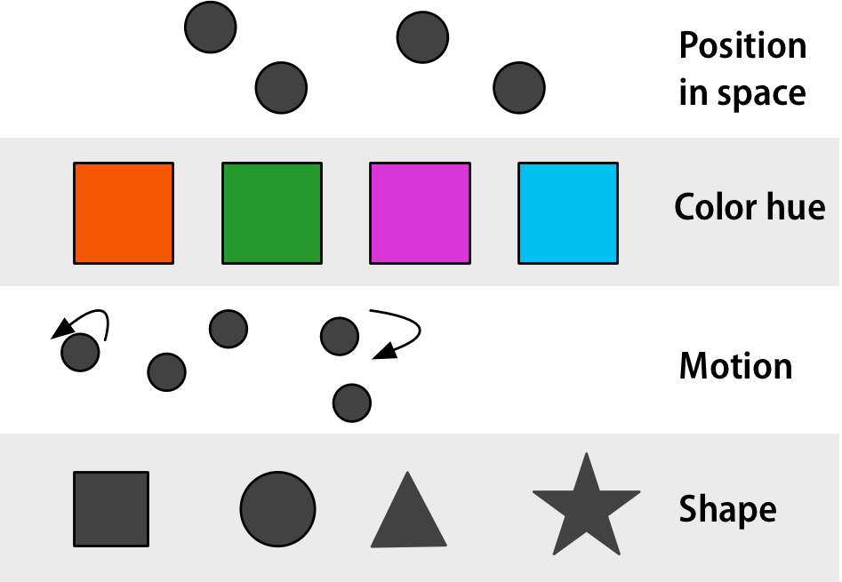{width="60%"}

[Munzer, T. (2014)](https://www.taylorfrancis.com/books/mono/10.1201/b17511/visualization-analysis-design-tamara-munzner){.footnote}

:::
::::


## Five Qualities of Great Data Visualisations {.smaller}

| Quality | What Does It Mean? | Questions to Ask When Evaluating a Plot |
|:---|:---|:---|
| **[Truthful]{.remember}** | Represents data honestly, without distortion or misleading conclusions. | Are the data, scales and comparisons accurate? Is important context missing? |
| **[Functional]{.remember}** | Does the chart do its job? Makes the information easy to read, interpret and compare. | What do I want people to understand? Can I quickly identify the main message? Are the chart type, axes, labels and legend appropriate? |
| **[Beautiful]{.remember}** | Uses visual design to support understanding and engagement. | Is the chart visually appealing? Are the colours, fonts and layout clear and consistent? Is there unnecessary clutter or decoration? |
| **[Insightful]{.remember}** | I discovered something I didn't know before. Reveals meaningful patterns, relationships or unexpected findings. | Does the chart help us discover something? What patterns, trends, differences or unusual observations can I discover from this plot? |
| **[Enlightening]{.remember}** | What I discovered has changed how I understand the problem. Helps us understand an issue more deeply and appreciate its significance. | What have I learned about the underlying issue? Why does it matter, and what new questions does it raise? |

[Reference:[Chp. 2, the truthful art](https://www.amazon.co.uk/Truthful-Art-Data-Charts-Communication/dp/0321934075/)]{.footnote}


## Principles of effective data visualization

- Always consider your audience first
- Be specific on a question that should be answered or the message that should be conveyed by the visualization
- *Diagram/sketch on a paper first! focus on the data, message and audience first, before you engage with software*
- Use the right software
- Choose the correct plot and right geometry
- Colors always mean something, use them for a good reason
- Include uncertainty when relevant
- Emphasize/highlight the most important message to convey & tell the story
- Choose the most appropriate titles/headings/subtitle & labels
-  Get people's feedback to improve the data visualisation

[Principles of Effective Data Visualization](https://www.sciencedirect.com/science/article/pii/S2666389920301896#sec2){.footnote}

## 
::::: columns
::: {.column width="30%"}
:::

::: {.column width="70%"}
### Learning objectives

- [Explain why data visualisation is important]{.graylight}

- [Identify the components of an effective data visualisation]{.graylight}

- [Select appropriate plot types for different kinds of data and questions]{.remember}

- Create and customise plots using ggplot2

:::
:::::

{.image-left}

## [Data visualisation catalogue](https://datavizproject.com/)

```{r}
#| echo: false
knitr::include_url("https://datavizproject.com/", height = "500px")
```


## [Data to Visualisation](https://www.data-to-viz.com/)

```{r}
#| echo: false
knitr::include_url("https://www.data-to-viz.com/", height = "500px")
```


## [R Gallery](https://www.r-graph-gallery.com/)

```{r}
#| echo: false
knitr::include_url("https://www.r-graph-gallery.com/", height = "500px")
```

## Directory of visualisations
```{r}
#| echo: false
knitr::include_url("https://clauswilke.com/dataviz/directory-of-visualizations.html")
```

## 
::::: columns
::: {.column width="30%"}
:::

::: {.column width="70%"}
### Learning objectives

- [Explain why data visualisation is important]{.graylight}

- [Identify the components of an effective data visualisation]{.graylight}

- [Select appropriate plot types for different kinds of data and questions]{.graylight}

- [Create and customise plots using ggplot2]{.remember}

:::
:::::

{.image-left}


## How to make the data plots?
:::{.fragment}

- There are many systems for making plots in R.

- One of the most popular, elegant and versatile R-package is **`ggplot2`** ! It is part of tidyverse package.

- Why is it so popular?
:::


## Why ggplot2

- Extremely powerful and easy to make good-looking plots
- Consistent (grammar of graphics), it is aligned well with other principles we will be learning
- It uses a coherent system for describing and building many kinds of plots
- It is highly customisable
- It can be extended to make specialised plots or add more features
- Excellent documentation and free resources
- Most importantly, your graphical output is easily `reproducible`!


## Excellent documentation and free resources

- [Official ggplot2 documentation](https://ggplot2.tidyverse.org/reference/) 🌐
- [Extension packages for ggplot2!](https://exts.ggplot2.tidyverse.org/) 🌐
- [ggplot2: Elegant Graphics for Data Analysis](https://ggplot2-book.org/index.html) 📖
- [R graphics cookbook](https://r-graphics.org/) 📖
-  [Beautiful plotting in R: A ggplot2 cheatsheet](http://zevross.com/blog/2014/08/04/beautiful-plotting-in-r-a-ggplot2-cheatsheet-3/)  📖
- [Data visualisation chapter in R for Data Science](https://r4ds.hadley.nz/data-visualize.html) 📖
- [Data visualization: a practical introduction (K. Healy)](http://socviz.co/) 📖
- [Fundamentals of data visualization (C. Wilke)](http://serialmentor.com/dataviz/) 📖


## [Made with ggplot2](https://bbc.github.io/rcookbook/)

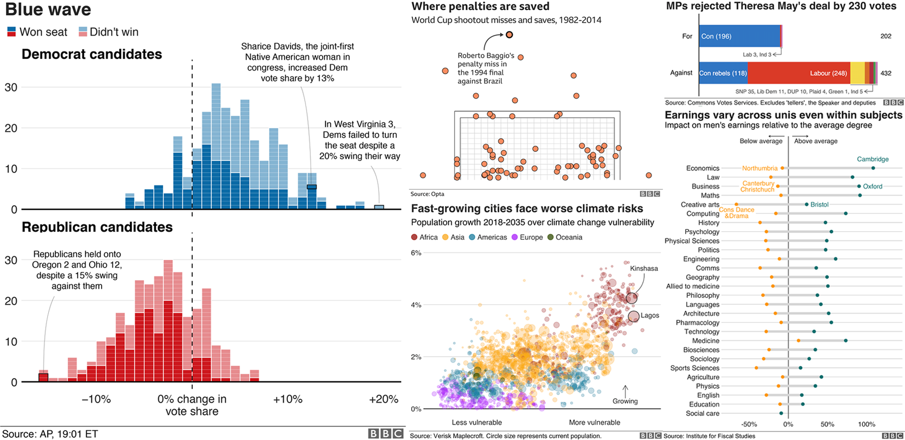

## Made with ggplot2

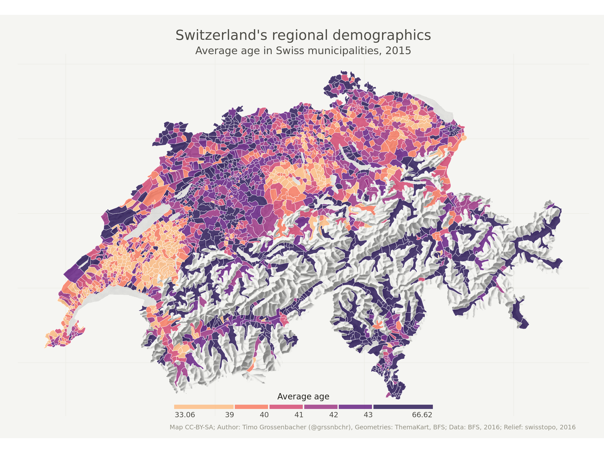{width="85%" height="85%"}


[[Source](https://timogrossenbacher.ch/2016/12/beautiful-thematic-maps-with-ggplot2-only/)]{.footnote}


## Made with ggplot2

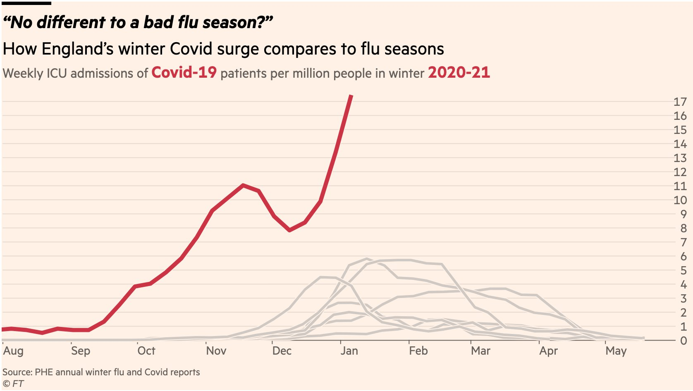

[[FT Data](https://twitter.com/ftdata)]{.footnote}


## From data to visualisation

All data visualizations [map data values]{.remember} into [quantifiable features of the resulting graphic]{.remember}. 

We refer to these features as [aesthetics]{.remember}.

## {.big} 

:::{.callout-note}
Lets' demonstrate this by using **gapmider** data
:::


## [gapminder.org](https://www.gapminder.org/tools/#$chart-type=bubbles)


<iframe src="https://player.vimeo.com/video/113449763?color=ffce08&title=0&byline=0&portrait=0" width="100%" height="100%" frameborder="0" allow="autoplay; fullscreen; picture-in-picture" allowfullscreen></iframe>

## Gapmider data

```{r}
#| echo: true
#| code-fold: true
gapminder
```


## gapminder_ 2024 data

```{r}
#| echo: true
#| code-fold: true
gapminder_2024 <- gapminder |> filter(year == "2024") |> select(-year)
gapminder_2024
```

## type `ggplot()`
```{r}
#| echo: true
#| code-fold: true
ggplot()
```

## Add data

```{r}
#| echo: true
#| code-fold: true
ggplot(data = gapminder_2024)
```

## Add aesthetics


```{r}
#| echo: true
#| code-fold: true
ggplot(data = gapminder_2024,
       mapping = aes(x = gdp_pcap, y = lex))
```

## Add geometry

```{r}
#| echo: true
#| code-fold: true
ggplot(data = gapminder_2024,
       mapping = aes(x = gdp_pcap, y = lex)) +
  geom_point()
```

## Add more aesthetics

```{r}
#| echo: true
#| code-fold: true

ggplot(data = gapminder_2024,
       mapping = aes(x = gdp_pcap, y = lex,
                     color = continent,
                     size = pop)) +
  geom_point()

```

## ggplot() template {.bigger}


ggplot(data = [DATA]{.blue}, mapping = aes([AESTHETIC MAPPINGS]{.yellow}) + <br>
  GEOM_FUNCTION()

:::{.fragment}
ggplot(data = [gapminder_2024]{.blue}, mapping = aes(x = [gdp_pcap]{.yellow}, y = [lex]{.yellow}, color = [continent]{.yellow}, size = [pop]{.yellow})) + <br>
  geom_point()
:::

## Mapping data to aesthetics

::: columns
::: column

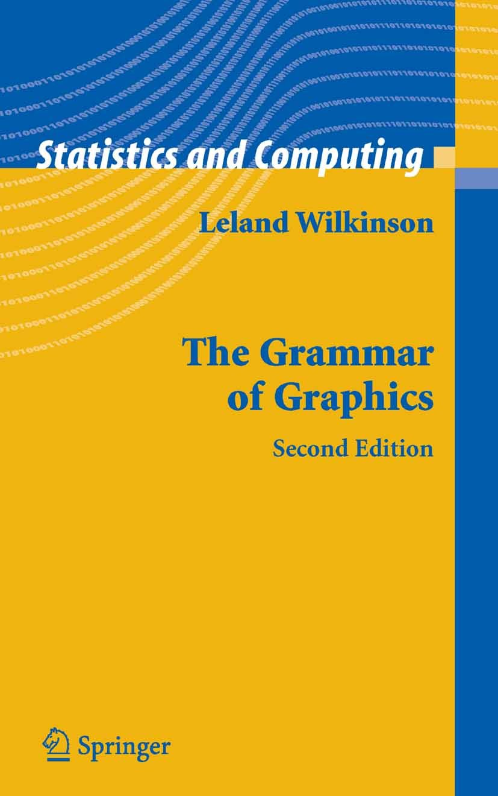{width=55%}

:::

::: column
[**Data:**]{.blue} A column in a dataset

[**Aesthetic:**]{.yellow} Visual property of a plot, e.g. position (x, y), color, size, shape, alpha.
:::
:::


## Mapping data to aesthetics
### Gapminder data

<br>

<table>
  <tr>
    <th class="cell-left">Data</th>
    <th class="cell-left">Aesthetic</th>
    <th class="cell-left">Graphic/Geometry</th>
  </tr>
    <td class="cell-left"> GDP/capita </td>
    <td class="cell-left">x</td>
    <td class="cell-left">point</td>
    </tr>
    <tr>
    <td class="cell-left">Life expectancy&emsp;</td>
    <td class="cell-left">y</td>
    <td class="cell-left">point</td>
    </tr>
    <tr>
    <td class="cell-left">Continent</td>
    <td class="cell-left">color</td>
    <td class="cell-left">point</td>
    </tr>
    <tr>
    <td class="cell-left">Population</td>
    <td class="cell-left">size</td>
    <td class="cell-left">point</td>
    </tr>
</table>

## Mapping data to aesthetics in ggplot2

<br>
<table>
  <tr>
    <th class="cell-left">gapminder_2024</th>
    <th class="cell-left"><code class="remark-inline-code">aes()</code></th>
    <th class="cell-left"><code class="remark-inline-code">geom</code></th>
  </tr>
  <tr>
    <td class="cell-left"> GDP/capita</td>
    <td class="cell-left"><code class="remark-inline-code">x</code></td>
    <td class="cell-left"><code class="remark-inline-code">geom_point()</code></td>
  </tr>
  <tr>
    <td class="cell-left"> Life expectancy&emsp;</td>
    <td class="cell-left"><code class="remark-inline-code">y</code></td>
    <td class="cell-left"><code class="remark-inline-code">geom_point()</code></td>
  </tr>
  <tr>
    <td class="cell-left">Continent</td>
    <td class="cell-left"><code class="remark-inline-code">color</code></td>
    <td class="cell-left"><code class="remark-inline-code">geom_point()</code></td>
  </tr>
  <tr>
    <td class="cell-left">Population</td>
    <td class="cell-left"><code class="remark-inline-code">size</code>&emsp;</td>
    <td class="cell-left"><code class="remark-inline-code">geom_point()</code></td>
  </tr>
</table>

## Grammar components as layers {layout-ncol=2}

::: column
So far we know about data, aesthetics, and geometries.

Think of these components as **layers**.

Add layers to foundational [ggplot()]{.remember} with `+`.
:::

::: column
{width=90%}
:::


[Drawing Anything with ggplot2" workshop](https://github.com/thomasp85/ggplot2_workshop){.footnote}

## Possible aesthetics

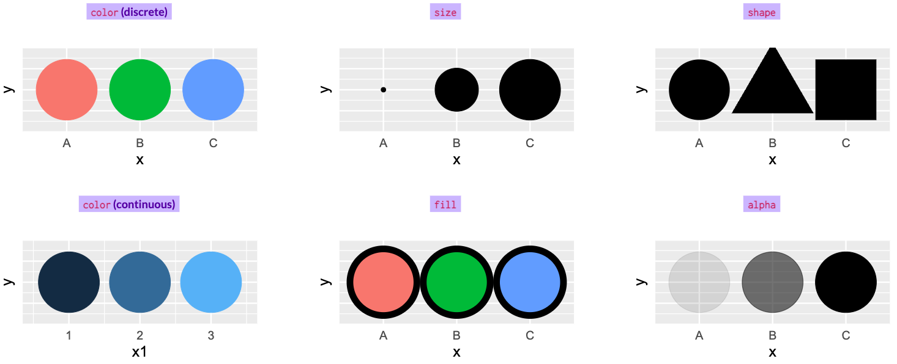{width=90%}


## Possible geoms

<table>
  <tr>
    <th class="cell-left"></th>
    <th class="cell-left">Example geom</th>
    <th class="cell-left">What it makes</th>
  </tr>
  <tr>
    <td class="cell-left"></td>
    <td class="cell-left"><code class="remark-inline-code">geom_col()</code></td>
    <td class="cell-left">Bar charts</td>
  </tr>
  <tr>
    <td class="cell-left"></td>
    <td class="cell-left"><code class="remark-inline-code">geom_text()</code></td>
    <td class="cell-left">Text</td>
  </tr>
  <tr>
    <td class="cell-left"></td>
    <td class="cell-left"><code class="remark-inline-code">geom_point()</code></td>
    <td class="cell-left">Points</td>
  </tr>
  <tr>
    <td class="cell-left"></td>
    <td class="cell-left"><code class="remark-inline-code">geom_boxplot()</code>&emsp;</td>
    <td class="cell-left">Boxplots</td>
  </tr>
  <tr>
    <td class="cell-left"></td>
    <td class="cell-left"><code class="remark-inline-code">geom_sf()</code></td>
    <td class="cell-left">Maps</td>
  </tr>
    <tr>
    <td class="cell-left">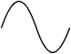</td>
    <td class="cell-left"><code class="remark-inline-code">geom_line()</code></td>
    <td class="cell-left">Lines</td>
  </tr>
</table>


## [Possible geoms](https://www.r-graph-gallery.com/)


There are many possible geoms, See [the **ggplot2** documentation](https://ggplot2.tidyverse.org/reference/index.html#section-layer-geoms) for<br>complete examples of all the different geom layers

```{r}
#| echo: false
knitr::include_url("https://ggplot2.tidyverse.org/reference/index.html", height = "500px")
```


## Additional layers {layout-ncol=2}

::: column
There are many other grammatical layers we can use to describe graphs!  

We sequentially add layers onto the foundational `ggplot()` plot to create complex figures.
:::

::: column
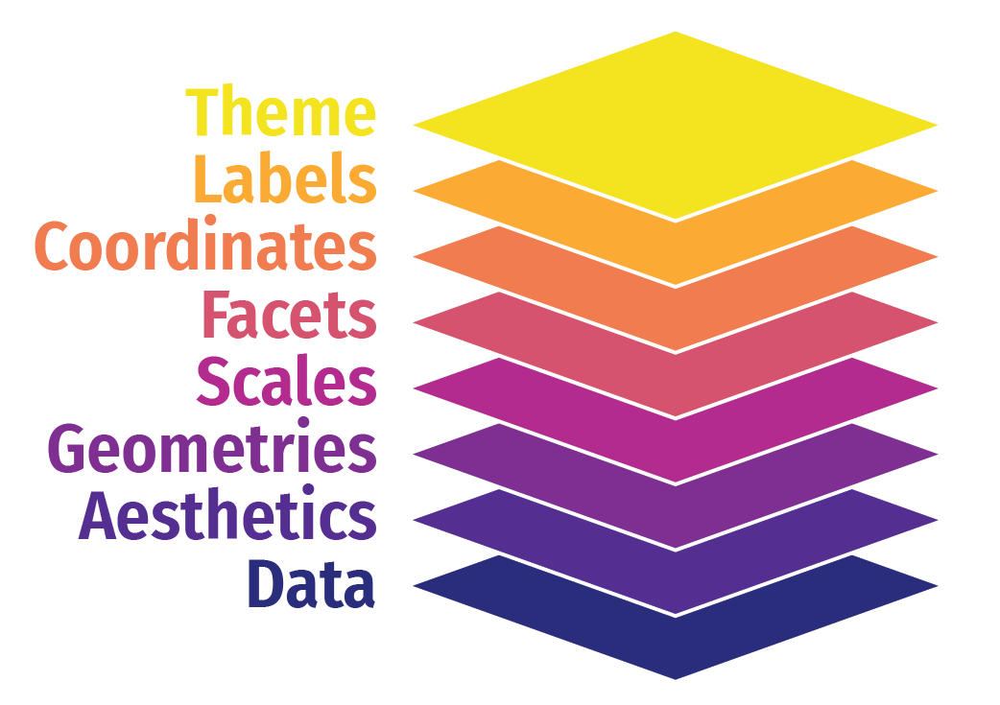{width=90%}
:::

## Scales

Scales change the properties of the variable mapping

<table>
  <tr>
    <th class="cell-left">Example layer</th>
    <th class="cell-left">What it does</th>
  </tr>
  <tr>
    <td class="cell-left"><code class="remark-inline-code">scale_x_continuous()</code></td>
    <td class="cell-left">Make the x-axis continuous</td>
  </tr>
  <tr>
    <td class="cell-left"><code class="remark-inline-code">scale_x_continuous(breaks = 1:5)</code></td>
    <td class="cell-left">Manually specify axis ticks</td>
  </tr>
  <tr>
    <td class="cell-left"><code class="remark-inline-code">scale_x_log10()</code></td>
    <td class="cell-left">Log the x-axis</td>
  </tr>
  <tr>
    <td class="cell-left"><code class="remark-inline-code">scale_color_colorblind()</code></td>
    <td class="cell-left">Use a color blind pallet</td>
  </tr>
  <tr>
    <td class="cell-left"><code class="remark-inline-code">scale_y_reverse()</code></td>
    <td class="cell-left">Reverse the y axis values</td>
  </tr>
</table>

## Scales 

**`scale_x_log10()`**

```{r}
#| echo: true
#| code-fold: true
ggplot(gapminder_2024, aes(x = gdp_pcap, 
y = lex, color = continent, size = pop)) +
  geom_point() +
  scale_x_log10()
```


## Scales 

**`scale_color_colorblind()`**

```{r}
#| echo: true
#| code-fold: true
ggplot(gapminder_2024, aes(x = gdp_pcap, 
y = lex, color = continent, size = pop)) +
  geom_point() +
  scale_x_log10() +
  scale_color_colorblind()
```


## Facets

Facets show subplots for different subsets of data

<table>
  <tr>
    <th class="cell-left">Example layer</th>
    <th class="cell-left">What it does</th>
  </tr>
  <tr>
    <td class="cell-left"><code class="remark-inline-code">facet_wrap(vars(continent))</code></td>
    <td class="cell-left">Plot for each continent</td>
  </tr>
  <tr>
    <td class="cell-left"><code class="remark-inline-code">facet_wrap(vars(continent, year))</code></td>
    <td class="cell-left">Plot for each continent/year</td>
  </tr>
  <tr>
    <td class="cell-left"><code class="remark-inline-code">facet_wrap(..., ncol = 1)</code></td>
    <td class="cell-left">Put all facets in one column</td>
  </tr>
  <tr>
    <td class="cell-left"><code class="remark-inline-code">facet_wrap(..., nrow = 1)</code></td>
    <td class="cell-left">Put all facets in one row</td>
  </tr>
</table>

## Facets 

### `facet_wrap(vars(continent))`

```{r}
#| echo: true
#| code-fold: true
ggplot(data = gapminder_2024, 
aes(x = gdp_pcap, y = lex, 
color = continent, size = pop)) +
  geom_point() +
  scale_x_log10() +
  scale_color_colorblind() +
  facet_wrap(vars(continent))
```


## Facets

### `facet_wrap(vars(continent, year))`

```{r}
#| echo: true
#| code-fold: true
ggplot(filter(gapminder, year %in% c(2002, 2007)), 
       aes(x = gdp_pcap, y = lex, 
       color = continent, size = pop)) +
  geom_point() +
  scale_x_log10() +
  scale_color_colorblind() +
  facet_wrap(vars(continent, year))
```


# Labels

Add labels to the plot with a single `labs()` layer

<table>
  <tr>
    <th class="cell-left">Example layer</th>
    <th class="cell-left">What it does</th>
  </tr>
  <tr>
    <td class="cell-left"><code class="remark-inline-code">labs(title = "Neat title")</code></td>
    <td class="cell-left">Title</td>
  </tr>
  <tr>
    <td class="cell-left"><code class="remark-inline-code">labs(caption = "Something")</code></td>
    <td class="cell-left">Caption</td>
  </tr>
  <tr>
    <td class="cell-left"><code class="remark-inline-code">labs(y = "Something")</code></td>
    <td class="cell-left">y-axis</td>
  </tr>
  <tr>
    <td class="cell-left"><code class="remark-inline-code">labs(size = "Population")</code></td>
    <td class="cell-left">Title of size legend</td>
  </tr>
</table>


## Labels

::::: columns

::: {.column width="50%"}

```{r}
#| echo: true
#| eval: false

#| code-fold: true
ggplot(gapminder_2024, 
       aes(x = gdp_pcap, y = lex, 
           color = continent, size = pop)) +
  geom_point() +
  scale_x_log10() +
  labs(title = "Health and wealth grow together",
       subtitle = "Data from 2007",
       x = "Wealth (GDP per capita)",
       y = "Health (life expectancy)",
       color = "Continent",
       size = "Population",
       caption = "Source: The Gapminder Project")
```

:::

::: {.column width="50%"}
```{r}
#| echo: false
#| #| eval: true
ggplot(gapminder_2024, 
       aes(x = gdp_pcap, y = lex, 
           color = continent, size = pop)) +
  geom_point() +
  scale_x_log10() +
  labs(title = "Health and wealth grow together",
       subtitle = "Data from 2007",
       x = "Wealth (GDP per capita)",
       y = "Health (life expectancy)",
       color = "Continent",
       size = "Population",
       caption = "Source: The Gapminder Project")
```
:::
::::

## Theme

Change the appearance of anything in the plot

>There are many built-in themes

<table>
  <tr>
    <th class="cell-left">Example layer</th>
    <th class="cell-left">What it does</th>
  </tr>
  <tr>
    <td class="cell-left"><code class="remark-inline-code">theme_grey()</code></td>
    <td class="cell-left">Default grey background</td>
  </tr>
  <tr>
    <td class="cell-left"><code class="remark-inline-code">theme_bw()</code></td>
    <td class="cell-left">Black and white</td>
  </tr>
  <tr>
    <td class="cell-left"><code class="remark-inline-code">theme_dark()</code></td>
    <td class="cell-left">Dark</td>
  </tr>
  <tr>
    <td class="cell-left"><code class="remark-inline-code">theme_minimal()</code></td>
    <td class="cell-left">Minimal</td>
  </tr>
</table>


## Theme

::::: columns
::: {.column width="50%"}

`theme_dark()`

```{r}
ggplot(gapminder_2024, aes(x = gdp_pcap, y = lex, color = continent, size = pop)) +
  geom_point() +
  scale_x_log10() +
  theme_dark()
```

:::

::: {.column width="50%"}

`theme_minimal()`

```{r}
ggplot(gapminder_2024, aes(x = gdp_pcap, y = lex, color = continent, size = pop)) +
  geom_point() +
  scale_x_log10() + 
  theme_minimal()
```


:::
:::::

## Theme

[Install **ggthemes** package](https://yutannihilation.github.io/allYourFigureAreBelongToUs/ggthemes/) to access many themes

```{r}
#| echo: false
knitr::include_url("https://yutannihilation.github.io/allYourFigureAreBelongToUs/ggthemes/", height = "500px")
```

## So many possibilities!


## Putting it all together {.big}

We can build a plot sequentially to see how each grammatical layer changes the appearance


## Start with data and aesthetics


```{r}
#| echo: true
#| code-fold: true
ggplot(data = gapminder_2024,                  
       mapping = aes(x = gdp_pcap,     
                     y = lex,       
                     color = continent,
                     size = pop))  
```


## Add a geom

```{r}
#| echo: true
#| code-fold: true
ggplot(data = gapminder_2024,                  
       mapping = aes(x = gdp_pcap,     
                     y = lex,       
                     color = continent,
                     size = pop)) +
  geom_point() #<<
```

## Use a log scale for x axis

```{r}
#| echo: true
#| code-fold: true
ggplot(data = gapminder_2024,                  
       mapping = aes(x = gdp_pcap,     
                     y = lex,       
                     color = continent,
                     size = pop)) +
  geom_point() +
  scale_x_log10() #<<
```

## Add labels

```{r}
#| echo: true
#| code-fold: true
ggplot(data = gapminder_2024,                  
       mapping = aes(x = gdp_pcap,     
                     y = lex,       
                     color = continent,
                     size = pop)) +
  geom_point() +
  scale_x_log10() +
  labs(x = "Income", y = "Life expectency",#<<
       title = "How Does Income Relate to Life Expectancy?") #<<
```


## Add a theme

```{r}
#| echo: true
#| code-fold: true
ggplot(data = gapminder_2024,                  
       mapping = aes(x = gdp_pcap,     
                     y = lex,       
                     color = continent,
                     size = pop)) +
  geom_point() +
  scale_x_log10() +
  labs(x = "Income", y = "Life expectency") +
  theme_classic() #<<
```


## Modify the theme

```{r}
#| echo: true
#| code-fold: true
ggplot(data = gapminder_2024,                  
       mapping = aes(x = gdp_pcap,     
                     y = lex,       
                     color = continent,
                     size = pop)) +
  geom_point() +
  scale_x_log10() +
  labs(x = "Income", y = "Life expectency", title = "How Does Income Relate to Life Expectancy?") +
  theme_classic() +
    theme(legend.position = "bottom", #<<
        plot.title = element_text(face = "bold")) #<<
```


## Visualising Time Series Data
### Emergency Departement Arrivals

```{r}
#| echo: true
#| code-fold: true
arrival_hourly
```

## `tsibble` objects

* A `tsibble` allows storage and manipulation of multiple time series in R.

* It contains:

  + An index: time information about the observation
  + Measured variable(s): numbers of interest
  + Key variable(s): optional unique identifiers for each series

* It works with tidyverse functions.

## Convert `tibble` to `tsibble`

```{r}
#| echo: true
#| code-fold: true
ed_arrival_tsb <- arrival_hourly |> 
  as_tsibble(index = hour, key= type_injury)

ed_arrival_tsb
```

## Time plots

```{r}
#| echo: true
#| code-fold: true
ed_arrival_tsb |> autoplot(arrival) # create a time plot of hourly data
```

## Interactive time plots

```{r}
#| echo: true
#| code-fold: true
#| fig-width: 8
#| fig-height: 4
library(dygraphs)
library(tsbox)
tsbox::ts_xts(ed_arrival_tsb) |> 
  dygraphs::dygraph() |> 
  dygraphs::dyRangeSelector(dateWindow = c("2010-01-01", "2010-01-15"))
```

## Seasonal plots

```{r}
#| echo: true
#| code-fold: true
#| label: day-seasonal-plot-hourly
ed_arrival_tsb |> ggtime::gg_season(arrival, period = "day") #seasonal plot
```

## Seasonal plots

```{r}
#| echo: true
#| code-fold: true
#| label: seasonal-plot-hourly
ed_arrival_tsb |> ggtime::gg_season(arrival, period = "week") #seasonal plot
```

## subseries plots

```{r}
#| label: day-sub-series
#| echo: true
#| code-fold: true
ed_arrival_tsb |> ggtime::gg_subseries(arrival, period = "day")# subseries plot
```

## subseries plots

```{r}
#| label: week-sub-series
#| echo: true
#| code-fold: true
ed_arrival_tsb |> ggtime::gg_subseries(arrival, period = "hour")# subseries plot
```


## Assigning ggplot objects

```{r}
#| echo: true
#| code-fold: true
p <- ggplot(gapminder_2024, aes(x = gdp_pcap, y = lex, size = pop, color = continent))

p + geom_point()
```

## A true grammar

- With the grammar of graphics, we *do* talk about specific chart *elements* and not specific chart *types*

- Map a column to the x-axis, fill by a different variable, and `geom_point()` to get points

- Geoms can be interchangable (e.g. switch `geom_violin()` to `geom_boxplot()`)


## Aesthetics in extra dimensions (Time)

Use **gganimate** to map variables to a time aesthetic

```{r}
#| eval: false
#| echo: true
#| code-fold: true
p <- ggplot(gapminder, aes(x = gdp_pcap, y = lex, size = pop, color = continent)) +
  geom_point(alpha = 0.7) +
  scale_size(range = c(2, 12), guide = "none") +   # use "none" to avoid deprecation warning
  guides(color = "none") +
  scale_x_log10(labels = scales::dollar) +
  labs(title = 'Year: {closest_state}', x = 'GDP per capita', y = 'Life expectancy') +
  ggthemes::scale_color_colorblind()+
  ggthemes::theme_few()+
  transition_states(year, transition_length = 3, state_length = 6, wrap = FALSE) +
  ease_aes('linear')

yrs <- sort(unique(gapminder$year))
frames_per_year <- 12    # how many frames to allocate to each year (most are "hold" frames)
fps <- 24                 # frames per second (lower = slower)

anim <- animate(
  p,
  nframes      = length(yrs) * frames_per_year,
  fps          = fps,
  width        = 900, height = 600, res = 144,
  start_pause  = fps * 0.5,            # ~0.5s pause at start
  end_pause    = fps * 0.5,            # ~0.5s pause at end
  renderer     = gifski_renderer("img/lecture3/gapminder_animation.gif", loop = FALSE)
)

anim  # shows in the Plots pane
```


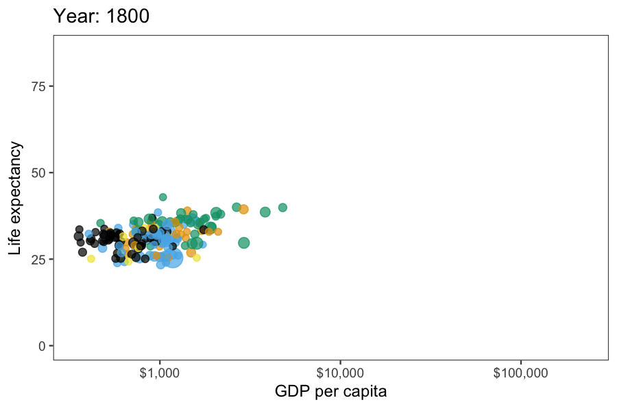


## ggplot2 extensions

- [gganimate](https://gganimate.com/) for animated plots
- [ggrepel](https://ggrepel.slowkow.com/) for better text labels
[ggthemes](https://yutannihilation.github.io/allYourFigureAreBelongToUs/ggthemes/) for more themes
- [ggforce](https://ggforce.data-imaginist.com/) for additional geoms and facets
- [ggraph](https://ggraph.data-imaginist.com/) for network graphs
- [plotly](https://plotly.com/r/) for interactive plots
- [patchwork](https://patchwork.data-imaginist.com/) for combining multiple plots
- [cowplot](https://wilkelab.github.io/cowplot/) for combining multiple plots
- [ggcorrplot](https://cran.r-project.org/web/packages/ggcorrplot/vignettes/ggcorrplot.html) for correlation matrices
- [ggdist](https://mjskay.github.io/ggdist/) for visualizing distributions and uncertainty

## Summary

- Data visualisation is an important tool for data analysis and communication
- Effective data visualisations have several key qualities
- There are many types of data visualisations, and the choice depends on the data and the question
- ggplot2 is a powerful and flexible R package for creating data visualisations using the grammar of graphics
- ggplot2 plots are built up in layers, with each layer adding a new component to the plot
- Common layers include data, aesthetics, geometries, scales, facets, labels, and themes
- Practice creating and customizing ggplot2 plots to improve your data visualisation skills


## References & resources {background-image="https://images.unsplash.com/photo-1550399105-05c4a7641b02?ixlib=rb-1.2.1&ixid=MnwxMjA3fDB8MHxwaG90by1wYWdlfHx8fGVufDB8fHx8&auto=format&fit=crop&w=774&q=80" background-size="contain" background-position="right"}

<!-- ## References & resources -->

::: columns
::: {.column width="60%"}

::: r-fit-text
- [R for Data Science](https://r4ds.hadley.nz/data-visualize.html) 📖
- [Data visualization: a practical introduction (K. Healy)](http://socviz.co/) 📖
- [Fundamentals of data visualization (C. Wilke)](http://serialmentor.com/dataviz/) 📖
- [ggplot2: Elegant Graphics for Data Analysis](https://ggplot2-book.org/index.html) 📖
- [R graphics cookbook](https://r-graphics.org/) 📖

:::

:::

::: {.column width="40%"}
:::
:::


# Any questions or thoughts? 💬

{fig-align="center"}
