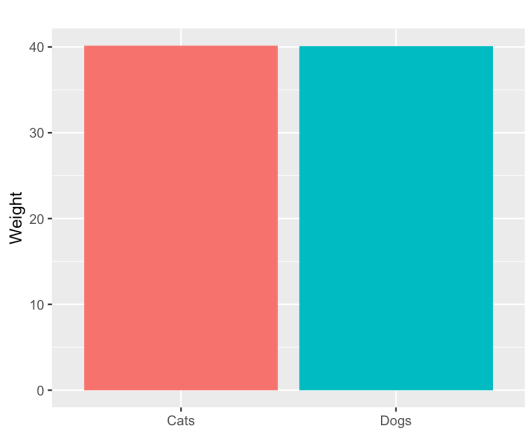
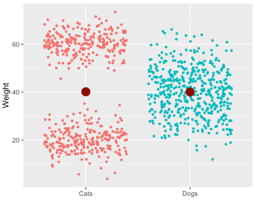
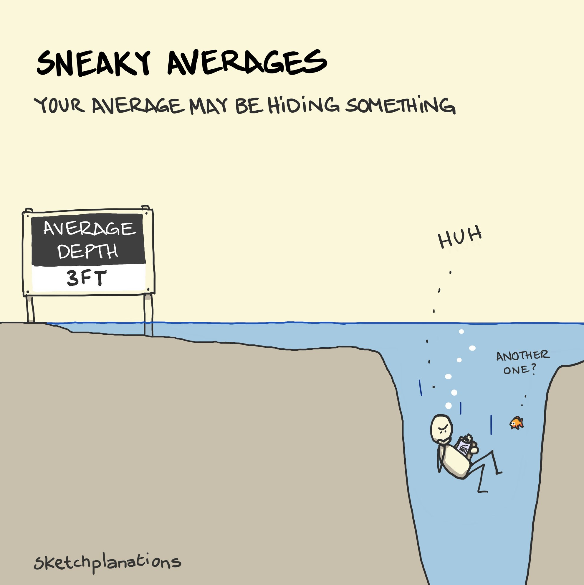
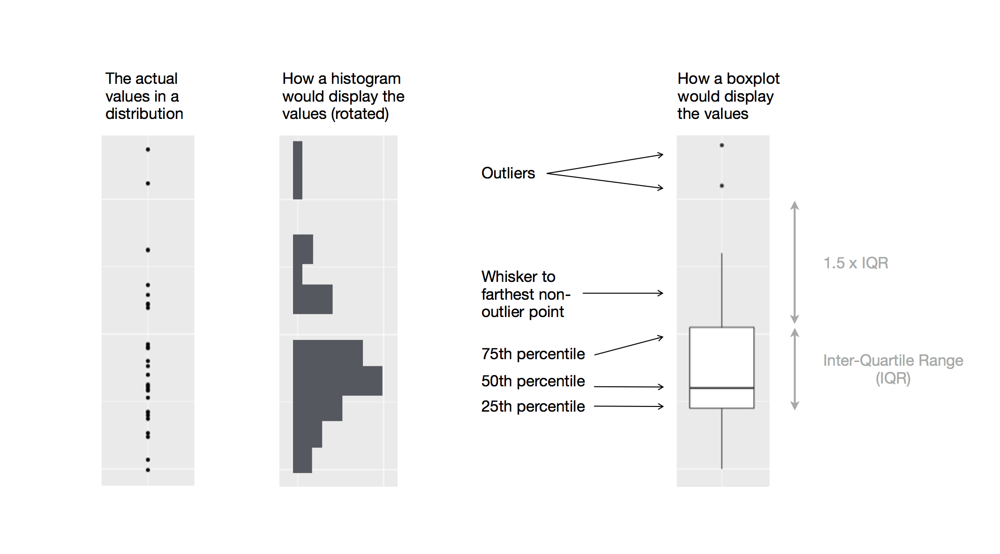
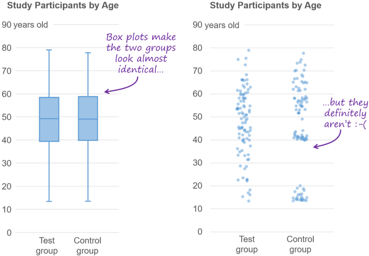
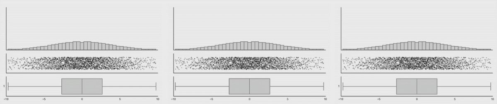
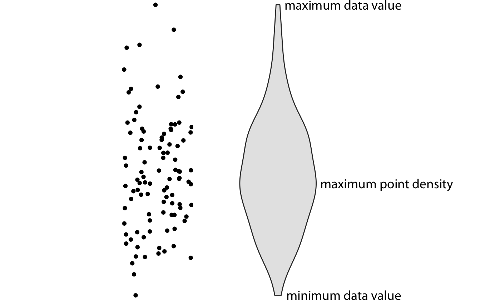

```{r}
#| label: setup
#| include: false

library(tidyverse)
library(ggridges)
library(ggforce)
library(ggdist)
library(ggthemes)
library(cowplot)
library(patchwork)
library(gganimate)
library(colorspace)
library(here)
library(countrycode)
# ggplot2 settings so plots scale well for slide size 
theme_set(ggthemes::theme_few(16)) # 16 for full width, 18 for half width 
update_geom_defaults("point", list(size = 2)) # 2 for full width, 2.5 for half width

# read data

titanic <- read_csv(here("data/titanic.csv")) |>
  select(age, sex, class, survived) |>
  arrange(age, sex, class)

lincoln_temps <- readRDS(here("data/lincoln_temps.rds"))

```

## 

::::: columns
::: {.column width="30%"}
:::

::: {.column width="70%"}
### Learning objectives

-   Understand why it matters to communicate variation and uncertainty

- Describe what they are, and where they come from

-   Learn how to visualise variation/uncertainty effectively
:::
:::::

{.image-left}

## 

::::: columns
::: {.column width="30%"}
:::

::: {.column width="70%"}
### Learning objectives

-   [Understand why it matters to communicate variation and uncertainty]{.remember}

-   Describe what they are, and where they come from

-   Learn how to visualise variation/uncertainty effectively

:::
:::::

{.image-left}

<!-- ## The Bay of Pigs

::::{.columns}
:::{.column}
-   In 1961, JFK’s advisers described the invasion’s success as a **“fair chance.”**
-   Kennedy heard *“quite likely”*; advisers meant *“maybe 50 %.”*
-   Misunderstanding of **verbal uncertainty → catastrophic decision**.
:::

:::{.column}

:::

:::: -->

## Problems with single numbers

:::: {.columns}

::: {.column width="50%"}

:::

::: {.column width="50%" .fragment}

:::

::::

## What happens when variation/uncertainty is hidden?


:::: {.columns}

::: {.column width="50%"}
### Average vs variation
{width="70%"}
:::

::: {.column width="50%" .fragment}
### Uncertainty is not Error — It’s Information

-   🔍 Uncertainty reveals what we *don’t know*, not what we did wrong
-   💡 Showing uncertainty **builds trust and credibility**
-   🎯 Every measurement hides variation — expose it honestly
-   🧭 Good visualizations help audiences reason, not guess
:::

::::

## When You See a Plot, Ask Yourself:

1.  Where could uncertainty/variation come from?
2.  Is it visible in the plot?
3.  Does the design imply false precision?
4.  Could different choices of the design (bin width, scale, etc) change the story?
5.  Are limitations clearly stated?

## Show the Variation That Matters

- Avoid visualizing single numbers when you have a whole range or distribution of numbers that could help your audience understand the data better.

    - Variation in single variables

    - Variation across multiple variables

    - Uncertainty in models and simulations


## 

::::: columns
::: {.column width="30%"}
:::

::: {.column width="70%"}
### Learning objectives

-   [Understand why it matters to communicate variation and uncertainty]{.graylight}

-   [Describe what they are, and where they come from]{.remember}

-   Learn how to visualise variation/uncertainty effectively
:::
:::::

{.image-left}


## Uncertainty, Variation, Randomness

-   **Uncertainty ≠ Variation**
    -   [Variation]{.remember} = Differences across observations, individuals, or time. Can be systematic or random.
    -   [Uncertainty]{.remember} = This is much broader! your relationship with the outside world! Incomplete knowledge about a quantity, event, relationship, or future outcome.
    -   [Randomness/noise]{.remember} = Chance-driven unpredictability in outcomes, even when the underlying process is understood.


## Different Types of Uncertainty {.center .middle}

::: {.fragment}
-   **Aleatoric uncertainty** — We don't know! inherent randomness of a process.
    *Example:* day-to-day sales fluctuate even under similar conditions.

-   **Epistemic uncertainty** — lack of knowledge or wrong assumptions.
    *Example:* missing predictors, misspecified model.
:::

## Where Does Variation/Uncertainty Come From?

-   [Process:]{.remember} The real world is variable-inherent randomness in systems

-   [Data:]{.remember} We don't observe everything perfectly- measurement error, missing data, sampling variability

-   [Model:]{.remember} Our representation of reality is imperfect - wrong model, parameter error, simplifying assumptions


## 

::::: columns
::: {.column width="30%"}
:::

::: {.column width="70%"}
### Learning objectives

-   [Understand why it matters to communicate variation and uncertainty]{.graylight}

-   [Describe what they are, and where they come from]{.graylight}

-   [Learn how to visualise variation/uncertainty effectively]{.remember}
:::
:::::

{.image-left}

## Section overview: Visual encodings of uncertainty

Learn **how** to encode uncertainty so audiences see **range, variability, and confidence**.

We’ll cover:

  1)  Distributions: histogram + density
  2)  Box, violin, and **rainclouds**
  3)  Multiple groups (facets & ridgelines)
  4)  Model uncertainty (fan chart, prediction intervals)

> Principle: **Show raw data + distribution shape + an interval** when possible.


## Passengers on the Titanic 

```{r}
#| echo: false
titanic
```

## Passengers on the Titanic {.smaller}

:::: {.columns} 

::: {.column width="33%"}
```{r}
#| echo: false
knitr::kable(titanic[1:12,], "html")
```
:::

::: {.column width="33%"}
```{r}
#| echo: false
knitr::kable(titanic[13:22,], "html")
```
:::

::: {.column width="33%"}
```{r}
#| echo: false
knitr::kable(titanic[23:36,], "html")
```
:::

::::

## Histogram: Define bins and count cases {.smaller}

```{r}
#| include: false
age_counts <- hist(titanic$age, breaks = (0:15) * 5 + .01, plot = FALSE)$counts
age_hist <- tibble(
  `age range` = c("0–5", "6–10", "11–15", "16–20", "21–25", "26–30", "31–35", "36–40", "41–45", "46–50", "51–55", "56–60", "61–65", "66–70", "71–75", "76–80"),
  count = c(age_counts, 0)
)
```

:::: {.columns}

::: {.column width="20%"}
```{r}
#| echo: false
knitr::kable(age_hist[1:8,], "html")
```
:::

::: {.column width="20%"}
```{r}
#| echo: false
knitr::kable(age_hist[9:16,], "html")
```
:::

::: {.column width="60%"}
```{r}
#| label: titanic-age-hist
#| echo: false
#| fig-width: 5.5
#| out-width: 70%
#| fig-asp: .618

age_hist5 <- age_hist |>
  mutate(age = (1:16) * 5 - 2.5) |>
  filter(count > 0)

h1 <- ggplot(age_hist5, aes(x = age, y = count)) + 
  geom_col(width = 4.7, fill = "#898989", na.rm = TRUE)  + 
  scale_y_continuous(expand = c(0, 0), breaks = 25 * (0:5)) +
  scale_x_continuous(name = "age (years)", limits = c(0, 75), expand = c(0, 0)) +
  coord_cartesian(clip = "off") +
  theme_minimal_hgrid(18) +
  theme(
    axis.line.x = element_blank()
  )

h1
```
:::

::::

## Histograms depend on the chosen bin width

```{r}
#| label: titanic-age-hist-binwidth
#| echo: false
#| out.width: 75%
#| fig.width: 8
#| fig.asp: 0.618

age_hist_1 <- tibble(
  age = (1:75) - 0.5, 
  count = hist(titanic$age, breaks = (0:75) + .01, plot = FALSE)$counts
)
age_hist_3 <- tibble(
  age = (1:25) * 3 - 1.5, 
  count = hist(titanic$age, breaks = (0:25) * 3 + .01, plot = FALSE)$counts
)
age_hist_15 <- tibble(
  age = (1:5) * 15 - 7.5, 
  count = hist(titanic$age, breaks = (0:5) * 15 + .01, plot = FALSE)$counts
)


h2 <- ggplot(age_hist_1, aes(x = age, y = count)) + 
  geom_col(width = .85, fill = "#898989")  + 
  scale_y_continuous(expand = c(0, 0), breaks = 10 * (0:5)) +
  scale_x_continuous(name = "age (years)", limits = c(0, 75), expand = c(0, 0)) +
  coord_cartesian(clip = "off") +
  theme_minimal_hgrid(14) +
  theme(
    axis.line.x = element_blank()
  )

h3 <- ggplot(age_hist_3, aes(x = age, y = count)) + 
  geom_col(width = 2.75, fill = "#898989")  + 
  scale_y_continuous(expand = c(0, 0), breaks = 25 * (0:5)) +
  scale_x_continuous(name = "age (years)", limits = c(0, 75), expand = c(0, 0)) +
  coord_cartesian(clip = "off") +
  theme_minimal_hgrid(14) +
  theme(
    axis.line.x = element_blank()
  )

h4 <- ggplot(age_hist_15, aes(x = age, y = count)) + 
  geom_col(width = 14.5, fill = "#898989")  + 
  scale_y_continuous(expand = c(0, 0), breaks = 100 * (0:4)) +
  scale_x_continuous(name = "age (years)", limits = c(0, 75), expand = c(0, 0)) +
  coord_cartesian(clip = "off") +
  theme_minimal_hgrid(14) +
  theme(
    axis.line.x = element_blank()
  )

h1 <- h1 + theme_minimal_hgrid(16) +
  theme(
    axis.line.x = element_blank()
  )

plot_grid(
  h2, NULL, h3,
  NULL, NULL, NULL,
  h1, NULL, h4,
  align = 'hv',
  rel_widths = c(1, .04, 1),
  rel_heights = c(1, .04, 1)
)
```


## Alternative to histogram: Kernel density estimate (KDE)
Use calculus to find the probability of each x value

:::: {.columns}

::: {.column width="50%"}
```{r titanic-age-hist2, echo = FALSE, fig.width = 7, fig.asp = 0.618, dev = "svg"}
h1 + ggtitle("Histogram") + theme(plot.title.position = "plot")
```
:::


::: {.column width="50%"}
```{r}
#| label: titanic-age-kde
#| echo: false
#| fig.width: 7
#| fig.asp: 0.618

ggplot(titanic, aes(x = age)) + 
  geom_density(fill = "#898989", color = darken("#898989", 0.5), bw = 2, kernel = "gaussian") + 
  scale_y_continuous(limits = c(0, 0.046), expand = c(0, 0), name = "density") +
  scale_x_continuous(name = "age (years)", limits = c(0, 75), expand = c(0, 0)) +
  coord_cartesian(clip = "off") +
  ggtitle("Kernel density estimate") +
  theme_minimal_hgrid(18) +
  theme(
    axis.line.x = element_blank(),
    plot.title.position = "plot"
  )
```

:::
::::

Histograms show raw counts, KDEs show proportions. (Total area = 1)


## KDEs also depend on parameter settings

```{r}
#| label: titanic-age-kde-grid
#| out.width: 75%
#| echo: false
#| fig.width: 8
#| fig.asp: 0.618

pdens1 <- ggplot(titanic, aes(x = age)) + 
  geom_density(fill = "#898989", color = darken("#898989", 0.5), bw = .5, kernel = "gaussian") + 
  scale_y_continuous(limits = c(0, 0.046), expand = c(0, 0), name = "density") +
  scale_x_continuous(name = "age (years)", limits = c(0, 75), expand = c(0, 0)) +
  coord_cartesian(clip = "off") +
  theme_minimal_hgrid(14) +
  theme(axis.line.x = element_blank())

pdens2 <- ggplot(titanic, aes(x = age)) + 
  geom_density(fill = "#898989", color = darken("#898989", 0.5), bw = 2, kernel = "gaussian") + 
  scale_y_continuous(limits = c(0, 0.046), expand = c(0, 0), name = "density") +
  scale_x_continuous(name = "age (years)", limits = c(0, 75), expand = c(0, 0)) +
  coord_cartesian(clip = "off") +
  theme_minimal_hgrid(14) +
  theme(axis.line.x = element_blank())

pdens3 <- ggplot(titanic, aes(x = age)) + 
  geom_density(fill = "#898989", color = darken("#898989", 0.5), bw = 5, kernel = "gaussian") + 
  scale_y_continuous(limits = c(0, 0.046), expand = c(0, 0), name = "density") +
  scale_x_continuous(name = "age (years)", limits = c(0, 75), expand = c(0, 0)) +
  coord_cartesian(clip = "off") +
  theme_minimal_hgrid(14) +
  theme(axis.line.x = element_blank())

pdens4 <- ggplot(titanic, aes(x = age)) + 
  geom_density(fill = "#898989", color = darken("#898989", 0.5), bw = 2, kernel = "rectangular") + 
  scale_y_continuous(limits = c(0, 0.046), expand = c(0, 0), name = "density") +
  scale_x_continuous(name = "age (years)", limits = c(0, 75), expand = c(0, 0)) +
  coord_cartesian(clip = "off") +
  theme_minimal_hgrid(14) +
  theme(axis.line.x = element_blank())

plot_grid(
  pdens1, NULL, pdens2, 
  NULL, NULL, NULL,
  pdens3, NULL, pdens4,
  align = 'hv',
  rel_widths = c(1, .04, 1),
  rel_heights = c(1, .04, 1)
)
```


## Careful: KDEs can show non-sensical data

```{r}
#| label: titanic-age-kde-wrong
#| out.width: 75%
#| echo: false
#| fig.width: 7
#| fig.asp: 0.618

pdens_neg <- ggplot(titanic, aes(x = age)) + 
  geom_density(fill = "#898989", color = darken("#898989", 0.5)) + 
  scale_y_continuous(limits = c(0, 0.046), expand = c(0, 0), name = "density") +
  scale_x_continuous(name = "age (years)", limits = c(-10, 79), expand = c(0, 0)) +
  coord_cartesian(clip = "off") +
  theme_minimal_hgrid(16) +
  theme(
    axis.line.x = element_blank()
  )
stamp_wrong(pdens_neg)
```

## Box Plots


Box plots are crude way to visualise distrbutions




## Challenges with Box Plots




## Challenges with Box Plots {.center .middle}




## Violin plot

A violin plot is a density plot rotated 90 degrees and then mirrored.




## Visualising Uncertainty in [ggplot2]{.yellow} {.big .center .middle}

## Making histograms with ggplot: `geom_histogram()`

```{r}
#| label: titanic-hist-ggplot-demo
#| message: true
ggplot(titanic, aes(age)) +
  geom_histogram()
```


## Setting the bin width

Do you like the bin placement?

```{r}
#| label: titanic-hist-ggplot-demo2
ggplot(titanic, aes(age)) +
  geom_histogram(binwidth = 5)
```


## Always set the center as well

```{r}
#| label: titanic-hist-ggplot-demo4
ggplot(titanic, aes(age)) +
  geom_histogram(
    binwidth = 5,  # width of the bins
    center = 2.5  # center of the bin containing that value
  )
```


## Making density plots with ggplot: `geom_density()`

```{r}
#| label: titanic-dens-ggplot-demo
ggplot(titanic, aes(age)) +
  geom_density(fill = "skyblue")
```

## Making density plots with ggplot: `geom_density()`


```{r}
#| label: titanic-dens-ggplot-demo2
ggplot(titanic, aes(age)) +
  geom_density() # without fill
```

## Modifying bandwidth (`bw`) and kernel parameters

```{r}
#| label: titanic-dens-ggplot-demo3
ggplot(titanic, aes(age)) +
  geom_density(
    fill = "skyblue",
    bw = 0.5,               # a small bandwidth
    kernel = "gaussian"     # Gaussian kernel (the default)
  )

```


## Modifying bandwidth (`bw`) and kernel parameters

```{r}
#| label: titanic-dens-ggplot-demo4
ggplot(titanic, aes(age)) +
  geom_density(
    fill = "skyblue",
    bw = 2,                 # a moderate bandwidth
    kernel = "rectangular"  # rectangular kernel
  )
```


## Making Box plots with ggplot: `geom_boxplot()`

```{r}
#| label: titanic-boxplot-ggplot-demo
ggplot(titanic, aes(age)) +
  geom_boxplot()
```


##  Making Violin plot with ggplot: `geom_violin()`

```{r}
#| label: titanic-violin-ggplot-demo
ggplot(titanic, aes(x= age, y = "")) +
  geom_violin()
```


## Compare distributions {.big .center .middle}

Uncertainty/Variation across multiple variables


## Careful: Are bars stacked or overlapping

Stacked or overlapping histograms are rarely a good choice.

:::: {.columns}

::: {.column}

```{r}
#| label: titanic-age-hist-stacked
#| echo: false
#| fig.width: 7
#| fig.asp: 0.618
gender_counts <- tibble(
  age = (1:25)*3 - 1.5, 
  male = hist(filter(titanic, sex == "male")$age, breaks = (0:25)*3 + .01, plot = FALSE)$counts,
  female = hist(filter(titanic, sex == "female")$age, breaks = (0:25)*3 + .01, plot = FALSE)$counts
) |>
  pivot_longer(-age, names_to = "gender", values_to = "count")

gender_counts$gender <- factor(gender_counts$gender, levels = c("female", "male"))

ggplot(gender_counts, aes(x = age, y = count, fill = gender)) + 
  geom_col(position = "stack") +
  scale_x_continuous(name = "age (years)", limits = c(0, 75), expand = c(0, 0)) +
  scale_y_continuous(limits = c(0, 89), expand = c(0, 0), name = "count") +
  scale_fill_manual(values = c("#D55E00", "#0072B2")) +
  coord_cartesian(clip = "off") +
  theme_minimal_hgrid(18) +
  theme(
    axis.line.x = element_blank(),
    legend.position = c(.9, .87),
    legend.justification = c("right", "top"),
    legend.box.background = element_rect(fill = "white", color = "white")
  )
```
:::

::: {.column}
```{r}
#| label: titanic-age-hist-overlap
#| echo: false
#| fig.width: 7
#| fig.asp: 0.618
ggplot(gender_counts, aes(x = age, y = count, fill = gender)) + 
  geom_col(position = "identity", alpha = 0.7) +
  scale_x_continuous(name = "age (years)", limits = c(0, 75), expand = c(0, 0)) +
  scale_y_continuous(limits = c(0, 56), expand = c(0, 0), name = "count") +
  scale_fill_manual(
    values = c("#D55E00", "#0072B2"),
    guide = guide_legend(reverse = TRUE)
  ) +
  coord_cartesian(clip = "off") +
  theme_minimal_hgrid(18) +
  theme(
    axis.line.x = element_blank(),
    legend.position = c(.9, .87),
    legend.justification = c("right", "top"),
    legend.box.background = element_rect(fill = "white", color = "white")
  )
```
:::
::::


## Alternatively: Age pyramid


```{r}
#| label: titanic-age-pyramid
#| echo: false
#| out.width: 70%
#| fig.width: 7
#| fig.asp: 0.618
ggplot(gender_counts, aes(x = age, y = ifelse(gender == "male", -1, 1)*count, fill = gender)) + 
  geom_col() +
  scale_x_continuous(name = "age (years)", limits = c(0, 75), expand = c(0, 0)) +
  scale_y_continuous(name = "count", breaks = 20*(-2:1), labels = c("40", "20", "0", "20")) +
  scale_fill_manual(values = c("#D55E00", "#0072B2"), guide = "none") +
  draw_text(x = 70, y = -39, "male", hjust = 0) +
  draw_text(x = 70, y = 21, "female", hjust = 0) +
  coord_flip() +
  theme_minimal_grid(16) +
  theme(axis.title.x = element_text(hjust = 0.61))
```


## Alternatively: KDEs showing proportions of total

```{r}
#| label: titanic-age-props
#| echo: false
#| out.width: 75%
#| fig.width: 10
#| fig.asp: 0.45

titanic |>
  mutate(sex = factor(sex, levels = c("male", "female"))) |>
  ggplot(aes(x = age, y = after_stat(count))) +
  geom_density(
    data = select(titanic, -sex), aes(fill = "all passengers"),
    color = "transparent"
  ) + 
  geom_density(aes(fill = sex), bw = 2, color = "transparent") +
  scale_x_continuous(limits = c(0, 75), name = "passenger age (years)", expand = c(0, 0)) +
  scale_y_continuous(limits = c(0, 26), name = "scaled density", expand = c(0, 0)) +
  scale_fill_manual(
    values = c("#b3b3b3a0", "#0072B2", "#D55E00"), 
    breaks = c("all passengers", "male", "female"),
    labels = c("all passengers  ", "males  ", "females"),
    name = NULL,
    guide = guide_legend(direction = "horizontal")
  ) +
  coord_cartesian(clip = "off") +
  facet_wrap(vars(sex), labeller = labeller(sex = function(sex) paste(sex, "passengers"))) +
  theme_minimal_hgrid(16) +
  theme(
    axis.line.x = element_blank(),
    strip.text = element_text(size = 14, margin = margin(0, 0, 0.2, 0, "cm")),
    legend.position = "bottom",
    legend.justification = "right",
    legend.margin = margin(4.5, 0, 1.5, 0, "pt"),
    legend.spacing.x = grid::unit(4.5, "pt"),
    legend.spacing.y = grid::unit(0, "pt"),
    legend.box.spacing = grid::unit(0, "cm")
  )
```


## Using temperature 

```{r}
#| label: temps_table
lincoln_temps |>
  dplyr::filter(month == "Jan") |>
  dplyr::select(date, `mean temp` = mean_temp)
```

## Reminder: usign density plot for each month

```{r}
#| label: temps_densities_january
#| echo: false
#| fig-width: 5.5
#| out-width: 100%
#| fig-asp: .618
lincoln_temps |>
  dplyr::filter(month == "Jan") |>
  ggplot2::ggplot(ggplot2::aes(mean_temp)) +
  ggplot2::geom_density(fill = "#898989", alpha = 0.7) +
  ggplot2::scale_x_continuous(name = "mean temperature (°F)", expand = c(0, 0)) +
  ggplot2::scale_y_continuous(expand = ggplot2::expansion(mult = c(0, 0.06))) +
  ggplot2::ggtitle("Temperature distribution") +
  theme_minimal_grid(18) +
  ggplot2::theme(plot.title.position = "plot",
                 plot.title = ggplot2::element_text(face = "plain"))
```

## A bad idea: Many overlapping density plots

```{r}
#| label: temps_densities_overlapping
#| echo: false
#| fig-width: 8
#| out-width: 70%
#| fig-asp: .618
p <- lincoln_temps |>
  mutate(
    month_long = fct_rev(month_long)
  ) |>
  ggplot(aes(mean_temp, fill = month)) +
  geom_density(alpha = 0.5) +
  scale_x_continuous(
    name = "mean temperature (°F)",
    expand = c(0, 0)
  ) +
  scale_y_continuous(expand = expansion(mult = c(0, 0.06))) +
  scale_fill_viridis_d(option = "D") +
  labs(subtitle = "") + # empty subtitle for some vertical space
  theme_minimal_grid(16)

stamp_bad(p)
```

## Another bad idea: Stacked density plots

```{r}
#| label: temps_densities_stacked
#| echo: false
#| fig-width: 8
#| out-width: 70%
#| fig-asp: .618
p <- lincoln_temps |>
  mutate(
    month_long = fct_rev(month_long)
  ) |>
  ggplot(aes(mean_temp, fill = month)) +
  geom_density(alpha = 0.7, position = "stack") +
  scale_x_continuous(
    name = "mean temperature (°F)",
    expand = c(0, 0)
  ) +
  scale_y_continuous(expand = expansion(mult = c(0, 0.06))) +
  scale_fill_viridis_d(option = "D") +
  labs(subtitle = "") + # empty subtitle for some vertical space
  theme_minimal_grid(16)

stamp_bad(p)
```

## Somewhat better: Small multiples

```{r}
#| label: temps_densities
#| echo: false
#| fig-width: 8
#| out-width: 80%
#| fig-asp: .618
lincoln_temps |>
  mutate(
    month_long = fct_rev(month_long)
  ) |>
  ggplot(aes(mean_temp)) +
  geom_density(fill = "#898989") +
  scale_x_continuous(
    name = "mean temperature (°F)",
    expand = c(0, 0)
  ) +
  scale_y_continuous(expand = expansion(mult = c(0, 0.06))) +
  facet_wrap(vars(month_long)) +
  theme_minimal_grid(16, color = "gray65") +
  theme(
    panel.background = element_rect(fill = "gray95")
  )
```

## Instead: Show values along y, conditions along x

```{r}
#| label: temps_boxplots
#| echo: false
#| fig-width: 8
#| out-width: 80%
#| fig-asp: .618
ggplot(lincoln_temps, aes(x = month, y = mean_temp)) +
  geom_boxplot(fill = "gray90") + 
  xlab("month") + 
  ylab("mean temperature (°F)") +
  theme_half_open()
```

## If you like density plots, consider violins


```{r}
#| label: temps_violins
#| echo: false
#| fig-width: 6
#| out-width: 70%
#| fig-asp: .618
ggplot(lincoln_temps, aes(x = month, y = mean_temp)) +
  geom_violin(fill = "gray90") + 
  xlab("month") + 
  ylab("mean temperature (°F)") +
  theme_half_open()
```


## For small datasets, you can also use a strip chart

Advantage: Can see raw data points instead of abstract representation.

```{r}
#| label: temps_stripchart2
#| echo: false
#| fig-width: 6
#| out-width: 60%
#| fig-asp: .618
ggplot(lincoln_temps, aes(x = month, y = mean_temp)) +
  geom_point(size = 0.75) +
  xlab("month") + 
  ylab("mean temperature (°F)") +
  theme_half_open()
```

## For small datasets, you can also use a strip chart

Advantage: Can see raw data points instead of abstract representation.

Horizontal jittering may be necessary to avoid overlapping points.

```{r}
#| label: temps_stripchart
#| echo: false
#| fig-width: 6
#| out-width: 60%
#| fig-asp: .618
ggplot(lincoln_temps, aes(x = month, y = mean_temp)) +
  geom_point(
    position = position_jitter(width = .15, height = 0, seed = 320),
    size = 0.75
  ) +
  xlab("month") + 
  ylab("mean temperature (°F)") +
  theme_half_open()
```

## We can also jitter points into boxplot

```{r}
#| label: temps_sina
#| echo: false
#| fig-width: 6
#| out-width: 60%
#| fig-asp: .618
ggplot(lincoln_temps, aes(x = month, y = mean_temp)) +
  geom_boxplot() + 
  geom_jitter(size = 0.75) + 
  xlab("month") + 
  ylab("mean temperature (°F)") +
  theme_few()
```

## We can also jitter points into violins

```{r}
#| label: temps_sina1
#| echo: false
#| fig-width: 6
#| out-width: 60%
#| fig-asp: .618
ggplot(lincoln_temps, aes(x = month, y = mean_temp)) +
  geom_violin(fill = "gray90", color = NA) + 
  geom_sina(size = 0.75) + 
  xlab("month") + 
  ylab("mean temperature (°F)") +
  theme_half_open()
```


[Such plots are called sina plots, to honor [Sina Hadi Sohi.](https://clauswilke.com/dataviz/boxplots-violins.html#fig:lincoln-temp-sina)]{.footnote}


## But maybe there's hope for overlapping density plots?
Multiple densities: Transparency

```{r}
#| label: temps_densities_overlapping2
#| echo: false
#| fig-width: 6
#| fig-asp: .618
lincoln_temps |>
  mutate(
    month_long = fct_rev(month_long)
  ) |>
  ggplot(aes(mean_temp, fill = month)) +
  geom_density(alpha = 0.4) +
  scale_x_continuous(
    name = "mean temperature (°F)",
    expand = c(0, 0),
    breaks = c(0, 25, 50, 75)
  ) +
  scale_y_continuous(expand = expansion(mult = c(0, 0.06))) +
  scale_fill_viridis_d(option = "D") +
  theme_minimal_grid(16)
```


How about we stagger the densities vertically?


## Vertically staggered density plots are called ridgelines
Multiple densities: Ridge plots


```{r}
#| label: lincoln-ridgeline-polished
#| echo: false
#| fig-width: 6
#| fig-asp: .618
ggplot(lincoln_temps, aes(x = mean_temp, y = month_long)) +
  geom_density_ridges(
    scale = 3,
    rel_min_height = 0.01,
    bandwidth = 3.4,
    fill = lighten("#898989", .3),
    color = "white"
  ) +
  scale_x_continuous(
    name = "mean temperature (°F)",
    expand = c(0, 0)#, breaks = c(0, 25, 50, 75)
  ) +
  scale_y_discrete(name = NULL, expand = expansion(add = c(0.2, 2.6))) +
  theme_minimal_grid(16) +
  theme(
    axis.text.y = element_text(vjust = 0)
  )
```


Notice the single fill color. More colors would be distracting.

## Combining multiple [**geom_**]{.yellow} in gglot2 {.big .center .middle}

## `iris` data

```{r}
iris |> as_tibble()
```

## Violin-boxplot-combination

```{r}
#| label: temps_boxplot_violin_com
#| echo: false
#| fig-width: 6
#| out-width: 60%
#| fig-asp: .618
  ggplot(iris, aes(Species, Sepal.Width)) + 
  geom_violin(fill = "grey90") + 
  geom_boxplot(width = .2)+
  theme_half_open()
```


## Better: add raw data

```{r}
#| label: temps_boxplot_violin
#| echo: false
#| fig-width: 6
#| out-width: 60%
#| fig-asp: .618
ggplot(iris, aes(Species, Sepal.Width)) + 
  geom_violin(fill = "grey90") + 
  geom_boxplot(width = .2)+
  geom_point(alpha = .5, position = position_jitter(seed = 1)) +
  theme_half_open()
```

## Raincloud plots- with boxplot + dotplot

```{r}
#| label: raincloud1
#| echo: false
#| fig-width: 6
#| out-width: 60%
#| fig-asp: .618
ggplot(iris, aes(Species, Sepal.Width)) + 
  ggdist::stat_halfeye(adjust = .5, width = .3, .width = 0, justification = -.3, point_colour = NA) + 
  geom_boxplot(width = .1, outlier.shape = NA) +
  ggdist::stat_dots(side = "left", dotsize = .3, justification = 1.1, binwidth = .1)+
  theme_few()
```

## Raincloud plots-with boxplot + jitter (on top)

```{r}
#| label: raincloud2
#| echo: false
#| fig-width: 6
#| out-width: 60%
#| fig-asp: .618
ggplot(iris, aes(Species, Sepal.Width)) + 
  ggdist::stat_halfeye(adjust = .5, width = .7, .width = 0, justification = -.2, point_colour = NA) + 
  geom_boxplot(width = .2, outlier.shape = NA) + 
  geom_jitter(width = .05, alpha = .3) +
  theme_few()
```

## with boxplot + jitter (side by side)

```{r}
#| label: raincloud3
#| echo: false
#| fig-width: 6
#| out-width: 60%
#| fig-asp: .618
ggplot(iris, aes(Species, Sepal.Width)) + 
  ggdist::stat_halfeye(adjust = .5, width = .3, .width = 0, justification = -.3, point_colour = NA) + 
  geom_boxplot(width = .1, outlier.shape = NA) +
  geom_jitter(aes(x = as.numeric(Species) - 0.25), width = 0.08, height = .2, alpha = 0.3, size = .5)+
  theme_few()

```


## with boxplot + barcode (side by side)

```{r}
#| label: raincloud4
#| echo: false
#| fig-width: 6
#| out-width: 60%
#| fig-asp: .618
ggplot(iris, aes(Species, Sepal.Width)) + 
  ggdist::stat_halfeye(adjust = .5, width = .6, .width = 0, justification = -.2, point_colour = NA) + 
  geom_boxplot(width = .1) +
  geom_point(aes(x = as.numeric(Species) - 0.25), shape = 95, size = 10, alpha = .2, color = "#1D785A") +
  theme_few()
```

## with boxplot + barcode (another example)

```{r}
#| label: raincloud-example
#| echo: false
#| fig-width: 6
#| out-width: 60%
#| fig-asp: .618
set.seed(2021)

grp1 <- tibble(value = seq(0, 20, length.out = 75), 
               group = "Group 1")

grp2 <- tibble(value = c(rep(0, 5), rnorm(20, 2, .2), rnorm(50, 6, 1), 
                         rnorm(50, 14.5, 1), rnorm(20, 18, .2), rep(20, 5)), 
               group = "Group 2")

grp3 <- tibble(value = rep(seq(0, 20, length.out = 5), 5), 
               group = "Group 3")

data <- bind_rows(grp1, grp2, grp3)
ggplot(data, aes(x = group, y = value)) + 
  ggdist::stat_halfeye(
    adjust = .5, 
    width = .6, 
    .width = 0, 
    justification = -.2, 
    point_colour = NA
  ) + 
  geom_boxplot(
    width = .15, 
    outlier.shape = NA
  ) +
  geom_point(
    ## draw horizontal lines instead of points
    shape = 95,
    size = 15,
    alpha = .2,
    color = "#1D785A"
  ) 
```


## Histograms Add the Rug to Historgram and density


```{r}
#| label: raincloud-example-rug
#| echo: false
#| fig-width: 6
#| out-width: 60%
#| fig-asp: .618
set.seed(1)
v <- rnorm(250, 10, 2)
d <- data.frame(v = v)

ggplot(d, aes(v)) +
  geom_histogram(aes(y = after_stat(density)), bins = 30, fill = "grey85", color = "white") +
  geom_density(linewidth = 1) +
  geom_rug(alpha = 0.4) +
  labs(title = "Histogram + Density + Rug",
       subtitle = "Rug shows raw data; density adds shape; histogram shows frequency") +
  theme_minimal()
```

## Making these plots in [**ggplot2**]{.yellow} and its extentions {.big .center .middle}


## Functions and packages


| Plot type   | Geom                    | Notes                                  |
|:-----------------|:----------------------|:------------------------------|
| boxplot      | `geom_boxplot()`        |                                        |
| violin plot  | `geom_violin()`         |                                        |
| strip chart  | `geom_point()`          | Jittering requires `position_jitter()` |
| sina plot    | `geom_sina()`           | From package **ggforce**               |
| ridgeplot    | `geom_density_ridges()` | From package **ggridges**              |
| distribution | `stat_halfeye()`        | From package **ggdist**                |
| barcode/rug  | `geom_rug()`            | From package **ggplot2**               |


## Boxplot


```{r}
#| label: temps-examples-boxplot
#| fig-width: 6
#| out-width: 60%
#| fig-asp: .618
ggplot(lincoln_temps, aes(x = month, y = mean_temp)) +
  geom_boxplot()+
  theme_few()
```


## Violins


```{r}
#| label: temps-examples-violins
#| fig-width: 6
#| out-width: 60%
#| fig-asp: .618
ggplot(lincoln_temps, aes(x = month, y = mean_temp)) +
  geom_violin() 
```


## Strip chart (no jitter)

```{r}
#| label: temps-examples-stripchart
#| fig-width: 6
#| out-width: 60%
#| fig-asp: .618
ggplot(lincoln_temps, aes(x = month, y = mean_temp)) +
  geom_point(size = 0.75)  # reduce point size to minimize overplotting 
```


## Strip chart (w/ jitter)


```{r}
#| label: temps-examples-stripchart-jitter
#| fig-width: 6
#| out-width: 60%
#| fig-asp: .618
ggplot(lincoln_temps, aes(x = month, y = mean_temp)) +
  geom_point(size = 0.75,  # reduce point size to minimize overplotting 
    position = position_jitter(
      width = 0.15,  # amount of jitter in horizontal direction
      height = 0     # amount of jitter in vertical direction (0 = none)
    )
  )
```


## Sina plot

```{r}
#| label: temps-examples-sina
#| fig-width: 6
#| out-width: 60%
#| fig-asp: .618

ggplot(lincoln_temps, aes(x = month, y = mean_temp)) +
  geom_violin() + # violins in background
  ggforce::geom_sina(size = 0.75, alpha = .5) # sina jittered points in foreground
```


## Ridgeline plot

```{r}
#| label: temps-examples-ridgeline
#| fig-width: 6
#| out-width: 60%
#| fig-asp: .618
library(ggridges) # for geom_density_ridges

ggplot(lincoln_temps, aes(x = mean_temp, y = month_long)) +
  ggridges::geom_density_ridges()
```

## Violin-boxplot-combination

```{r}
#| label: temps_boxplot_violin1_com
#| fig-width: 6
#| out-width: 60%
#| fig-asp: .618
  ggplot(iris, aes(Species, Sepal.Width)) + 
  geom_violin(fill = "grey90") + 
  geom_boxplot(width = .2)+
  theme_half_open()
```


## Better: add raw data

```{r}
#| label: temps_boxplot_violin1
#| fig-width: 6
#| out-width: 60%
#| fig-asp: .618
ggplot(iris, aes(Species, Sepal.Width)) + 
  geom_violin(fill = "grey90") + 
  geom_boxplot(width = .2)+
  geom_point(alpha = .5, position = position_jitter(seed = 1)) +
  theme_half_open()
```

## Raincloud plots- with boxplot + dotplot

```{r}
#| label: raincloud11
#| fig-width: 6
#| out-width: 60%
#| fig-asp: .618
ggplot(iris, aes(Species, Sepal.Width)) + 
  ggdist::stat_halfeye(adjust = .5, width = .3, 
  .width = 0, justification = -.3, point_colour = NA) + 
  geom_boxplot(width = .1, outlier.shape = NA) +
  ggdist::stat_dots(side = "left", dotsize = .3, 
  justification = 1.1, binwidth = .1)+
  theme_few()
```

## Raincloud plots-with boxplot + jitter (on top)

```{r}
#| label: raincloud21
#| fig-width: 6
#| out-width: 60%
#| fig-asp: .618
ggplot(iris, aes(Species, Sepal.Width)) + 
  ggdist::stat_halfeye(adjust = .5, width = .7, 
  .width = 0, justification = -.2, point_colour = NA) + 
  geom_boxplot(width = .2, outlier.shape = NA) + 
  geom_jitter(width = .05, alpha = .3) +
  theme_few()
```

## with boxplot + jitter (side by side)

```{r}
#| label: raincloud31
#| fig-width: 6
#| out-width: 60%
#| fig-asp: .618
ggplot(iris, aes(Species, Sepal.Width)) + 
  ggdist::stat_halfeye(adjust = .5, width = .3, .width = 0, justification = -.3, point_colour = NA) + 
  geom_boxplot(width = .1, outlier.shape = NA) +
  geom_jitter(aes(x = as.numeric(Species) - 0.25), width = 0.08, height = .2, alpha = 0.3, size = .5)+
  theme_few()

```


## with boxplot + barcode (side by side)

```{r}
#| label: raincloud41
#| fig-width: 6
#| out-width: 60%
#| fig-asp: .618
ggplot(iris, aes(Species, Sepal.Width)) + 
  ggdist::stat_halfeye(adjust = .5, width = .6, .width = 0, justification = -.2, point_colour = NA) + 
  geom_boxplot(width = .1) +
  geom_point(aes(x = as.numeric(Species) - 0.25), shape = 95, size = 10, alpha = .2, color = "#1D785A") +
  theme_few()
```

## Add the rug to historgram and density

```{r}
#| label: data-raincloud-example-rug-viz
#| include: false

set.seed(1)
v <- rnorm(250, 10, 2)
d <- data.frame(v = v)
```

::::{.columns}

:::{.column}
```{r}
#| label: raincloud-example-rug-viz
#| eval: false

ggplot(d, aes(v)) +
  geom_histogram(aes(y = after_stat(density)), 
  bins = 30, fill = "grey85", color = "white") +
  geom_density(linewidth = 1) +
  geom_rug(alpha = 0.4) +
  labs(title = "Histogram + Density + Rug")+
  theme_few()
```
:::

:::{.column}
```{r}
#| label: raincloud-example-rug-viz1
#| echo: false
#| fig-width: 6
#| fig-asp: .618

ggplot(d, aes(v)) +
  geom_histogram(aes(y = after_stat(density)), 
  bins = 30, fill = "grey85", color = "white") +
  geom_density(linewidth = 1) +
  geom_rug(alpha = 0.4) +
  labs(title = "Histogram + Density + Rug")+
  theme_few()
```
:::

::::

## Intervals & Ribbons (CI/PI)
**CI**: uncertainty about the mean/fit; **PI**: uncertainty about future observations.

```{r}
#| echo: false
set.seed(42)
df <- data.frame(x = 1:30, y = cumsum(rnorm(30, 0.2, 1)))
ci <- transform(df,
  lower = y - 1.5, upper = y + 1.5
)
ggplot(ci, aes(x, y)) +
  geom_ribbon(aes(ymin = lower, ymax = upper), alpha = 0.2, fill = "skyblue") +
  geom_line(color = "steelblue", linewidth = 1) +
  labs(title = "Line + Ribbon (CI)",
       subtitle = "Always label the interval (e.g., 95% confidence interval)") +
  theme_minimal()
```

## Spaghetti: Show multiple plausible futures


```{r}
#| echo: false
set.seed(42)
library(dplyr); library(ggplot2)
simulate_walk <- function(seed){
  set.seed(seed)
  data.frame(t = 0:40,
             y = cumsum(rnorm(41, 0.2, 1)),
             sim = paste0("sim_", seed))
}
df_sp <- bind_rows(lapply(1:40, simulate_walk))

ggplot(df_sp, aes(t, y, group = sim)) +
  geom_line(alpha = 0.25) +
  labs(title = "Ensemble (Spaghetti) Forecasts",
       subtitle = "Multiple plausible futures make uncertainty salient") +
  theme_minimal()
```

## Fan Charts


```{r}
#| echo: false
h <- 30
sims <- 200
mu   <- cumsum(rnorm(h, 0.1, 0.2))
sim_mat <- replicate(sims, mu + cumsum(rnorm(h, 0, 0.8)))
qs <- apply(sim_mat, 1, quantile, probs = c(.025,.1,.25,.5,.75,.9,.975))
df_fan <- data.frame(t = 1:h,
                     q025 = qs[1,], q10 = qs[2,], q25 = qs[3,], q50 = qs[4,],
                     q75 = qs[5,], q90 = qs[6,], q975 = qs[7,])

ggplot(df_fan, aes(t, q50)) +
  geom_ribbon(aes(ymin = q25, ymax = q75), alpha = .25) +
  geom_ribbon(aes(ymin = q10, ymax = q90), alpha = .18) +
  geom_ribbon(aes(ymin = q025, ymax = q975), alpha = .12) +
  geom_line() +
  labs(title = "Fan Chart: Nested Quantile Ribbons",
       subtitle = "50% (darkest), 80%, and 95% intervals") +
  theme_minimal()
```


## [Choosing colors](https://www.figma.com/colors/)

```{r}
#| echo: false
knitr::include_url("https://www.figma.com/colors/", height = "500px")
```


## References & resources {background-image="https://images.unsplash.com/photo-1550399105-05c4a7641b02?ixlib=rb-1.2.1&ixid=MnwxMjA3fDB8MHxwaG90by1wYWdlfHx8fGVufDB8fHx8&auto=format&fit=crop&w=774&q=80" background-size="contain" background-position="right"}

<!-- ## References & resources -->

:::::: columns
:::: {.column width="60%"}
::: r-fit-text
-   Fundamentals of Data Visualization: [Chapter 7: Visualizing distributions](https://clauswilke.com/dataviz/histograms-density-plots.html)
-   Data Visualization—A Practical Introduction: [4.6 Histograms and density plots](https://socviz.co/groupfacettx.html#histograms)
-   **ggplot2** reference documentation: [`geom_histogram()`](https://ggplot2.tidyverse.org/reference/geom_histogram)
-   **ggplot2** reference documentation: [`geom_density()`](https://ggplot2.tidyverse.org/reference/geom_density)
-   Fundamentals of Data Visualization: [Chapter 7: Visualizing many distributions at once](https://clauswilke.com/dataviz/boxplots-violins.html) 📖
-   **ggplot2** reference documentation: [`geom_boxplot()`](https://ggplot2.tidyverse.org/reference/geom_histogram), [`geom_violin()`](https://ggplot2.tidyverse.org/reference/geom_violin), [`position_jitter()`](https://ggplot2.tidyverse.org/reference/position_jitter.html)
-   **ggforce** reference documentation: [`geom_sina()`](https://ggforce.data-imaginist.com/reference/geom_sina.html)
-   **ggridges** reference documentation: [`geom_density_ridges()`](https://wilkelab.org/ggridges/reference/geom_density_ridges.html)
:::
::::

::: {.column width="40%"}
:::
::::::


# Any questions or thoughts? 💬

{fig-align="center"}