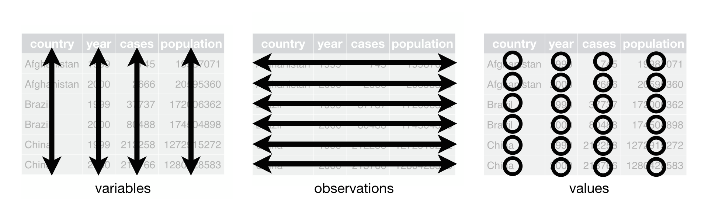
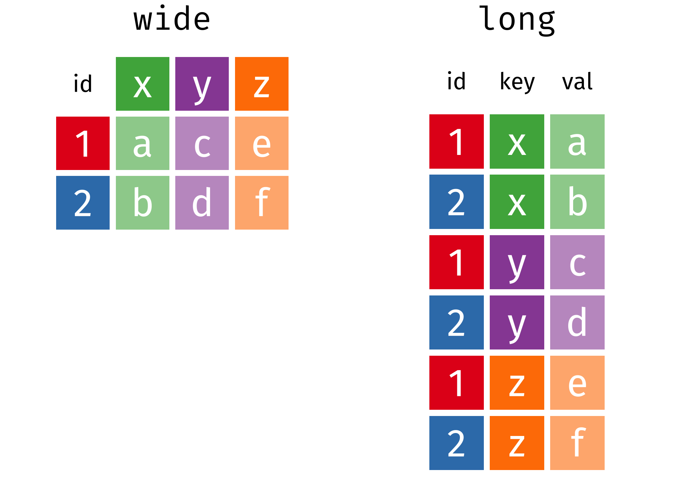
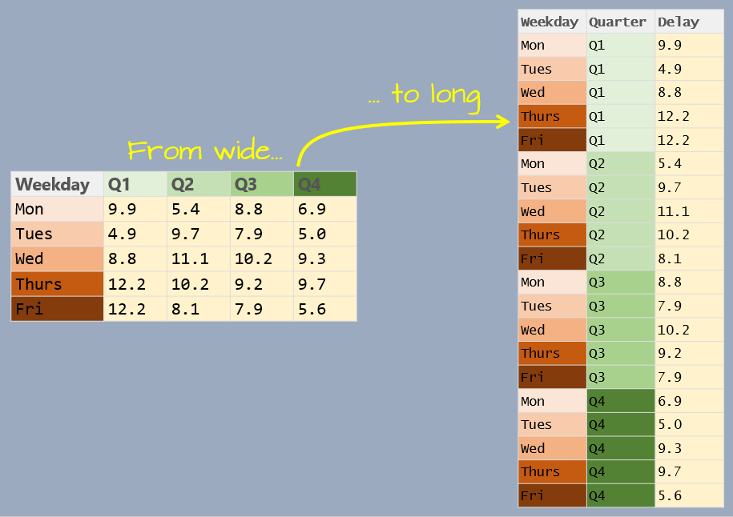
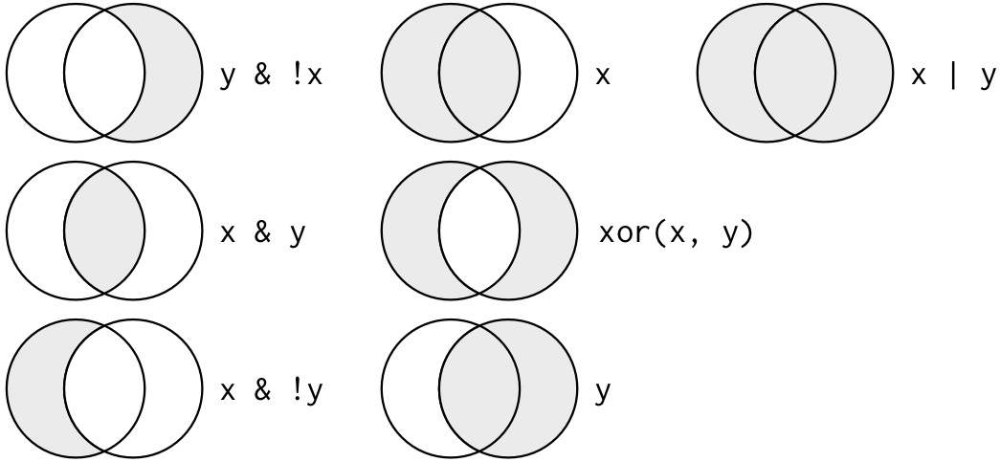

```{r}
#| label: setup
#| include: false

library(tidyverse)
library(kableExtra)
library(DT)
library(ggthemes)
library(here)
library(countrycode)

gapminder <- read_csv(here("data/gapminder_all.csv")) |> 
  mutate(continent = countrycode(country, origin = "country.name", destination = "continent")) |> 
  filter(year <= 2024) |> drop_na()

```

## 

::::: columns
::: {.column width="30%"}
:::

::: {.column width="70%"}
### Learning objectives

**By the end of this session, you are able to:**


- Describe why and when we use data wrangling

- Describe tidy data and argue why it is important when doing data analytitcs using tidyverse packages in R
  
- Reshape and join different datasets

- Transform data using different functions in dplyr package

:::
:::::

{.image-left}


## What is data wrangling?

Reshaping or transforming **raw** data into a format that’s easier to work with later (for visualisation, modelling, reporting).

- Real-world data rarely arrives in the perfect form for analysis.

- You’ll often create new variables, compute summaries, rename variables, or reorder observations to make work easier.


## Tidy data (structure, not cleanliness)

::::{.columns}

:::{.column}
Tidy data follows three simple rules:

1. Each **variable** has its own **column**.

2. Each **observation** has its own **row**.  

3. Each **value** has its own **cell**.

Tidy data is the native shape that **tidyverse** tools expect.
:::

:::{.column}
{width="95%"}
:::

::::

## Why do we need data to be in Tidy format?

- For the functions in `tidyverse` to work, your data needs to be in a `tidy format`

- This doesn't mean that it's clean, it refers to the *structure* of the data
  
- All the packages in the **tidyverse**, and its extensions work best with tidy data; that why it's called that!

## Wide vs. long data
### Example of tidy data




[Figure by Garrick Aden-Buie in **tidyexplain**](https://github.com/gadenbuie/tidyexplain){.footnote}


## Moving from wide to long
  
You can use `pivot_longer()` & `pivot_wider()` from `tidyr` package in `tidyverse` to move from wider to longer and viceversa.




[Tidying/reshaping tables using tidyr](https://mgimond.github.io/ES218/Week03b.html){.footnote}

## Joins multiple datasets

::::{.columns}

:::{.column}
```{r}
band_members <- tibble(name = c("Mick", "John", "Paul"), band = c("Stones","Beatles","Beatles"))
band_members
```
:::

:::{.column}
```{r}
band_instruments <- tibble(name = c("John","Paul","Keith"), plays = c("guitar","bass","guitar"))
band_instruments
```
:::
:::::

## Joins: combine tables by keys

Use joins to add columns from one table to another.

```{r}
left_join(band_members, band_instruments, by = "name")
```

Different joins keep different cases:

- `left_join(x, y)`: keep all rows of `x`, match from `y`. 

- `right_join(x, y)`: keep all rows of `y`, match from `x`.

- `inner_join(x, y)`: keep matches only.  

- `full_join(x, y)`: keep rows of `y`, or of both.


## dplyr package

`dplyr` is a package for data transformation/manipulation

There are many fucntions from this package that help you to transform data:

Here, we start by looking at 7 useful functions that you'll typically use when transforming data.

## What dplyr functions do?

- Pick rows/observations with `filter()`

- Pick columns/variables with `select()`

- Sort rows with `arrange()`

- Make new columns/variables with `mutate()`

- Make group summaries with `group_by` and then  `summarize()`

- Count things: `count()`  

[Learn more]()

## How these functions work?

Every `dplyr` verb follows the same pattern:

1. The first argument is always the data you want to transform in the form of a `tibble` (i.e. kind of table)

2. Following that, it take one or multiple `condition`

3. and the function always returns a `tibble`


## Lets' use dplyr functions with `gapmider data {.big}

## `gapminder` data

```{r}
gapminder
```


## Pipes: write code like you think

The pipe operator passes the left-hand object into the first argument of the right-hand function.

- `|>` , The shortkey is `Ctr+Shift+M`

```{r}
gapminder |>
  arrange(desc(year)) |>
  filter(year == 2024) |> 
  select(country, continent) |> 
  count(continent)
```


## Picking rows with `filter()`

Take the `gapminder` dataset and return all rows/observations where `country` is equal to **Denmark**:

```{r}
#| label: filter-UK
 gapminder |> filter(country == "Denmark")
```

## Comparison operators

::::{.columns}

:::{.column}
:::{.callout-caution}
When you use a single equal sign `=` , you set an argument (like `data = gapminder`); 
when you use two `==`, you are setting a condition (like country == "United Kingdom".)
:::
:::

:::{.column}

| condition   | Meaning                  |
| ----------- | ------------------------ |
| `x < y`     | Less than                |
| `x > y`     | Greater than             |
| `x == y`    | Equal to                 |
| `x <= y`    | Less than or equal to    |
| `x >= y`    | Greater than or equal to |
| `x != y`    | Not equal to             |
| `x %in% y`  | In (group membership)    |
| `is.na(x)`  | Is missing               |
| `!is.na(x)` | Is not missing           |

:::
::::

## Use logical operators for multiple conditions

You can use **and** .`&` , **or** with `|` and **not*** with `!`:



## Use multiple condition

```{r}
#| label: filter-denmark-multiple
gapminder |> filter(country != "Denmark" | 
       year > 2000 & lex < 30)
```

## Create new variables/columns with `mutate()`


```{r}
#| label: mutate-single
gapminder |> mutate(gdp = gdp_pcap * pop)
```

## Create multiple variables

And you can create multiple columns by including a comma-separated list of new columns to create:

```{r}
#| label: mutate-multiple
gapminder |> 
  mutate(gdp = gdp_pcap * pop,
        pop_mill = round(pop / 1000000)
        )
```


## Combining multiple operations/verbs

- What if you want to `filter` gapminder data to include only rows from year = 2002 and make a new column with the logged GDP per capita?

    - Doing this requires both `filter()` and `mutate()`, so we need to find a way to use both at once. 

    - In real projects, you need to use many operations!

## Combine operations with pipes `|>`

One really nice solution is to use a pipe, or `|>`. **The pipe takes an object on the left and passes it as the first argument of the function on the right**.

```{r}
#| label: pipe-multiple
#| eval: false
gapminder |> filter(----, country == "Canada")

gapminder |> filter(country == "Canada")

```

gapminder will automatically get placed in the **----** spot


## Combine multiple operations
### Solution: Use intermediate variables for each step:

```{r}
#| label: combine-fucntions
#| eval: false

gapminder_2002_filtered <- gapminder |> filter(year == 2002) 

gapminder_2002_logged <- gapminder_2002_filtered |> mutate(log_gdp_pcap = log(gdp_pcap))
```

✅ That works fine

❌ Your environment panel will start getting full of lots of intermediate variables, and data

## Combine multiple operations
### Solution: Nest the functions inside each other

```{r}
#| label: nest-fucntions
#| eval: false
filter(mutate(gapminder, log_gdp_pcap = log(gdp_pcap)), year == 2002)
```


✅ That works fine

❌ It gets *really* complicated once you have even more functions 

❌ It's hard to keep track of which function's arguments go where. I'd avoid doing this entirely.

## 

Here's another way to think about pipes more conceptually. This isn't valid R code, obviously, but imagine you're going to take yourself, and then wake up, get out of bed, get dressed, and leave the house. Writing that whole process as nested functions would look like this:

```{r}
#| label: wake-up-nested
#| eval: false
leave_house(get_dressed(get_out_of_bed(wake_up(me, time = "8:00"), side = "correct"), pants = TRUE, shirt = TRUE), car = TRUE, bike = FALSE)
```


##

Instead of nesting everything, we can use pipes to chain these together. This would read

Take myself, *and then* wake up at 8:00, *and then* get out of bed on the correct side, *and then* get dressed with pants and a shirt, *and then* leave the house in a car

```{r}
#| label: wake-up-pipes
#| eval: false
me |>  
  wake_up(time = "8:00") |> 
  get_out_of_bed(side = "correct") |> 
  get_dressed(pants = TRUE, shirt = TRUE) |> 
  leave_house(car = TRUE, bike = FALSE)

```

## Summarizing data with `summarize()`

The `summarize()` verb takes an entire data frame and calculates summary information about it. 
For instance, this will find the average life expectancy for the whole `gapminder` data:

```{r}
#| label: wake-up-pipes1
#| eval: false
gapminder |> summarize(mean_life_expectency = mean(lex),
                        min_life_expectency = min(lex),
                        max_life_expectency = max(lex))
```

## Uisng group by alone

` group_by()` function puts rows into groups based on values in a given column. If you run this:


```{r}
#| label: groupby
gapminder |> group_by(continent) |> head()
```


:::{.notes}
…you won't see anything different! R has put the dataset into separate invisible groups behind the scenes, but you haven't done anything with those groups, so nothing has really happened. If you do things with those groups with `summarize()`, though, `group_by()` becomes much more useful.
:::

## `summarize()` without `group_by()`

:::{.callout-note}
Notice that `summarize()` on its own summarizes the whole dataset, so you only get a single row back. 
These values are the averages and minimums for the entire data frame. This not very  useful!
:::

- `summarize()` is often used with `group_by()`

- If you group your data into separate subgroups, you can use `summarize()` to calculate summary for each group. 

## `summarize()` + `group_by()`

`summarize()` collapses rows; paired with `group_by()` it computes summaries *per group*

```{r}
gapminder |>
group_by(continent, year) |> 
summarize(mean_life_expectency = mean(lex),
                        min_life_expectency = min(lex),
                        max_life_expectency = max(lex))
```

## Selecting with `select()` fucntion

You can choose specific columns with the .sred[`select()`] verb. This will only keep two columns: `lex` and `year`:

```{r}
gapminder |> select(lex, year)
```

## Removing variables with `select()`

You can remove specific columns by prefacing the column names with `-`, like `-lex`:

```{r}
gapminder |> select(-lex)
```

## Rename variables/columns using rename()

If you ant rename columns, you can use `rename()` function! 
Follow this pattern: `rename(old_name = new_name)`.

```{r}
gapminder |> rename(life_expectancy = lex)
```


## Arranging data with `arrange()`

The `arrange()` verb sorts data. By default it sorts ascendingly, putting the lowest values first! You can use `desc()`, e.g. `arrange(desc(lex))` for the reverse!:

```{r}
gapminder |> arrange(lex)
```


## References & resources {background-image="https://images.unsplash.com/photo-1550399105-05c4a7641b02?ixlib=rb-1.2.1&ixid=MnwxMjA3fDB8MHxwaG90by1wYWdlfHx8fGVufDB8fHx8&auto=format&fit=crop&w=774&q=80" background-size="contain" background-position="right"}

<!-- ## References & resources -->

:::::: columns
:::: {.column width="60%"}
::: r-fit-text

- [Chp.3 R for Data Science](https://r4ds.hadley.nz/data-transform) 📖

- [Chp.5 R for Data Science](https://r4ds.hadley.nz/data-tidy.html)

- [Data tidying with tidyr :: Cheatsheet](https://rstudio.github.io/cheatsheets/html/tidyr.html?_gl=1*hh98ug*_ga*ODk2OTYzMDcwLjE3NTUyNDg3MjE.*_ga_2C0WZ1JHG0*czE3NjE1NTc4MTIkbzMxJGcxJHQxNzYxNTU3OTA4JGo2MCRsMCRoMA..)

- [Data transformation with dplyr :: Cheatsheet](https://rstudio.github.io/cheatsheets/html/data-transformation.html?_gl=1*hh98ug*_ga*ODk2OTYzMDcwLjE3NTUyNDg3MjE.*_ga_2C0WZ1JHG0*czE3NjE1NTc4MTIkbzMxJGcxJHQxNzYxNTU3OTA4JGo2MCRsMCRoMA..)


:::
::::

::: {.column width="40%"}
:::
::::::

# Any questions or thoughts? 💬

{fig-align="center"}