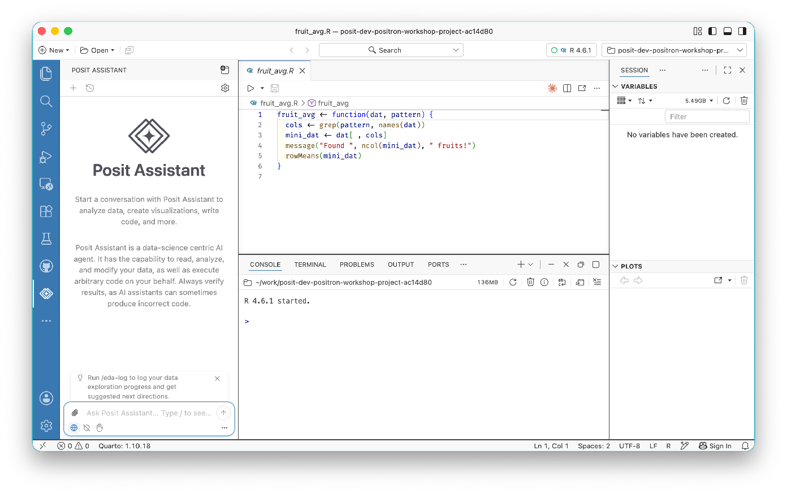
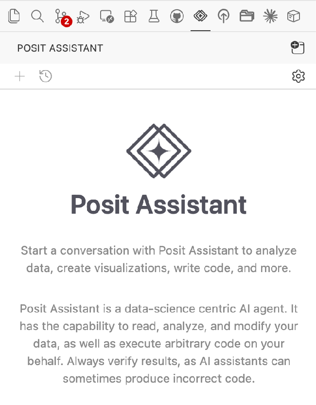
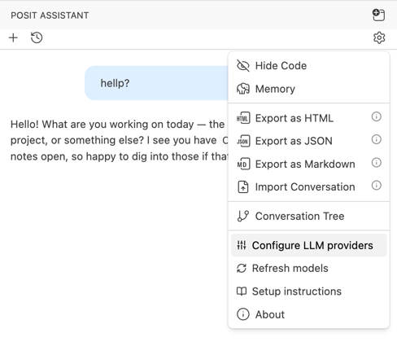
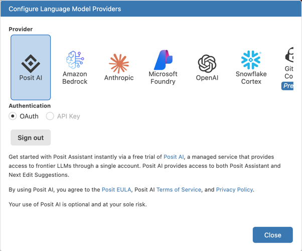
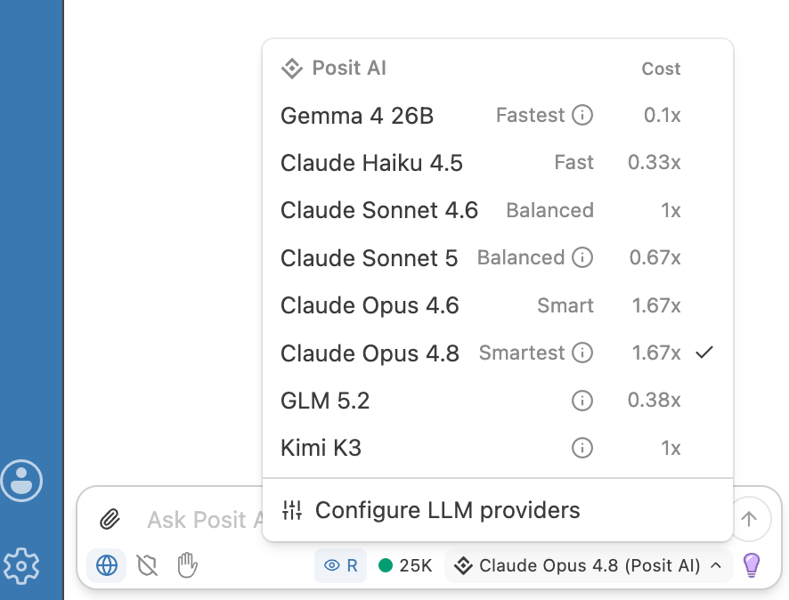

##

::::: columns
::: {.column width="30%"}
:::

::: {.column width="70%"}
### Learning objectives

**By the end of this session, you are able to:**

- Describe the main techniques for using LLMs to code

- Use autocomplete and Posit Assistant in Positron

- Configure a provider, a model and a thinking level in Posit Assistant

- Decide which coding tasks are suitable for an LLM, and how to check the result
:::
:::::

{.image-left}

## Using LLMs to code {.big}

## Main techniques

1. **[Web chat]{.remember}**: ask chatgpt.com or claude.ai for code, then copy and paste it

2. **[Inline autocomplete]{.remember}**: the model suggests the rest of your line while you type

3. **[In-IDE (Integrated Development Environment) chat]{.remember}**: the same chat, but inside your editor, so it can see your files

4. **[Agentic coding]{.remember}**: the model writes code, runs it, reads the result and tries again

. . .

Two things change as you move down the list:

- **Context**: how much of your work the model can see

- **Autonomy**: whether the model only suggests, or also acts

## Web chat

- You ask: *"Give me an R function that does ..."*

- You copy the code into your script, run it, copy the error back, ...

. . .

❌ It is easy for the chat and your code to get out of sync

❌ The model cannot see your data, your files or your R session

:::{.callout-note}
This is like copying results from Excel into Word before R Markdown and Quarto: every change means copying again.
:::

## Inline autocomplete

The model suggests how to finish what you are typing.

- Sometimes helpful, often not

- A useful skill today: **ignore the bad suggestions, accept the good ones**

. . .

In Positron, there are two providers:

| Provider | What it does |
|---|---|
| **Posit AI Next Edit Suggestions (NES)** | Suggests your next change anywhere in the file, based on your recent edits |
| **GitHub Copilot** | Suggests text at the cursor as you type |

## Autocomplete in Positron: practical use

- `Tab` accepts a suggestion; `Esc` (or continuing to type) dismisses it

- Both providers are on by default once you sign in

- Turn off NES: set `nextEditSuggestions.enable` to `{"*": false}`

- Turn off Copilot: set `positron.assistant.inlineCompletions.enable` to `{"*": false}`

- Keep files private: add them to `positron.assistant.aiExcludes`

:::{.callout-tip}
If the suggestions distract you, turn them off. You can still use chat.
:::

## In-IDE chat and agentic coding

**In chat, [you close the loop]{.remember}**: you run the code and decide what to do next.

**In agentic coding, [the model closes the loop]{.remember}**: it runs the code, reads the result and tries again.

. . .

| | In-IDE chat | Agentic coding |
|---|---|---|
| Who runs the code | You | The model |
| Steps per request | One | Many, until done or stuck |
| Your main effort | Every step | Reviewing the final result |
| Main risk | Slow and repetitive | Large changes you did not watch |

:::{.notes}
Example: "this function fails on missing values, fix it".
Chat: suggests a fix; I run it; it now fails on empty data frames; I ask again.
Agent: edits, runs test cases, finds the empty-data-frame failure itself, fixes it, reports back.
The agent only checks what it thinks to check: a wrong analytic choice can pass every step.
:::

## {.center}

{fig-align="center" width="95%"}

::: notes
Point to the Posit Assistant icon in the activity bar (left) and the chat panel it opens.
:::

## What about AI?

::::{.columns}

:::{.column width="55%"}
{height="40px" style="vertical-align: middle;"} **Posit Assistant** is an AI agent geared towards the needs of data scientists.

Available in Positron and RStudio (and the terminal).

<https://assistant.posit.co/>

<https://positron.posit.co/ai-features.html>
:::

:::{.column width="45%"}
{width="90%"}
:::

::::

## Configure a provider (or several)

::::{.columns}

:::{.column width="40%"}
{height="260px"}
:::

:::{.column width="60%"}
{height="260px"}
:::

::::

::: {.smaller}
- Settings (gear icon) → **Configure LLM providers**

- No provider access? See the Posit AI plans at [posit.ai](https://posit.ai/).

- GitHub Copilot is [free for students](https://docs.github.com/en/copilot/how-tos/copilot-on-github/set-up-copilot/enable-copilot/set-up-for-students).
:::

## Within a provider, you can access different models

{fig-align="center" width="70%"}

:::{.notes}
The model picker is at the bottom of the chat input. The cost column is relative to the default model.
:::

## Positron Assistant: Five Modes

| Mode | What it does | When to use |
|:---|:---|:---|
| **Normal** | Edits code with approval for most changes | Everyday coding and debugging |
| **Plan** | Explores and proposes a solution without editing | Designing an analysis workflow |
| **Auto** | Takes actions autonomously, seeking approval based on risk | Multi-step coding tasks |
| **Cleaning** | Audits data and asks for cleaning decisions | Data quality and preparation |
| **Ask** | Read-only; explains code without executing it | Learning and understanding code |

::: {.callout-tip}
**Which mode?** Ask to learn · Plan to design · Normal to code · Auto to delegate · Cleaning to prepare data
:::

## Working with Posit Assistant

- **Give context**: reference a file or folder with `@`; attach or drag in images

- **Manage memory**: start a new conversation with `/clear`; keep longer context in `AGENTS.md` and a plan file (`/plan`)

- **Use built-in workflows**: `/report` creates a Quarto report; `/eda-log` logs your exploratory analysis

- **Choose cost and quality**: model and thinking level

## Which coding tasks suit an LLM?

::: {.smaller}

| | Tasks | Why |
|---|---|---|
| ✅ **Strong** | Translation, explaining unfamiliar code, debugging from an error message, writing tests, boilerplate | Information is complete, or the result is easy to check |
| ⚠️ **With care** | Refactoring, documentation, code from a description | The model fills gaps with plausible defaults |
| ❌ **Weak** | Statistical correctness, recent or niche package functions, analytic decisions | Errors look plausible and are hard to detect |

:::

. . .

**Rule:** use an LLM where the task is fully specified, or the output is cheap to check.

## Good blog posts to develop understanding

- Hadley Wickham's substack [Tidy design principles](https://tidydesign.substack.com/)\*

    - [What is an agent?](https://tidydesign.substack.com/p/what-is-an-agent)

    - [Your LLM can't math (and that's ok)](https://tidydesign.substack.com/p/your-llm-cant-math-and-thats-ok)

    - [A coding agent is six functions in a trenchcoat](https://tidydesign.substack.com/p/a-coding-agent-is-six-functions-in)

    - [Help! My coding agent can run code](https://tidydesign.substack.com/p/help-my-coding-agent-can-run-code)

    - Etc.

[\* The name does not reflect the content very well!]{.footnote}

## References & resources {background-image="https://images.unsplash.com/photo-1550399105-05c4a7641b02?ixlib=rb-1.2.1&ixid=MnwxMjA3fDB8MHxwaG90by1wYWdlfHx8fGVufDB8fHx8&auto=format&fit=crop&w=774&q=80" background-size="contain" background-position="right"}

:::::: columns
:::: {.column width="60%"}
::: r-fit-text

- [Posit Assistant](https://assistant.posit.co/)

- [Positron AI features](https://positron.posit.co/ai-features.html)

- [What's new with Posit AI](https://docs.posit.co/posit-ai/whats-new/)

- [A brief and biased history of Posit data science agents](https://opensource.posit.co/blog/2026-06-11_history-of-posit-data-science-agents/)

- [Tidy design principles (substack)](https://tidydesign.substack.com/)

Slides on Posit Assistant adapted from Posit Software, PBC, [CC BY-SA 4.0](https://creativecommons.org/licenses/by-sa/4.0/).

:::
::::

::: {.column width="40%"}
:::
::::::

# Any questions or thoughts? 💬

{fig-align="center"}
