```{r}
#| label: setup
#| include: false
library(tidyverse)
library(fontawesome)
library(gapminder)
library(ggthemes)
library(GGally)
library(skimr)
library(corrr)
library(here)
library(tidymodels)
```

## 

::::: columns
::: {.column width="30%"}
:::

::: {.column width="70%"}
### Learning objectives

**By the end of this session, you are able to:**

::: incremental
- Understand how Machine Learning algorithms work

- Differentiate between supervised and unsupervised learning, and between prediction and inference goals.

- Explain the bias-variance trade-off and why minimizing Test MSE is preferred over Training MSE.

- Apply Simple and Multiple Linear Regression to estimate relationships between predictors and responses.
- Interpret regression coefficients and evaluate model accuracy.

- Extend linear models using interaction terms and identify potential issues like non-linearity or collinearity.
:::

:::
:::::

{.image-left}


## Data Science Workflow

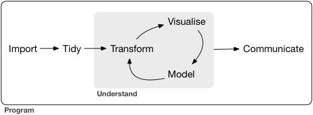

## The Advertising Example

Consider a company that sells a consumer product across 200 regional markets.  

For each market, the `sales` outcome is recorded, along with advertising budgets in `TV`, `radio`, and `newspaper`.

The company cannot directly change sales, but it `can` control its advertising expenditures.  

It wants to understand how these three media channels drive sales and how to allocate budgets effectively.

## Advert data

```{r}
#| label: advertising-data
#| echo: false

advertising <- read_csv(here("data/advertising.csv"))
advertising
```


## Advertising Data- Scatterplots

```{r}
#| label: advertising-scatterplots
#| echo: false
library(ggplot2)
library(patchwork)

# example data frame (replace with your actual data frame name)
# advertising <- read.csv("Advertising.csv")

p1 <- ggplot(advertising, aes(x = TV, y = sales)) +
  geom_point() +
  geom_smooth(method = "lm", se = FALSE, color = "blue") +
  labs(x = "TV", y = "sales")

p2 <- ggplot(advertising, aes(x = radio, y = sales)) +
  geom_point() +
  geom_smooth(method = "lm", se = FALSE, color = "blue") +
  labs(x = "Radio", y = "sales")

p3 <- ggplot(advertising, aes(x = newspaper, y = sales)) +
  geom_point() +
  geom_smooth(method = "lm", se = FALSE, color = "blue") +
  labs(x = "Newspaper", y = "sales")

# arrange plots in one row
(p1 + p2 + p3) & ggthemes::theme_few()

```


## Why Visualization Alone Is Not Enough

Visualization helps us see relationships between `sales` and `TV, media, and newspapaer` advertising budget.

[But visualisation cannot scale.]{.remember}

Visualisation cannot answer:

- How much extra sales we expect from an additional $£1,000$ in TV?
- Whether reallocating budget from newspaper to radio increases sales?
- How accurate predictions will be in unseen markets?

To answer such questions, we need `(Machine Learning) models` that estimate the relationship.

## Terminologies: Inputs and Outputs in the Advertising Example

In the advertising dataset, `TV, radio, newspapaer`, are an `input variables`, `sales` is an `output` variable.  

These input variables are referred to by several interchangeable names: `predictors`, `independent variables`, `features`, or simply `variables`.  

The `output` variable—here, sales—is often called the `response`, `outcome`, `target` or `dependent variable`, and we denote it by $Y$.

We typically denote inputs using the symbol $X$, with subscripts to distinguish them. Thus, $X_1$ represents TV budget, $X_2$ the radio budget, and $X_3$ the newspaper budget.

## A General Framework

More broadly, we consider a quantitative response $Y$ and $p$ different predictors  
$X_1, X_2, \ldots, X_p$. 

We assume there is some relationship linking the response to the predictors, written in the general form

$$
Y = f(X) + \epsilon
$$

where $X = (X_1, X_2, \ldots, X_p)$.  

The function $f$ is fixed but unknown, and $\epsilon$ is a random error term that is independent of the predictors and is normally distributed with mean zero and standard deviation of $\sigma$.

In this expression, $f$ captures the `systematic information` that the predictors provide about the response, while $\epsilon$ represents the unpredictable variation, i.e., `irreducible error`, that remains even after accounting for $X$.


# What is Machine Learning?

Machine learning is a set of tools for understanding data. We assume a relationship:

$$
Y = f(X) + \epsilon
$$

Here, $f(X)$ is an unknown function, and accounts for systematic information and $\epsilon$ represents irreducible error. Training data provide observations used to estimate $f(X)$.

## Why Do We Estimate $f$?

Since the true function $f$ is unknown, our task is to use data to construct an estimate $\hat{f}$ that captures the relationship between the predictors and the response. Once we have $\hat{f}$, we can use it for two main purposes:

 - **Prediction** of new responses

 - **Understanding** of how predictors relate to the response. 

## Prediction

Given new values of $X$, we can compute $\hat{f}(X)$ to predict the corresponding value of $Y$. 

Even with a perfect estimate, the random error term $\epsilon$ means that predictions can never be exact.

## Understanding/Inference

By studying the shape of $\hat{f}$, we learn how $Y$ changes as the predictors change. 

This helps us identify important predictors, quantify their effects.

In every case, $\epsilon$ represents the variation that `cannot` be explained by the predictors—this is the irreducible error that no method can eliminate.


## Using ML for Inference: The Advertising Example

The Advertising data allow us to ask questions about *how* advertising affects sales.  

When our goal is **inference**, we use models to understand the underlying relationships:

- Which media channels (TV, radio, newspaper) are associated with sales? 

- Are there diminishing returns or interactions between the media?

Inference focuses on interpreting the model and explaining the mechanisms behind the data.


## Using Models for Prediction: The Advertising Example

Models are also essential when our goal is `prediction`.  
Given advertising budgets for a new market, we want to accurately forecast future sales.  

Here, the main question is:

- How well can we predict sales from TV, radio, and newspaper spending?

In this predictive setting, we care less about the exact form of the relationship and more about producing reliable estimate for unseen markets.  


## How Do We Estimate $f$?

To estimate the unknown function $f$, we begin with a set of $n$ observed data points—our [training data]{.remember} 

These are the observations we use to teach the method how to approximate the relationship between predictors and the response. 

For each observation $i = 1, \ldots, n$, we record the predictor values $(x_{i1}, x_{i2}, \ldots, x_{ip})$ and the response $y_i$. 

We can write each training pair as $(x_i, y_i)$, where $(x_i = (x_{i1}, \ldots, x_{ip})^{T})$.

The goal is to use these training observations to construct an estimate $\hat{f}$ such that  

$$
Y \approx \hat{f}(X)
$$


## How Do We Estimate $f$?


- For any new or existing observation $(X, Y)$;

- Across any methods, the central task is always the same: 

    - use the data to find a function $\hat{f}$ that captures the systematic relationship between inputs and output. 

- Broadly, the methods for estimating $f$ fall into two major families: i) `parametric approaches`, and `non-parametric` ones.


## Parametric Methods

Parametric methods estimate $f$ by assuming a specific functional form and then fitting that form to the data. The process begins with a model-based assumption, such as a linear relationship:

$$
f(X) = \beta_0 + \beta_1 X_1 + \cdots + \beta_p X_p,
$$

which reduces the task from estimating an arbitrary function to estimating the $p+1$ parameters $(\beta_0, \ldots, \beta_p)$. 

## Parametric Methods

- Once the form is chosen, we fit the model to the training data using a procedure such as **ordinary least squares**, obtaining parameter estimates that make the model’s predictions close to the observed responses.

- This approach greatly simplifies estimation but comes with a trade-off.

        - If the chosen functional form poorly matches the true relationship, the resulting estimate may be inaccurate. 

- More flexible parametric models can capture a wider range of shapes but require estimating more parameters, increasing the risk of **overfitting**, where the model starts to follow noise rather than the underlying signal.


## Example: A Parametric Model for the Advertising Data 

- Suppose we assume that sales depends linearly on the three media budgets:

$$
\text{sales} \approx \beta_0 + \beta_1 \, \text{TV} + \beta_2 \, \text{Radio} + \beta_3 \, \text{Newspaper}.
$$

::: incremental
- Once we make this linearity assumption, the entire estimation problem reduces to finding the four parameters $(\beta_0, \beta_1, \beta_2, \beta_3)$. 

- Using **ordinary least squares**, we estimate these coefficients so that the fitted model’s predictions are as close as possible to the observed sales across the 200 markets.

- This example illustrates the essence of the parametric approach: by specifying a functional form, we convert the general task of estimating an unknown function $f$ into the more manageable job of estimating a small number of parameters.
:::

## Ordinary least squares

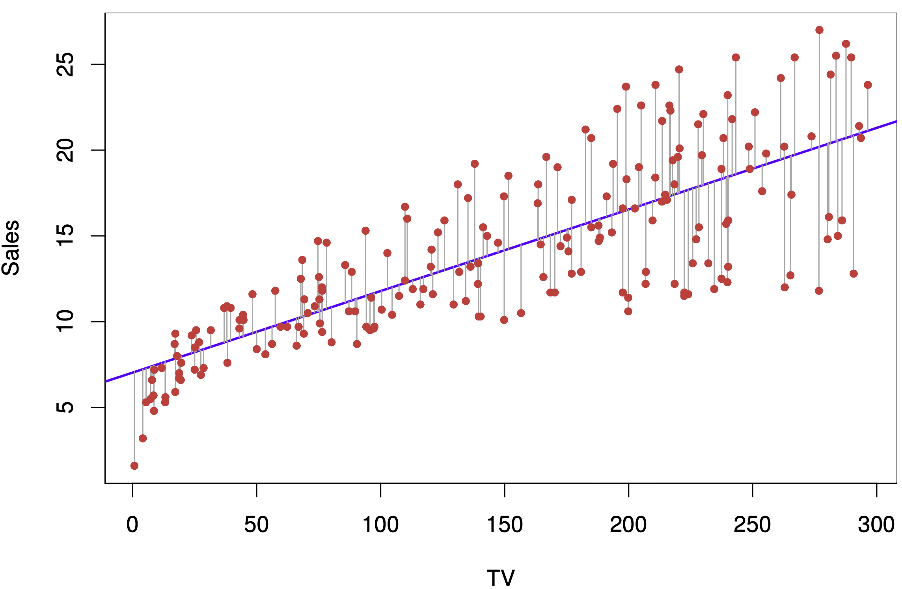

<!-- ## Non-Parametric Methods

- Non-parametric methods avoid specifying a particular functional form for $f$. 

- Instead of assuming a model such as a linear relationship, these approaches estimate $f$ by allowing the data to determine its shape as flexibly as needed. 

::: incremental
- This flexibility enables non-parametric methods to capture a wide variety of patterns and structures that parametric models might miss if their assumed form is incorrect.

- The strength of this approach is that it removes the risk of choosing the wrong functional form; with no rigid structure imposed on $f$, the fitted relationship can adapt closely to the data. 

- However, this flexibility comes at a cost. Because non-parametric methods do not simplify the estimation problem to a small set of parameters, they typically require **many more observations** and takes more time to run. 
::: -->

## Interpretable vs. Flexible Methods

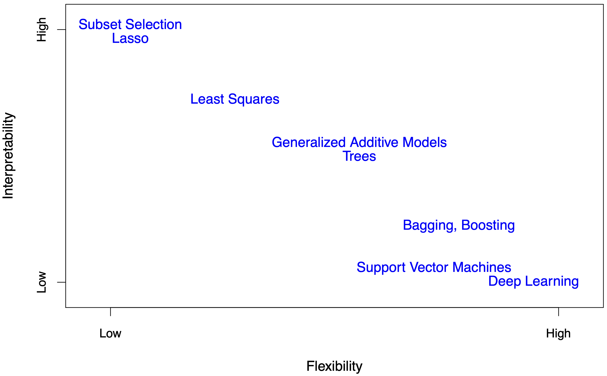{.image-center width="600px"}


##  Machine learning approaches

::::{.columns}
:::{.column}
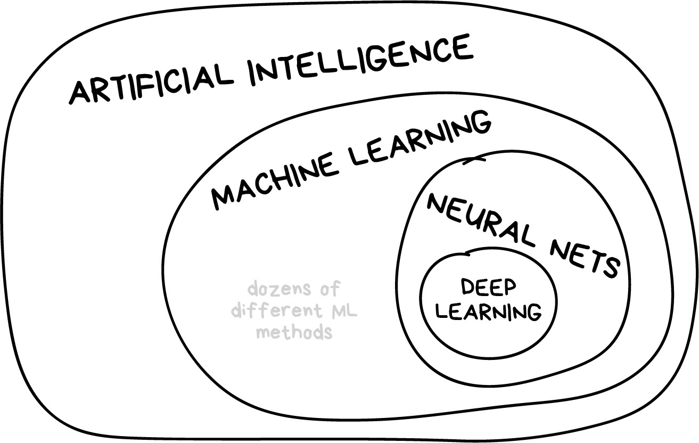
:::

:::{.column}
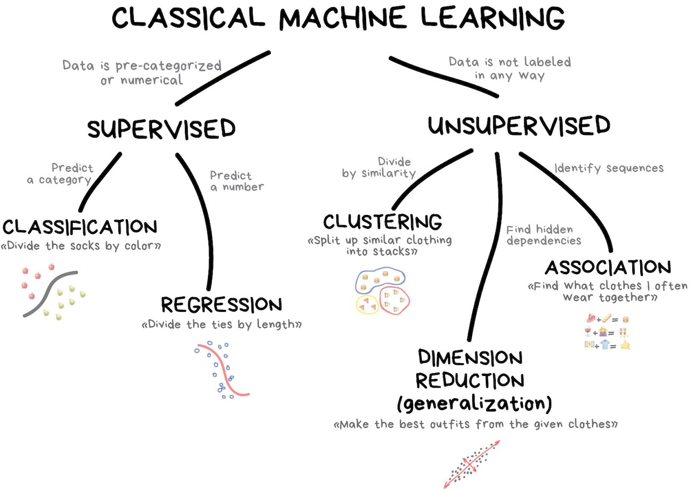
:::

::::

## Supervised vs. Unsupervised Learning {.smaller}

**`Supervised learning`**

- Each observation provides predictors $x_i$ and a response $y_i$.  
- The goal is to learn how $y$ depends on $x$ for prediction or inference.  
- Methods include linear regression, logistic regression, GAMs, boosting, and support vector machines.  
- Most of statistical learning—including much of this course—focuses on this setting.

::: fragment

**`Unsupervised learning`**

- We observe predictors $x_i$ but **`no`** response values $y_i$. 
- The task is exploratory: find patterns or structure in the data.  
- A common tool is **`clustering`**, which groups observations based on similarity.  
- Example: segmenting customers by income, location, and shopping habits when spending labels are unavailable.
:::

## Examples of Supervised and Unsupervised Learning {.smaller}


**`Supervised learning examples`**

- Predicting **`sales`** from TV, radio, and newspaper budgets using linear regression.  
- Classifying whether a **`tumor is malignant or benign`** using patient features in a logistic regression.

::: fragment

**`Unsupervised learning examples`**

- **`Clustering customers`** into groups based on income, location, and shopping behavior for market segmentation.  
- Applying **`PCA`** to reduce dimensionality and uncover major patterns in a gene expression data set without response labels.
:::

## How Do You Know if a Model is Good?

- No single method works best on all data sets—there is `no free lunch`.
- A method that performs well on one data set may perform poorly on another.  
- Therefore, choosing the best method for a given problem is a critical part of Machine Learning.  
- To make this choice, we need a principled way to measure how well a model performs:

    - On the training (in-sample) data used to fit the model. How good a model fitting is?
    - On previously unseen test (out-of-sample) data. How accurate the model is?

## Measuring the Quality of Fit

- We evaluate a model by comparing its predictions to the observed responses.  
- In regression, the key metric is **Mean Squared Error (MSE)**:  

$$
  MSE = \frac{1}{n} \sum_{i=1}^n (y_i - \hat{f}(x_i))^{2}.
$$

- This value is computed on the **training data** used to fit the model.  
- A small training MSE means the model matches the training observations well.  
- But training performance is not what we ultimately care about.


## Measuring Model Accuracy Using Test Data

- `Training error` shows how well a `model fits the data` used to train it, but this often **overestimates performance**.  
- To understand real predictive ability, we evaluate the model on **`previously unseen data`**.  
- `Test (out-of-sample)` MSE measures average prediction error on new observations:  
  $$
  \text{Test MSE} = \text{Ave}(y_0 - \hat{f}(x_0))^2.
  $$
- A good model has **low test error**, even if its training error is not the smallest.  
- Test error captures the model’s ability to **`generalise`** beyond the data used for estimation.


## Training MSE vs. Test MSE

- Our real goal is good performance on **unseen test data**.  
- Training MSE can be very misleading
    - A model with very low training MSE may generalise poorly to new observations. This is `Overfitting`.
- **Test MSE** measures average prediction error on new data:  
$$
  \text{Test MSE} = \text{Ave}(y_0 - \hat{f}(x_0))^2.
$$

- The best method is the one with the **`lowest test MSE`**, not the lowest training MSE.


## Examples of Training vs. Test MSE

::::{.columns}

::: {.column width="50%"}
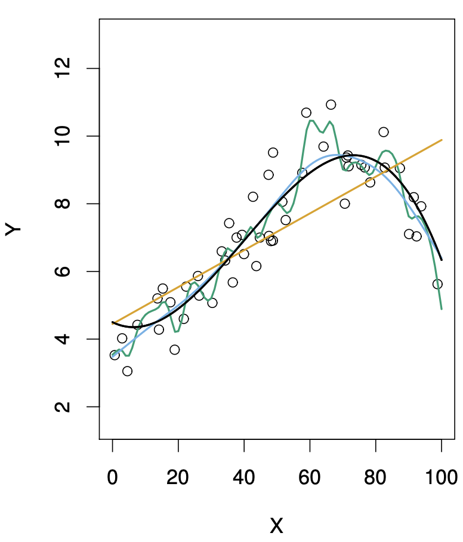
:::

::: {.column width="50%"}
::: {.fragment}
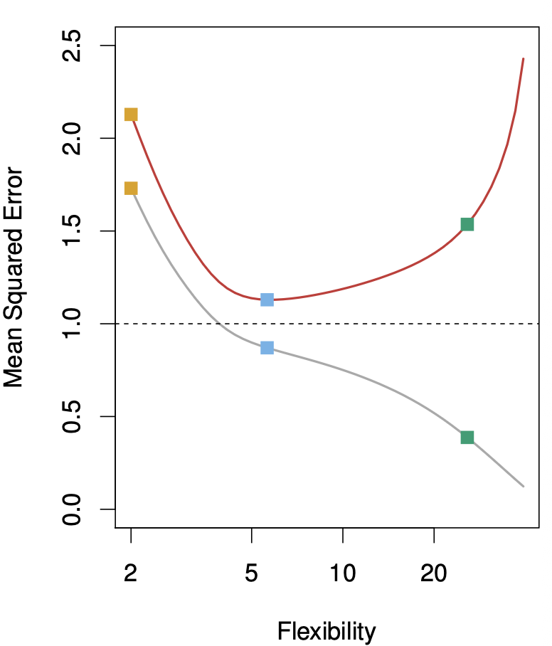
:::
:::

:::::


## Examples of Training vs. Test MSE

::::{.columns}

::: {.column width="50%"}
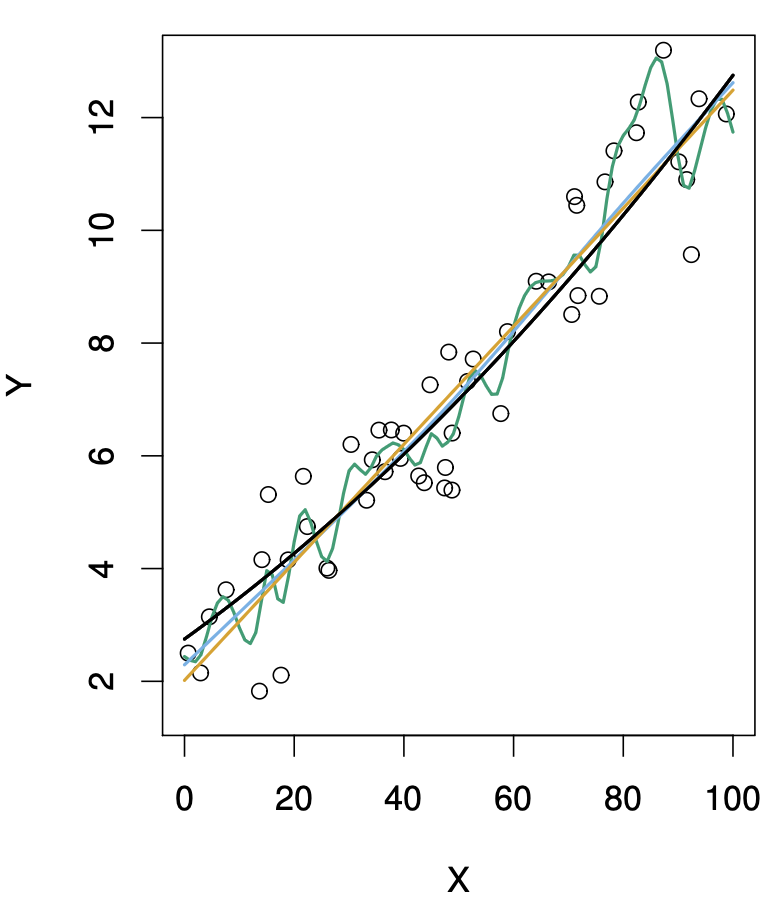
:::

::: {.column width="50%"}
::: {.fragment}
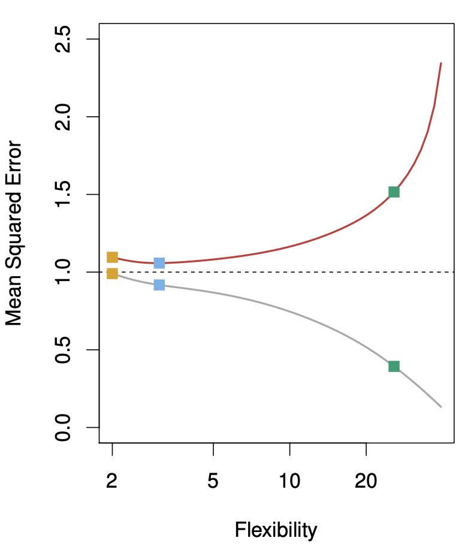
:::
:::

:::::

## Examples of Training vs. Test MSE

::::{.columns}

::: {.column width="50%"}
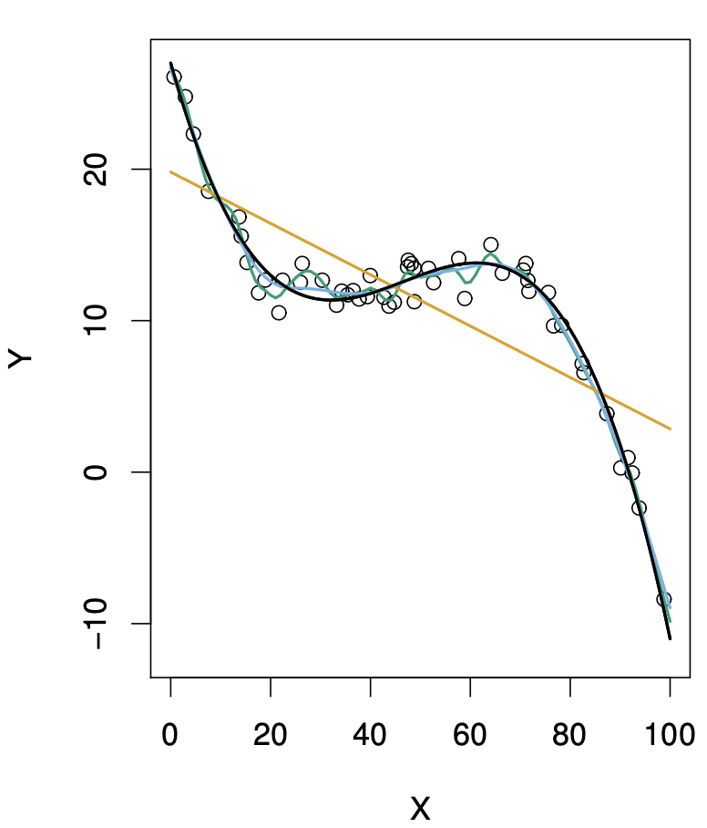
:::

::: {.column width="50%"}
::: {.fragment}
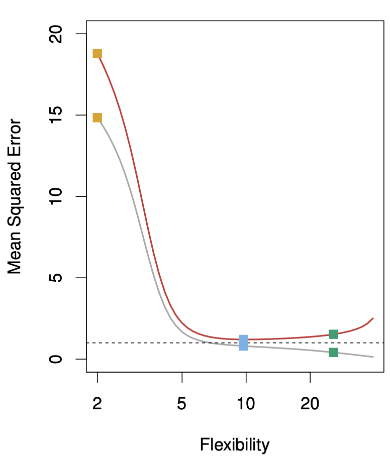
:::
:::

:::::


## The Bias–Variance Trade-Off

- The **expected test MSE** can be decomposed as  
$$
  \text{Var}(\hat f(x_0)) + \text{Bias}^2(\hat f(x_0)) + \text{Var}(\epsilon).
$$

::: incremental

- **Bias** reflects error from approximating a complex truth with a simpler model.  
  - Simple, rigid models (e.g., linear regression) → **high bias**, low flexibility.
- **Variance** measures how much $\hat f$ would change with a different training set.  
  - Highly flexible models → **high variance**, sensitive to noise.
- As **flexibility increases**, bias decreases but variance increases.  
  - Test MSE decreases at first, then increases → **U-shaped curve**.
- Overly flexible models overfit: low training MSE but poor test MSE.  
- Good performance requires balancing low bias **and** low variance. This balance is the core of the **bias–variance trade-off**.
:::

## Variance Bias Tradeoff vs. Model Complexity

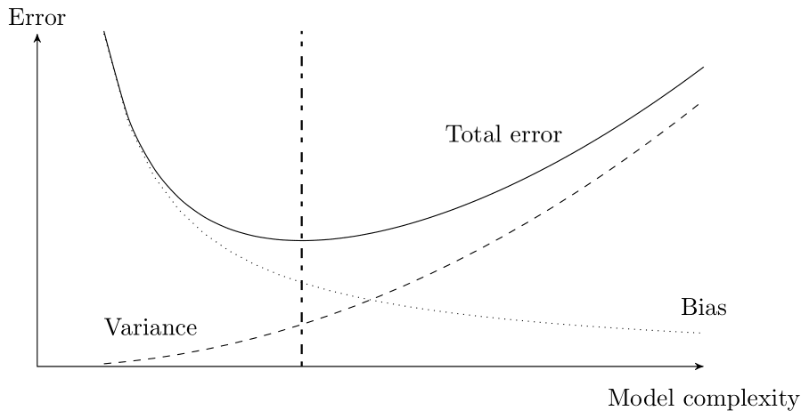{.image-center width="600px"}

## MSE, Bias and Variance for three Models

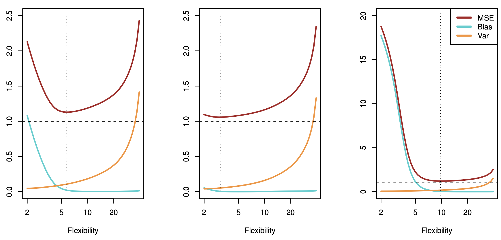{.image-center width="600px"}


# {.big}

Regression


## Why Study Linear Regression?


Linear regression is a foundational supervised learning method for predicting quantitative responses.

::: incremental
 - TWe often need to understand how inputs relate to an outcome and how to make informed predictions. 
 
 - From the Advertising data, Key questions include:

    - **Is there a relationship** between advertising budgets and sales?  
    - **How strong** is this relationship—does knowing the budget help predict sales well?  
    - **Which media matter most** (TV, radio, newspaper), and how do we separate their individual contributions?  
    - **How large is the effect** of each medium—how much do sales increase per dollar spent?  

- These questions motivate the linear regression framework.
:::

## Simple Linear Regression

Simple linear regression provides a straightforward way to predict a quantitative response $Y$ using a single predictor $X$. The method assumes that $Y$ and $X$ have an approximately linear relationship. We express this as

$$
Y \approx \beta_0 + \beta_1 X.
$$

For example, if $X$ represents TV advertising and $Y$ represents sales, we model  
$$
\text{sales} \approx \beta_0 + \beta_1 \times \text{TV}.
$$

::: fragment
Here, $\beta_0$ and $\beta_1$ are unknown model coefficients: $\beta_0$ is the intercept and $\beta_1$ is the slope. After fitting the model using training data, we obtain estimates $\hat{\beta}_0$ and $\hat{\beta}_1$. We can then predict the response at a new value $X = x$ using

$$
\hat{y} = \hat{\beta}_0 + \hat{\beta}_1 x.
$$
:::

## Assumptions - Linearity

The standard linear regression model is widely used and highly interpretable, but it relies on two restrictive assumptions that are often violated in practice.

- A one-unit change in $X_j$ is assumed to produce a **constant change** in $Y$, regardless of the value of $X_j$. 

- The relationship between $X_j$ and $Y$ is assumed to follow a straight line.


## Assumptions - Additivity


- The effect of each predictor $X_j$ on the response $Y$ is **independent** of the values of the other predictors.  
- Formally, in the model  
  $$
  \mathbb{E}[Y \mid X] = \beta_0 + \beta_1 X_1 + \cdots + \beta_p X_p,
  $$
  the contribution of $X_j$ does not change depending on the levels of $X_k$ for $k \neq j$.  
- This rules out **interactions** unless explicitly added to the model.

## Estimating the Coefficients

In simple linear regression, the coefficients $\beta_0$ and $\beta_1$ are unknown and must be estimated from data. Suppose we observe $n$ pairs  
$(x_1, y_1), (x_2, y_2), \ldots, (x_n, y_n)$, each containing a measurement of the predictor $X$ and the response $Y$. 

In the Advertising example, these pairs correspond to TV advertising budgets and product sales across $n = 200$ markets.

::: fragment
Our goal is to find estimates $\hat{\beta}_0$ and $\hat{\beta}_1$ such that the linear model

$$
Y \approx \beta_0 + \beta_1 X
$$

fits the observed data well, meaning $y_i \approx \hat{\beta}_0 + \hat{\beta}_1 x_i$ for all $i = 1, \ldots, n$. 

We choose the line that is **closest** to the data points according to a chosen measure of fit. The most common approach is to minimize the **`least squares`** criterion, yielding coefficient estimates that produce the best-fitting line in the sense of minimizing the total squared prediction errors.
:::

## Least squares fit

{.image-center width="600px"}


## Least Squares and the Residual Sum of Squares

For the Advertising data, the least squares line for predicting sales from TV is obtained by minimizing how far the fitted line is from the data points. For each observation, the fitted value is  
$$
\hat{y}_i = \hat{\beta}_0 + \hat{\beta}_1 x_i,
$$
and the residual is  
$$
e_i = y_i - \hat{y}_i,
$$
the difference between the observed and predicted response. The **residual sum of squares (RSS)** is  
$$
RSS = e_1^2 + e_2^2 + \cdots + e_n^2
      = \sum_{i=1}^n (y_i - \hat{\beta}_0 - \hat{\beta}_1 x_i)^2.
$$

## Least Squares

The least squares estimates $\hat{\beta}_0$ and $\hat{\beta}_1$ are the values that minimize the RSS. They are given by  
$$
\hat{\beta}_1 = 
\frac{\sum_{i=1}^n (x_i - \bar{x})(y_i - \bar{y})}
     {\sum_{i=1}^n (x_i - \bar{x})^2},
\qquad
\hat{\beta}_0 = \bar{y} - \hat{\beta}_1 \bar{x}.
$$

For the Advertising data, the fitted model is  
$$
\hat{y} = 7.03 + 0.0475\,TV,
$$
indicating that an additional \$1,000 in TV advertising is associated with roughly **47.5 more sales units**.


## Assessing the Accuracy of a Model

$R^2$ Statistic

- Measures the **proportion of variance explained** by the model.  
- Defined as  
  $$
  R^2 = 1 - \frac{RSS}{TSS},
  $$
  where $TSS = \sum_{i=1}^n (y_i - \bar{y})^2$.  
- Always between 0 and 1; larger values indicate better fit.  
- In the Advertising example, $R^2 = 0.61$, meaning TV advertising explains just under two-thirds of the variation in sales.
:::


## Multiple Linear Regression (MLR)

- Simple linear regression uses one predictor, but many real problems involve multiple predictors. 

- In the Advertising data, sales may depend not only on TV spending but also on radio and newspaper advertising. Fitting separate simple regressions for each medium is unsatisfactory because each model ignores the other predictors and cannot produce a unified prediction.

::: fragment
A better approach is **multiple linear regression**, which includes all predictors in a single model. With $p$ predictors, the model is

$$
Y = \beta_0 + \beta_1 X_1 + \beta_2 X_2 + \cdots + \beta_p X_p + \epsilon,
$$

where $\beta_j$ measures the average change in $Y$ for a one-unit increase in $X_j$, holding all other predictors fixed.

For the Advertising data, the model becomes

$$
\text{sales} = \beta_0 
+ \beta_1 \times \text{TV} 
+ \beta_2 \times \text{radio} 
+ \beta_3 \times \text{newspaper} 
+ \epsilon.
$$

:::

## Estimating Coefficients in MLR

In the multiple linear regression model, the coefficients $\beta_0, \beta_1, \ldots, \beta_p$ are unknown and must be estimated from the data. 

Given estimates $\hat{\beta}_0, \hat{\beta}_1, \ldots, \hat{\beta}_p$, predictions are made using

$$
\hat{y} = \hat{\beta}_0 + \hat{\beta}_1 x_1 + \hat{\beta}_2 x_2 + \cdots + \hat{\beta}_p x_p.
$$

The coefficients are chosen to minimize the **residual sum of squares (RSS)**,

$$
RSS = \sum_{i=1}^n (y_i - \hat{y}_i)^2 
     = \sum_{i=1}^n (y_i - \hat{\beta}_0 - \hat{\beta}_1 x_{i1} - \cdots - \hat{\beta}_p x_{ip})^2.
$$


## Deciding on Important Variables

After determining that at least one predictor is associated with the response, we often want to identify **which** predictors matter. This task is known as **variable selection**. 

In practice, the response is usually related to only a subset of the predictors, so choosing the right variables is essential.

::: fragment
**`Why not fit all possible models?`**  

- With $p$ predictors, there are $2^p$ possible subsets.  
- Feasible for small $p$ (e.g., $p=2$ gives 4 models), but impossible for moderate or large $p$ (e.g., $p=30$ gives over a billion models).  
- Instead, we use automated, efficient strategies to explore a smaller set of candidate models.
:::

## Classical variable-selection approaches

- `Forward selection:` Start with no predictors, add the variable that most improves the fit, and continue adding until a stopping rule is met.  

- `Backward selection:` Start with all predictors, remove the least significant one, and continue removing until only important variables remain.  

- `Mixed (stepwise) selection:` Combine forward and backward steps, adding useful predictors and removing those whose p-values become large.

These approaches help identify a manageable subset of predictors that provide a strong, interpretable model without examining all $2^p$ possibilities.


## Model Fit in MLR

Model fit is commonly assessed using **$R^2$**, interpreted in the same way as in simple linear regression. 

In multiple regression, $R^2$ equals the squared correlation between the response $Y$ and the fitted values $\hat{Y}$, and the fitted linear model maximizes this correlation among all linear models.

## Interpreting $R^2$

::: incremental
- $R^2$ near 1 means the model explains a large share of the variability in $Y$.  

- for the Advertising data, using TV, radio, and newspaper yields  
  $R^2 = 0.8972$, while using only TV and radio gives $R^2 = 0.89719$ — essentially no improvement from adding newspaper. 

- **$R^2$ always increases** when predictors are added, even if they are not useful, because adding predictors always decreases RSS on the training data.
:::

## Predictions in Multiple Linear Regression

Once we fit a multiple regression model, predictions follow from  
$$
\hat{Y} = \hat{\beta}_0 + \hat{\beta}_1 X_1 + \cdots + \hat{\beta}_p X_p.
$$

::: fragment
However, three sources of uncertainty affect any prediction:

- `Uncertainty` in the coefficient estimates (reducible error)

  - The estimates $\hat{\beta}_0, \hat{\beta}_1, \ldots, \hat{\beta}_p$ are only approximations of the true $\beta$’s.  

- `Model bias`

  - The linear model is usually only an approximation to reality.  

- `Irreducible error` in individual outcomes

  - Even if we knew the true $f(X)$, the response varies because of $\epsilon$.  
:::

## Qualitative Predictors in Linear Regression

Not all predictors in a regression model are quantitative; many real data sets contain **qualitative (categorical)** variables. These must be converted into `factor form` in R before being included in a linear regression model.

::: fragment
- When a qualitative predictor has **two levels**, it can be incorporated into the regression easily by creating a **dummy variable** (indicator).  
- For a variable like *own* (whether a person owns a house), we create
  $$
  x_i =
  \begin{cases}
  1, & \text{if the $i$th person owns a house}, \\
  0, & \text{if the $i$th person does not own a house}.
  \end{cases}
  $$
- This dummy variable can then be used just like any quantitative predictor.

- Dummy-variable encoding allows qualitative features to influence the regression line and enables comparisons between groups.
:::

## Extensions of the Linear Model

- The standard linear regression model assumes that predictor effects are **additive** and **linear**.  

    - Additivity means the effect of $X_j$ on $Y$ does not depend on other predictors.  

    - Linearity means a one-unit increase in $X_j$ changes $Y$ by a constant amount.

- These assumptions are often too restrictive, and interaction terms provide a classical way to relax them.

## Extensions of the Linear Model: Interactions

**Motivation: synergy between predictors**  

In the Advertising data, TV and radio each increase sales, but the effect of TV may depend on radio spending.

::: fragment
`Interaction terms`  
Adding a product term allows the effect of one predictor to depend on another:
$$
Y = \beta_0 + \beta_1 X_1 + \beta_2 X_2 + \beta_3 X_1 X_2 + \epsilon.
$$
Rewriting,
$$
Y = \beta_0 + (\beta_1 + \beta_3 X_2) X_1 + \beta_2 X_2 + \epsilon,
$$
shows that the slope for $X_1$ changes with $X_2$, and vice versa.
:::


##  Examples of interaction - Advertising

  Including **TV × radio** dramatically improves fit ($R^2 = 96.8\%$ vs. $89.7\%$), with the interaction term highly significant.
- Factory productivity:  

  - The effect of adding a production line depends on the number of workers.

- Mixed quantitative–qualitative interactions:

  - For predicting credit card balance, an interaction between *income* and *student* status allows different slopes for students and non-students.

**`Hierarchical principle`**  
If an interaction $X_1 X_2$ is included, the main effects $X_1$ and $X_2$ should also be included, even if their individual p-values are not significant.


## Non-linear Relationships

The standard linear model assumes a straight-line relationship between predictors and the response, but many real relationships are curved. A simple way to extend the linear model is to include **non-linear transformations** of predictors while keeping the model linear in the coefficients.

`Polynomial regression`


- A quadratic model introduces curvature while remaining a linear regression:
  $$
  \text{mpg} = \beta_0 + \beta_1 \cdot \text{x} + \beta_2 \cdot \text{x}^2 + \epsilon.
  $$

- This is simply multiple linear regression with predictors $X_1 = X_1$ and $X_2 = \text{X2}^2$. 

- If relationshop is not linear, The quadratic fit or other transformations, may improves performance!


## Potential Problems in Linear Regression

When fitting a linear regression model, a number of issues can arise that affect interpretation, inference, and predictive accuracy. Common problems include:

- **`Non-linearity`**: The true relationship between predictors and the response may not be linear, leading to systematic model bias.  
- **`Correlated errors`**: Residuals may be dependent, violating independence assumptions.  
- **`Heteroscedasticity`**: The variance of the error terms may change with the level of the predictors, violating constant-variance assumptions.  
- **`Outliers`**: Unusual response values can distort coefficient estimates and reduce model reliability.  
- **`High-leverage points`**: Observations with extreme predictor values can disproportionately influence the fitted regression line.  
- **`Collinearity`**: Strong correlations among predictors can inflate standard errors and make coefficient estimates unstable.

Diagnosing and addressing these problems is critical for building reliable regression models.


## References & resources {background-image="https://images.unsplash.com/photo-1550399105-05c4a7641b02?ixlib=rb-1.2.1&ixid=MnwxMjA3fDB8MHxwaG90by1wYWdlfHx8fGVufDB8fHx8&auto=format&fit=crop&w=774&q=80" background-size="contain" background-position="right"}

<!-- ## References & resources -->

:::::: columns
:::: {.column width="60%"}
::: r-fit-text

- [Chp 2 Statistical Learning, Introduction to Statistical Learning ](https://www.statlearning.com/)📖

- [Chp 3 Statistical Learning, Learning Regression](https://www.statlearning.com/)📖

- [Tidymodelling with R](https://www.tmwr.org/ames)📖

:::
::::

::: {.column width="40%"}
:::
::::::

# Any questions or thoughts? 💬

{fig-align="center"}
