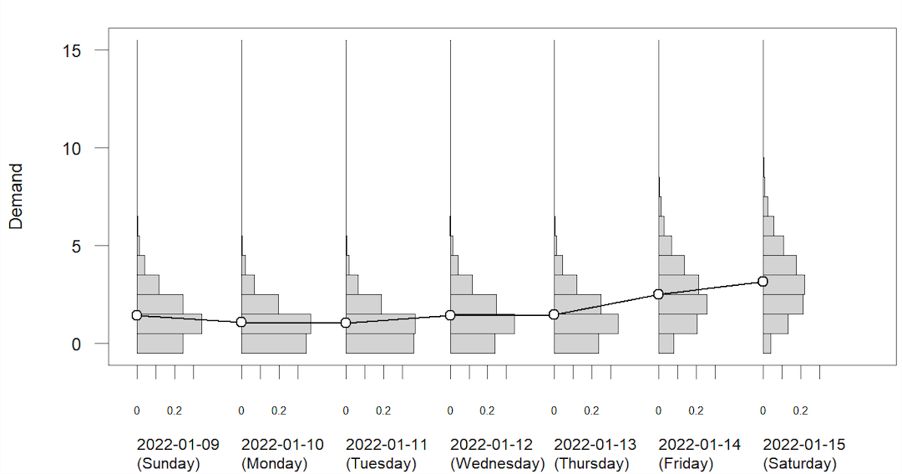
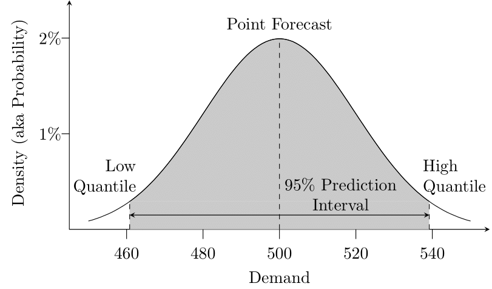
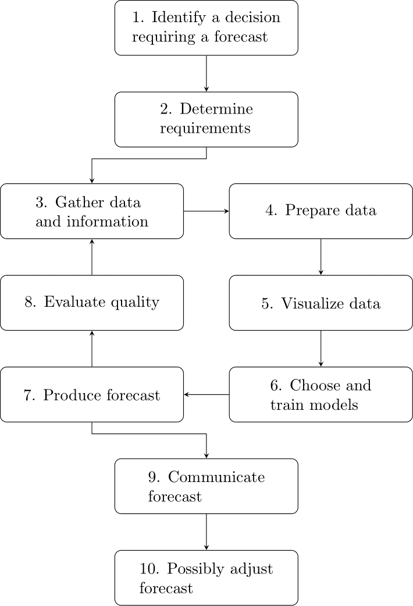
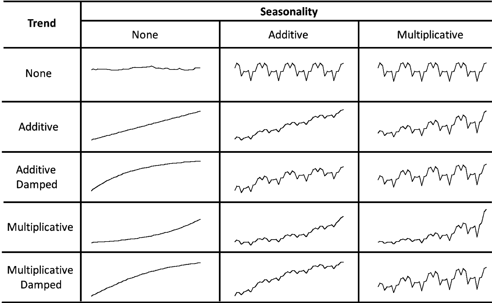
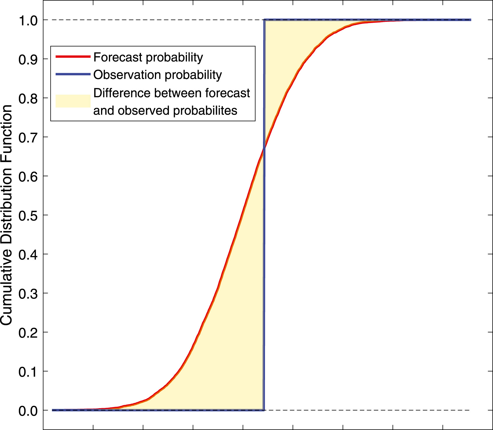

```{r}
#| label: setup
#| include: false
#| cache: false

library(fpp3)
library(tidyverse)
library(readxl)
library(patchwork)
ausbeer <- aus_production |> select(Beer)
```

```{r}
#| label: probabilistic_data
#| include: false
#| cache: false

h02 <- tsibbledata::PBS |>
  filter(ATC2 == "H02") |>
  summarise(Cost = sum(Cost))
melsyd <- tsibbledata::ansett |>
  filter(Airports == "MEL-SYD")

austa <- readxl::read_excel(here::here("data/340101.xlsx"), sheet = "Data1", skip = 9) |>
  rename(date = `Series ID`, value = A85375847A) |>
  select(date, value) |>
  transmute(
    Month = yearmonth(date),
    Visitors = value / 1e3
  ) |>
  bind_rows(tibble(
    Month = yearmonth(seq(as.Date("2021-11-01"), by = "1 month", length = 2)),
    Visitors = NA_real_
  )) |>
  as_tsibble(index = Month) |>
  filter(Month >= yearmonth("2000 Jan"))
```

## 

::::: columns
::: {.column width="30%"}
:::

::: {.column width="70%"}
### Learning objectives

**By the end of this session, you are able to:**

::: incremental
- Describe the forecasting workflow
- Identify factors affecting forecastability
- Describe forecasting methods
- Fit forecasting models using fable
- Produce forecasts using fable
- Evaluate forecast accuracy and residual diagnostics
- Visualise forecast distributions
:::

:::
:::::

{.image-left}

## What is a forecast?

Forecasting  is estimating how the sequence of observations will continue into the future based on all of the information available at the time when we generate the forecast.

```{r}
#| label: forecasting
#| out.width: "90%"
#| fig.align: 'center'
#| echo: false

ausbeer |> model(ETS(Beer)) |> forecast(h=20) |> autoplot(tail(ausbeer, 60), level=NULL, alpha=.01)+
  geom_vline(xintercept = as.numeric(as.Date("2010-04-01")),col="red", linetype = "longdash")+
  labs(x ="Time",y="Observation",title = "Forecasting")+ ggthemes::theme_few()
```

## What is a forecast?

```{r}
#| label: austa
#| echo: false
austa <- readxl::read_excel(here::here("data/340101.xlsx"), sheet = "Data1", skip = 9) |>
  rename(date = `Series ID`, value = A85375847A) |>
  select(date, value) |>
  transmute(
    Month = yearmonth(date),
    Visitors = value / 1e3
  ) |>
  bind_rows(tibble(
    Month = yearmonth(seq(as.Date("2021-11-01"), by = "1 month", length = 2)),
    Visitors = NA_real_
  )) |>
  as_tsibble(index = Month) |>
  filter(Month >= yearmonth("2000 Jan"))
# Grab ABS data
# Fit ETS model
fit <- austa |>
  filter(Month < yearmonth("2018 Jan")) |>
  model(ETS(Visitors))
# Product forecasts
fc <- forecast(fit, h = 48) |>
  mutate(Month = as.Date(Month))
# Simulate 100 future sample paths
set.seed(1967)
sim <- fit |>
  generate(h = 48, times = 100) |>
  mutate(
    replicate = factor(.rep, levels = 1:100, labels = paste("Future", 1:100)),
    .rep = as.numeric(.rep)
  ) |>
  as_tibble() |>
  mutate(Month = as.Date(Month))
# Nice colors
cols <- scale_colour_manual(
  values = c("#D55E00", "#0072B2", "#009E73", "#CC79A7", "#E69F00", "#56B4E9", "#F0E442", sample(rainbow(93))),
  breaks = paste("Future", 1:100),
  name = " "
)
# Now build up some plots with alignment
p1 <- austa |>
  mutate(Visitors = if_else(Month >= yearmonth("2018 Jan"), NA_real_, Visitors)) |>
  as_tibble() |>
  mutate(Month = as.Date(Month)) |>
  ggplot(aes(x = Month, y = Visitors)) +
  geom_line() +
  labs(
    x = "Month",
    y = "Thousands of visitors",
    title = "Total short-term visitors to Australia"
  ) +
  scale_x_date(
    breaks = seq(as.Date("2000-01-01"), by = "5 years", l = 5),
    labels = paste("Jan", seq(2000, 2020, by = 5)),
    minor_breaks = seq(as.Date("2001-01-01"), by = "1 year", l = 25)
  ) +
  ylim(min(austa$Visitors, sim$.sim, na.rm = TRUE), max(austa$Visitors, sim$.sim, na.rm = TRUE))+ggthemes::theme_few()
p2 <- p1 + cols +
  geom_line(aes(y = .sim, group = replicate, colour = replicate),
    data = sim |> filter(.rep <= 1)
  )
p3 <- p1 + cols +
  geom_line(aes(y = .sim, group = replicate, colour = replicate),
    data = sim |> filter(.rep <= 2)
  )
p4 <- p1 + cols +
  geom_line(aes(y = .sim, group = replicate, colour = replicate),
    data = sim |> filter(.rep <= 3)
  )
p5 <- p1 + cols +
  geom_line(aes(y = .sim, group = replicate, colour = replicate),
    data = sim |> filter(.rep <= 10)
  )
p6 <- p1 + cols +
  geom_line(aes(y = .sim, group = replicate, colour = replicate), alpha = 0.5, data = sim) +
  guides(colour = "none")
p7 <- p1 +
  geom_line(aes(y = .sim, group = replicate, colour = replicate), alpha = 0.5, col = "gray", data = sim) +
  guides(colour = "none")
p8 <- p7 + autolayer(fc, level = c(50, 90))
p9 <- p8 + coord_cartesian(xlim = as.Date(c("2014-01-01", "2021-08-01"))) +
  scale_x_date(
    breaks = seq(as.Date("2000-01-01"), by = "2 years", l = 11),
    labels = paste("Jan", seq(2000, 2020, by = 2)),
    minor_breaks = seq(as.Date("2001-01-01"), by = "1 year", l = 25)
  )
aligned_plots <- align_patches(p1, p2, p3, p4, p5, p6, p7, p8, p9)
```


```{r austa1, dependson="austa", echo=FALSE}
aligned_plots[[1]]
```

## What is a forecast?

A forecast is an estimate of the probability distribution of a variable to be observed in
the future.

```{r austa2, dependson='austa', echo=FALSE}
aligned_plots[[2]]
```


## What is a forecast?

A forecast is an estimate of the probability distribution of a variable to be observed in
the future.

```{r austa3, dependson='austa', echo=FALSE}
aligned_plots[[3]]
```

## What is a forecast?

A forecast is an estimate of the probability distribution of a variable to be observed in
the future.

```{r austa4, dependson='austa', echo=FALSE}
aligned_plots[[4]]
```


## What is a forecast?

A forecast is an estimate of the probability distribution of a variable to be observed in
the future.

```{r austa5, dependson='austa', echo=FALSE}
aligned_plots[[5]]
```


## What is a forecast?

A forecast is an estimate of the probability distribution of a variable to be observed in
the future.

```{r austa6, dependson='austa', echo=FALSE}
aligned_plots[[6]]
```


## What is a forecast?

A forecast is an estimate of the probability distribution of a variable to be observed in
the future.

```{r austa7, dependson='austa', echo=FALSE}
aligned_plots[[7]]
```


## What is a forecast?

A forecast is an estimate of the probability distribution of a variable to be observed in
the future.

```{r austa8, dependson='austa', echo=FALSE}
aligned_plots[[8]]
```


## Prediction interval


```{r austa9, dependson='austa', echo=FALSE}
aligned_plots[[9]]
```

## Visualising forecast distributions



## Forecast distribution




## What can we forecast?


```{r austa9b, dependson='austa', echo=FALSE}
aligned_plots[[9]] +
  geom_line(
    colour = "black",
    data = austa |> filter(Month >= yearmonth("2018 Jan")) |> mutate(Month = as.Date(Month))
  )
```

## Which is easiest to forecast?

 1. daily electricity demand in 3 days time
 2. timing of next Halley's comet appearance
 3. time of sunrise this day next year
 4. Google stock price tomorrow
 5. Google stock price in 6 months time
 6. maximum temperature tomorrow
 7. exchange rate of \$US/£ next week
 8. total sales of anti diabetic drugs in Wales next month

::: fragment

 - how do we measure "easiest"?
 - what makes something easy/difficult to forecast?
:::

## Factors affecting forecastability

Something is easier to forecast if:

 - we have a good understanding of the factors that contribute to it
 - there is lots of data available;
 - the forecasts cannot affect the thing we are trying to forecast.
 - there is relatively low natural/unexplainable random variation.
 - the future is somewhat similar to the past
 - the forecast horizon is short

## What data do we need for forecasting?

All information available at the time when we generate the forecast:

1. Past/historical time series data on the variable we intend to forecast
2. Past and future data about deterministic predictors/regressors
3. Past and future data about stochastic predictors/regressors
4. Expertise of individuals in an organization and any contextual information that may affect the forecast variable
    + New information


## Why does an organisation need forecast?

Why do you use forecast?


| **`Forecasting required in many situation`**                | **`Forecast`**  |
| ----------------------------------------------------- |:---------:|
| Whether to build a new hospital in next 10 years?     |      ?    |
| How many staff does a call center need next week?     |      ?    |
| How many dose of vaccine is required next month?      |      ?    |

- An important aid to planning and decision making

  * To inform decisions
  * To provide evidences
  
## Forecasting workflow {.center}

::::{.columns}
:::{.column}
{width="75%"}
:::

:::{.column}
### Determine requirements
- The forecast variable
- The forecast horizon
- The forecast frequency
- The temporal granularity
:::
::::

## Statistical forecasting steps

* Prepare data.
* Visualise data.
* Choosing and fitting models (specify and train models).
* Produce forecast.
* Evaluate quality.

## Time series data

Some examples of time series include:

- Four-yearly Olympic winning times
- Annual Google profits
- Quarterly Australian beer production
- Monthly rainfall
- Weekly retail sales
- Daily IBM stock prices
- Hourly electricity demand
- 5-minute freeway traffic counts
- Time-stamped stock transaction data

## Example: Australian prison population

```{r prison}
tourism_tibble <- readr::read_csv(here::here("data/tourism.csv"))
tourism_tibble
```

## Craete a tsibble object

```{r}
tourism_tsibble <- tourism_tibble |> mutate(Quarter = yearquarter(Quarter)) |>
  as_tsibble(
    index = Quarter,
    key = c(Region, State, Purpose)
  )
  tourism_tsibble
```

## Useful functions

```{r tstable2, echo=FALSE}
tribble(
  ~`Frequency`, ~Function,
  "Annual", "`start:end`",
  "Quarterly", "`yearquarter()`",
  "Monthly", "`yearmonth()`",
  "Weekly", "`yearweek()`",
  "Daily", "`as_date()`, `ymd()`,`dmy()`, `mdy()`",
  "Sub-daily", "`as_datetime()`"
) |>
  knitr::kable(booktabs = TRUE)
```

## Some forecasting methods {.big}

## `MEAN(y)`: Average method

  * Forecast of all future values is equal to mean of historical data $\{y_1,\dots,y_T\}$.
  * Forecasts: $\hat{y}_{T+h|T} = \bar{y} = (y_1+\dots+y_T)/T$

```{r mean-method-explained, echo=FALSE, message=FALSE, warning=FALSE, fig.height = 3.4}
bricks <- aus_production |>
  filter(!is.na(Bricks)) |>
  mutate(average = mean(Bricks))

fc <- bricks |>
  model(MEAN(Bricks)) |>
  forecast(h = "5 years")

bricks |>
  ggplot(aes(x = Quarter, y = Bricks)) +
  geom_line() +
  geom_line(aes(y = average), colour = "blue", linetype = "dashed") +
  geom_line(aes(y = .mean), data = fc, colour = "blue") +
  labs(title = "Clay brick production in Australia")
```

## `NAIVE(y)`: Naïve method

  * Forecasts equal to last observed value.
  * Forecasts: $\hat{y}_{T+h|T} =y_T$.
  * Consequence of efficient market hypothesis.

```{r naive-method-explained, echo = FALSE, warning = FALSE, fig.height = 3.4}
bricks |>
  filter(!is.na(Bricks)) |>
  model(NAIVE(Bricks)) |>
  forecast(h = "5 years") |>
  autoplot(filter(bricks, year(Quarter) > 1990), level = NULL) +
  geom_point(aes(y = Bricks), data = slice(bricks, n()), colour = "blue") +
  labs(title = "Clay brick production in Australia")
```


## `SNAIVE(y ~ lag(m))`: Seasonal naïve method

  * Forecasts equal to last value from same season.
  * Forecasts: $\hat{y}_{T+h|T} =y_{T+h-m(k+1)}$, where $m=$ seasonal period and $k$ is the integer part of $(h-1)/m$.

```{r snaive-method-explained, echo = FALSE, warning = FALSE, fig.height = 3.4}
bricks |>
  model(SNAIVE(Bricks ~ lag("year"))) |>
  forecast(h = "5 years") |>
  autoplot(filter(bricks, year(Quarter) > 1990), level = NULL) +
  geom_point(aes(y = Bricks), data = slice(bricks, (n() - 3):n()), colour = "blue") +
  labs(title = "Clay brick production in Australia")
```


## Exponential smoothing models



## ETS models, `ETS()`

$$
\begin{array}{l@{}p{2.3cm}@{}c@{}l}
\text{General notation}
    &       & \text{ETS} & :\ \textbf{E}xponen\textbf{T}ial\ \textbf{S}moothing \\[-0.2cm]
    & \nearrow\!\!\!\! & \uparrow & \!\!\!\!\nwarrow \\[2pt]
    & \textbf{E}rror & \textbf{T}rend & \textbf{S}eason
\end{array}
$$


**Error:** additive (“A”) or multiplicative (“M”).

**Trend:** none (“N”), additive (“A”), multiplicative (“M”), or damped (“Ad”, “Md”).

**Seasonality:** none (“N”), additive (“A”), or multiplicative (“M”).

## ARMA models, `ARIMA()`
$$
\begin{aligned}
y_t &= c + \phi_1 y_{t-1} + \cdots + \phi_p y_{t-p} \\
    &\qquad\quad + \theta_1 \varepsilon_{t-1} + \cdots + \theta_q \varepsilon_{t-q} + \varepsilon_t.
\end{aligned}
$$

* Combine ARMA model with **differencing**.
* $d$-differenced series follows an ARMA model.
* Need to choose $p$, $d$, $q$ and whether or not to include $c$.

## ARIMA($p,d,q$) model

| **AR** | autoregressive (lagged observations as inputs) |
|-------|------------------------------------------------|
| **I** | integrated (differencing to make the series stationary) |
| **MA** | moving average (lagged errors as inputs) |


* White noise model: ARIMA(0,0,0)  
* Random walk: ARIMA(0,1,0) with no constant  
* Random walk with drift: ARIMA(0,1,0) with constant  
* AR($p$): ARIMA($p$,0,0)  
* MA($q$): ARIMA(0,0,$q$)


## Model specification

- Model specification in fable supports a formula based interface 
- A model formula in R is expressed using `response ~ terms`
    - the formula’s left side describes the response 
    - the right describes terms used to model the response.
- `Attention`: MODEL name is in capital letters, e.g. `SNAIVE`

## Model estimation

The `model()` function trains models on data.
- It returns a `mable` object.

```{r model_template, eval=FALSE, echo=TRUE}
# Fit the models
my_mable <- my_data |>  
  model(
    choose_name1 = MODEL1(response ~ term1+...),
    choose_name2 = MODEL2(response ~ term1+...),
    choose_name3 = MODEL3(response ~ term1+...),
    choose_name4 = MODEL4(response ~ term1+...)
  )
```


## Model fitting- example

The `model()` function trains models on data.

```{r beer-model}
beer_fit <- aus_production |>
  model(
    `Seasonal_naïve` = SNAIVE(Beer),
    `Naïve` = NAIVE(Beer),
    Mean = MEAN(Beer),
    regression = TSLM(Beer),
    exponential_smoothing = ETS(Beer),
    arima = ARIMA(Beer),
  )
```


## Extract information from `mable`

```{r beer-mablea, eval= FALSE, dependson='beer-model'}
beer_fit |> select(snaive) |> report()
beer_fit |> tidy()
beer_fit |> glance()
```

- The `report()` function gives a formatted model-specific display.
- The `tidy()` function is used to extract the coefficients from the models.
- We can extract information about some specific model using the `filter()` and `select()`functions.


## Producing forecasts

- The `forecast()` function is used to produce forecasts from estimated models.
- **h** can be specified with:
    * a number (the number of future observations)
    * natural language (the length of time to predict)
    * provide a dataset of future time periods
    
## Producing forecasts

A `fabl` is a forecast table with point forecasts and distributions.
```{r beer-fc, echo = TRUE, dependson='beer-model'}
beer_fc <- beer_fit |> forecast(h = "5 years")
beer_fc
```

## Forecast distributions from bootstrapping

When a normal distribution for the residuals is an unreasonable assumption, one alternative is to use bootstrapping, which only assumes that the residuals are uncorrelated with constant variance.

- A one-step forecast error is defined as $e_t = y_t - \hat{y}_{t|t-1}$, $y_t = \hat{y}_{t|t-1} + e_t.$

- So we can simulate the next observation of a time series using $y_{T+1} = \hat{y}_{T+1|T} + e_{T+1}$

- Adding the new simulated observation to our data set, we can repeat the process to obtain $y_{T+2} = \hat{y}_{T+2|T+1} + e_{T+2}$

## Generate many possible future using `generate()`

```{r generate, echo=TRUE}
beer_2000 <- aus_production |> filter(year(Quarter) == 2000) |> select(Beer)
fit <- beer_2000 |>
  model(NAIVE(Beer))
sim <- fit |> generate(h = 12, times = 5, bootstrap = TRUE)
sim
```

## Use `forecast()` function to generate probabilistic forecasts

```{r probabilistic-forecast, echo=TRUE}
fc <- fit |> forecast(h = 12, bootstrap = TRUE)
fc
```


## Prediction intervals

- Forecast intervals can be extracted using the `hilo()` function.

```{r fb-fc, echo=TRUE}
fit <- aus_production |> select(Beer) |> model(NAIVE(Beer))
forecast(fit) |> hilo(level = 95) |> unpack_hilo("95%")
```

## Prediction intervals

```{r beer-fc-interval, dependson='beer-fc'}
beer_fc |>
  hilo(level = c(50, 75))
```


## Evaluating forecast accuracy {.big}

## Evaluate forecast accuracy

* In order to evaluate the performance of a forecasting model, we compute its forecast  accuracy.
* Forecast accuracy is compared by measuring errors based on the test set.
* Ideally it should allow comparing benefits from improved accuracy with the cost of obtaining the improvement.

## Evaluate forecast accuracy- Business impact

* We should be choosing forecast models that lead to better business decisions
    - least staffing costs, least emission, highest service level, least stock-out, least inventory, fastest response, least change in planing,  for example.
* However, this is not always easy to obtain, therefore we might simply use methods that provide the most accurate forecast.

## In-sample (training) vs. out-of-sample (test)

* Fitting and its residual are not a reliable indication of forecast accuracy
* A model which fits the training data well will not necessarily forecast well
* A perfect fit can always be obtained by using a model with enough parameters
* Over-fitting a model to data is just as bad as failing to identify a systematic pattern in the data

## Forecast accuracy evaluation using test sets

* We mimic the real life situation
* We pretend we don't know some part of data (new data)
* It must not be used for *any* aspect of model training
* Forecast accuracy is computed only based on the test set

## Time series cross-validation {-}

* Forecast accuracy averaged over test sets.
 * Also known as "evaluation on a rolling forecasting origin"

```{r cv1, cache=TRUE, echo=FALSE, fig.height=4}
par(mar=c(0,0,0,0))
plot(0,0,xlim=c(0,28),ylim=c(0,1),
       xaxt="n",yaxt="n",bty="n",xlab="",ylab="",type="n")
i <- 1
for(j in 1:10)
{
  test <- (16+j):26
  train <- 1:(15+j)
  arrows(0,1-j/20,27,1-j/20,0.05)
  points(train,rep(1-j/20,length(train)),pch=19,col="blue")
  if(length(test) >= i)
    points(test[i], 1-j/20, pch=19, col="red")
  if(length(test) >= i)
    points(test[-i], rep(1-j/20,length(test)-1), pch=19, col="gray")
  else
    points(test, rep(1-j/20,length(test)), pch=19, col="gray")
}
text(28,.95,"time")
```


## Creating the rolling training sets 


There are three main rolling types which can be used.

* Stretch: extends a growing length window with new data.
* Slide: shifts a fixed length window through the data.
* Tile: moves a fixed length window without overlap.

Three functions to roll a tsibble: `stretch_tsibble()`, `slide_tsibble()`,
and `tile_tsibble()`.

For time series cross-validation, stretching windows are most commonly used.


## Forecast errors

Forecast "error": the difference between an observed value and its forecast.
$$
  e_{T+h} = y_{T+h} - \hat{y}_{T+h|T},
$$
where the training data is given by $\{y_1,\dots,y_T\}$


## Measures of forecast accuracy

```{r beer-fc-1, echo=FALSE, fig.height=4}
beer_fit <- aus_production |>
  filter(between(year(Quarter), 1992, 2007)) |>
  model(
    snaive = SNAIVE(Beer),
    mean = MEAN(Beer)
  )
beer_fit |>
  forecast(h = "3 years") |>
  autoplot(aus_production, level = NULL) +
  labs(
    title = "Forecasts for quarterly beer production",
    x = "Year", y = "Megalitres"
  ) +
  guides(colour = guide_legend(title = "Forecast"))
```

## Measures of forecast accuracy

$$
\begin{aligned}
y_{T+h} &= (T+h)\text{th observation},\quad h=1,\ldots,H,\\
\hat{y}_{T+h\mid T} &= \text{forecast of } y_{T+h} \text{ based on data up to time } T,\\
e_{T+h} &= y_{T+h} - \hat{y}_{T+h\mid T}.
\end{aligned}
$$


$$
\begin{aligned}
\text{MAE} &= \text{mean}\!\left(\lvert e_{T+h}\rvert\right),\\
\text{MSE} &= \text{mean}\!\left(e_{T+h}^2\right),\qquad
\text{RMSE} = \sqrt{\text{mean}\!\left(e_{T+h}^2\right)},\\
\text{MAPE} &= 100\,\text{mean}\!\left(\frac{\lvert e_{T+h}\rvert}{\lvert y_{T+h}\rvert}\right).
\end{aligned}
$$


  * MAE, MSE, RMSE are all scale dependent.
  * MAPE is scale independent but is only sensible if $y_t\gg 0$ for all $t$, and $y$ has a natural zero.

## Measures of forecast accuracy


`Mean Absolute Scaled Error`
$$
  \text{MASE} = \text{mean}(|e_{T+h}|/Q)
$$


- For non-seasonal series, scale uses naïve forecasts:

$Q = \frac{1}{T-1}\displaystyle\sum_{t=2}^T |y_{t}-y_{t-1}|$

- For seasonal series, scale uses seasonal naïve forecasts:

$Q = \frac{1}{T-m}\displaystyle\sum_{t=m+1}^T |y_{t}-y_{t-m}|$

where $m$ is the seasonal frequency


## Measures of forecast accuracy


`Root Mean Squared Scaled Error`
$$
  \text{RMSSE} = \sqrt{\text{mean}(e^2_{T+h}/Q)}
$$


- For non-seasonal series, scale uses naïve forecasts:

$Q = \frac{1}{T-1}\displaystyle\sum_{t=2}^T (y_{t}-y_{t-1})^2$

- For seasonal series, scale uses seasonal naïve forecasts:

$Q = \frac{1}{T-m}\displaystyle\sum_{t=m+1}^T (y_{t}-y_{t-m})^2$
where $m$ is the seasonal frequency


## Measures of forecast accuracy


```{r beer-test-accuracy, dependson='beer-fc-1'}
beer_fc <- forecast(beer_fit, h = "3 years")
accuracy(beer_fc, aus_production)
```


## Prediction interval accuracy using winkler score

Winkler proposed a scoring method to enable comparisons between prediction intervals:

- it takes account of both coverage and width of the intervals.

$$
\begin{aligned}
W(l_t,u_t,y_t)=
\begin{cases}
u_t - l_t, & \text{if } l_t < y_t < u_t,\\[4pt]
(u_t - l_t) + \dfrac{2}{\alpha}(l_t - y_t), & \text{if } y_t < l_t,\\[6pt]
(u_t - l_t) + \dfrac{2}{\alpha}(y_t - u_t), & \text{if } y_t > u_t.
\end{cases}
\end{aligned}
$$


## Prediction interval accuracy

```{r winker-accuracy, echo=TRUE}
  # Compute interval accuracy
beer_fc |> accuracy(aus_production,
   measures = interval_accuracy_measures) 
```


## Quantile score

$$
\begin{aligned}
Q_{p,t} =
\begin{cases}
2(1-p)\,\big(f_{p,t} - y_t\big), & \text{if } y_t < f_{p,t},\\[6pt]
2p\,\big(y_t - f_{p,t}\big), & \text{if } y_t \ge f_{p,t}.
\end{cases}
\end{aligned}
$$


## Continuous Ranked Probability Score (CRPS)

$$\large \text{CRPS} = \text{mean}(p_j),$$ 

where

$$p_j = \int_{-\infty}^{\infty} \left(G_j(x) - F_j(x)\right)^2dx,$$


## Continuous Ranked Probability Score (CRPS)



## Quantile score and CRPS


```{r qs-crps-accuracy, echo=TRUE}
beer_fc |>
  accuracy(aus_production, list(measures=distribution_accuracy_measures))
```


## Quantile score


```{r qs-accuracy, echo=TRUE}
beer_fc |>
  accuracy(aus_production, list(qs=quantile_score), probs = .9)
```


## Residual diagnostics {.big}

## Fitted values

 - $\hat{y}_{t|t-1}$ is the forecast of $y_t$ based on observations $y_1,\dots,y_t$.
 - We call these "fitted values".
 - Sometimes drop the subscript: $\hat{y}_t \equiv \hat{y}_{t|t-1}$.
 - Often not true forecasts since parameters are estimated on all data.

## Forecasting residuals assumptions

Residuals in forecasting: difference between observed value and its fitted value: $e_t = y_t-\hat{y}_{t|t-1}$.


  1. $\{e_t\}$ uncorrelated. If they aren't, then information left in  residuals that should be used in computing forecasts.
  2. $\{e_t\}$ have mean zero. If they don't, then forecasts are biased.


Useful properties (for prediction intervals)

  3. $\{e_t\}$ have constant variance.
  4. $\{e_t\}$ are normally distributed.

## ACF of residuals

  * We assume that the residuals are white noise (uncorrelated, mean zero, constant variance). If they aren't, then there is information left in  the residuals that should be used in computing forecasts.

  * So a standard residual diagnostic is to check the ACF of the residuals of a forecasting method.

  * We *expect* these to look like white noise.

## Beer production - augment

```{r augment}
fit <- aus_production |> select(Beer) |> model(SNAIVE(Beer))
augment(fit)
```


## References & resources {background-image="https://images.unsplash.com/photo-1550399105-05c4a7641b02?ixlib=rb-1.2.1&ixid=MnwxMjA3fDB8MHxwaG90by1wYWdlfHx8fGVufDB8fHx8&auto=format&fit=crop&w=774&q=80" background-size="contain" background-position="right"}

<!-- ## References & resources -->

:::::: columns
:::: {.column width="60%"}
::: r-fit-text

- [Chp 1 Forecasting: Principles and Practice ](https://otexts.com/fpp3/intro.html)📖

- [Chp 2 Time Series Graphics](https://otexts.com/fpp3/graphics.html)📖

- [Chp 5: The forecaster's toolbox](https://otexts.com/fpp3/toolbox.html)📖

:::
::::

::: {.column width="40%"}
:::
::::::

# Any questions or thoughts? 💬

{fig-align="center"}
